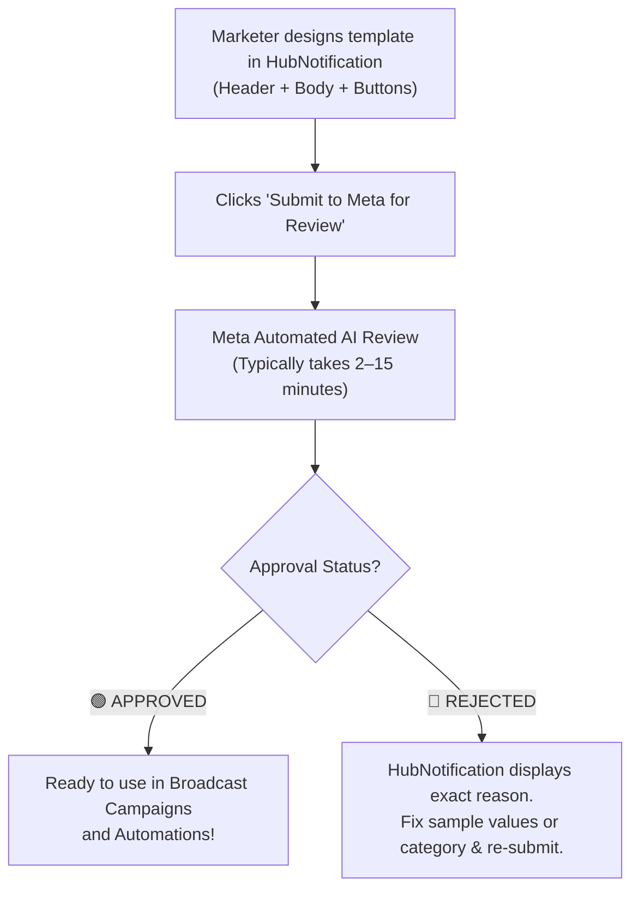
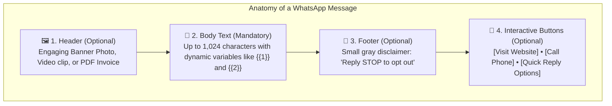

# 📝 Designing Meta-Approved WhatsApp Templates

When messaging customers who have not contacted your business in the past 24 hours, **Meta (WhatsApp) requires all outbound messages to use pre-approved templates**. This anti-spam rule ensures that WhatsApp remains a trusted, high-engagement channel.

With HubNotification's visual **Template Studio** (`/app/whatsapp/templates`), you can design stunning templates with photos, videos, PDF catalogs, and clickable interactive buttons without touching code or Meta Developer portals!

---

## 🗂️ The 3 Official WhatsApp Template Categories

When creating a template, you must assign it to one of three official Meta categories:

| Category | Typical Use Cases | Approval Speed |
| :--- | :--- | :---: |
| **Marketing** | Promotions, holiday discount offers, product launch announcements, abandoned cart reminders, webinar invites. | 5–30 Mins |
| **Utility** | Order confirmation receipts, payment reminders, shipping tracking links, appointment reminders, account status updates. | Instant to 5 Mins |
| **Authentication** | One-Time Passwords (OTPs), 2FA verification codes, login security links. | 1–5 Mins |

---

## 🎨 Anatomy of a WhatsApp Rich Template

A high-converting WhatsApp template consists of four modular building blocks:

### 1. Header (Optional)
* **Text Header**: A bold headline (e.g., *"Exclusive Weekend Offer!*").
* **Media Header**: Upload an eye-catching **Image (JPG/PNG)**, a short product **Video (MP4)**, or a downloadable **Document (PDF Brochure)**.

### 2. Body Text (Mandatory)
* Your core message (up to 1,024 characters).
* **Dynamic Variables**: Insert placeholders like `{{1}}` for customer name and `{{2}}` for coupon code.
* *Example*: *"Hello {{1}}, we are excited to offer you 20% off on your next purchase! Use code {{2}} at checkout."*

### 3. Footer (Optional)
* A subtle, gray text line at the very bottom (up to 60 characters).
* *Recommended*: *"Reply STOP to unsubscribe."*

### 4. Interactive Buttons (Up to 3 Buttons)
* **Call-To-Action (CTA) Buttons**:
  * **Visit Website**: Opens your online store or landing page (supports dynamic URLs, e.g., `https://mystore.com/orders/{{1}}`).
  * **Call Phone Number**: Tapping this button directly dials your customer support phone number.
* **Quick-Reply Buttons**:
  * Chips that customers can tap to reply instantly (e.g., *"I'm Interested"*, *"Not Now"*, *"Talk to Agent"*).

---

## 🛠️ How to Create & Submit a Template: Step-by-Step

1. Navigate to **WhatsApp ➔ Templates** (`/app/whatsapp/templates`).
2. Click the **+ Create Template** button in the upper right.
3. Fill in the Template Details:
   * **Template Name**: Enter a lowercase name using underscores (e.g., `flash_sale_october`). No spaces or capital letters allowed by Meta.
   * **Language**: Select your target language (e.g., `English (US)` or `Hindi`).
   * **Category**: Choose `Marketing` or `Utility`.
4. Configure the **Header**:
   * Select **Image**, then upload a representative sample banner.
5. Write the **Body Text**:
   * Type your message.
   * Click **+ Add Variable** whenever you want to insert a placeholder like `{{1}}`.
6. Provide **Sample Values**:
   * Meta requires you to provide sample values for every variable so their review system understands your intent.
   * For `{{1}}`, type sample: *"Rajesh"*.
   * For `{{2}}`, type sample: *"DIWALI20"*.
7. Add **Buttons**:
   * Select **Visit Website** ➔ Button Text: *"Shop Collection"* ➔ URL: `https://yourdomain.com/sale`.
   * Select **Quick Reply** ➔ Button Text: *"Talk to Agent"*.
8. Review the **Live Interactive Preview** in the right-hand smartphone simulator.
9. Click **Submit to Meta for Review**.

---

## 🔄 Tracking Status & Syncing with Meta

Once submitted, the template appears in your directory with a status pill:
* 🟡 **`PENDING`**: Currently being evaluated by Meta's automated compliance scanner (typically takes under 15 minutes).
* 🟢 **`APPROVED`**: Ready to be used immediately in broadcasts and automation flows!
* 🔴 **`REJECTED`**: Meta rejected the template. Click the template to view Meta's rejection note.

> [!TIP]
> **Click "Sync from Meta":** If a template is taking longer than 15 minutes to update, click the **Sync from Meta** button at the top of the page to refresh your status immediately.

---

## ⚠️ Common Reasons for Template Rejection & How to Fix Them

| Common Mistake | Why Meta Rejects It | The Easy Fix |
| :--- | :--- | :--- |
| **Missing Sample Values** | Reviewers cannot tell what `{{1}}` or `{{2}}` stands for. | Always enter realistic sample names and numbers in the sample fields box. |
| **Wrong Category** | Submitting a promotional discount under `Utility` to pay lower fees. | Always classify promotional offers as `Marketing`. Meta strictly penalizes mismatched categories. |
| **Broken or Shortened URLs** | Using bit.ly or generic link shorteners. | Use your full, official company domain (e.g., `https://yourcompany.com/offer`). |
| **Spelling Errors & ALL CAPS** | Writing headlines in `ALL CAPITAL LETTERS` or with excessive exclamation marks (e.g., *"BUY NOW OR MISS OUT!!!"*). | Use polite, professional sentence-case text. |
