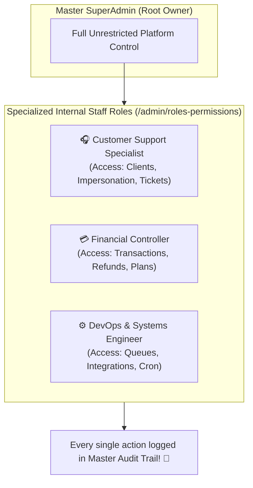
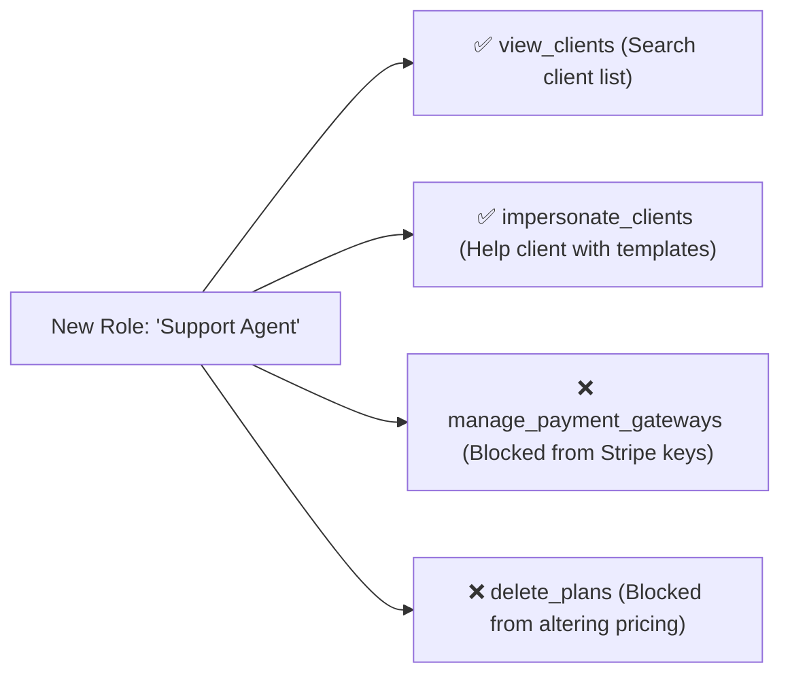

# 🛡️ Admin RBAC, Roles & Platform Audit Logs

As your SaaS platform grows, you will hire internal staff to assist with customer support tickets, manage billing disputes, and monitor cloud queues. You must never give every employee master root privileges to your payment gateways or database credentials.

HubNotification provides a granular **Role-Based Access Control (RBAC)** engine (`/admin/roles-permissions`), internal **Admin User Management** (`/admin/admins`), and a tamper-proof **Platform Audit Log** (`/admin/audit-logs`).

---

## 👥 Creating Internal Administrator Accounts (`/admin/admins`)

SuperAdmins and internal platform operators are managed separately from client workspace accounts:

1. Navigate to **Admin Management ➔ Admins** (`/admin/admins`).
2. Click the **+ New Admin User** button.
3. Fill in the operator's details:
   * **Full Name**: (e.g., *"Ananya Deshmukh"*).
   * **Corporate Email**: (e.g., `ananya@hubnest.com`).
   * **Initial Password**: Set a temporary password with mandatory reset.
   * **Assign Role**: Select their administrative role (e.g., *Support Specialist* or *SuperAdmin*).
4. Click **Create Admin User**.
5. The operator can now log in securely at `/admin/login`.

---

## 🎭 Creating Custom Roles & Granular Permissions (`/admin/roles-permissions`)

HubNotification includes fine-grained permission flags that let you customize exactly what each staff member can see and do:

### Steps to Create a Role:
1. Navigate to **Roles & Permissions** (`/admin/roles-permissions`).
2. Click **+ Add New Role**.
3. Name your role (e.g., *"Customer Support Specialist"*).
4. In the permissions grid, check the relevant capabilities:
   * **Client Management**: `view_clients`, `update_clients`, `impersonate_clients`.
   * **Support Helpdesk**: `view_support_tickets`, `reply_support_tickets`.
   * Leave sensitive permissions unchecked: `manage_payment_gateways`, `manage_integrations`, `delete_clients`.
5. Click **Save Role**. Any staff member assigned to this role will only see their allowed modules in the sidebar!

---

## 📜 Master Platform Audit Logs (`/admin/audit-logs`)

To maintain complete transparency and meet ISO/SOC2 security compliance, HubNotification records every administrative action in the **Master Platform Audit Log**:

| Logged Event | What It Captures | Why It Matters |
| :--- | :--- | :--- |
| **`client.impersonate`** | Records when an internal operator logged into a client's workspace. | Prevents unauthorized snooping into private client chats. |
| **`payment_gateway.updated`** | Records changes to Stripe or Razorpay API keys. | Safeguards platform payout credentials from tampering. |
| **`plan.created / plan.updated`** | Records changes to pricing, trial days, or quota limits. | Ensures authorized pricing changes. |
| **`admin.login / admin.logout`** | Records operator logins with IP address, browser, and timestamp. | Detects unauthorized login attempts or dormant accounts. |

---

## 🔍 How to Search & Filter Audit Records

1. Navigate to **Audit Logs** (`/admin/audit-logs`).
2. Use the top search bar to search by:
   * **Admin Email**: See everything done by a specific staff member.
   * **IP Address**: Investigate suspicious geographic access.
   * **Action Type**: Filter by `impersonate`, `refund`, or `credential_update`.
3. Click any row to expand the full JSON diff showing the exact **Old Values** vs. **New Values**.

---

## 💡 SuperAdmin Security Best Practices

> [!TIP]
> **Enforce 2FA on All Internal Admin Accounts:** Internal operators have access to sensitive client databases. Never allow an internal staff member to operate without Two-Factor Authentication enabled.

> [!IMPORTANT]
> **Deactivate Inactive Staff Accounts Immediately:** When an internal contractor or employee leaves your company, use the **Toggle Status** button in `/admin/admins` to deactivate their administrative access in one click.

> [!NOTE]
> **Immutable Storage:** Audit logs are saved to an append-only database table and cannot be wiped or edited by any internal operator, ensuring legal compliance during audits.
