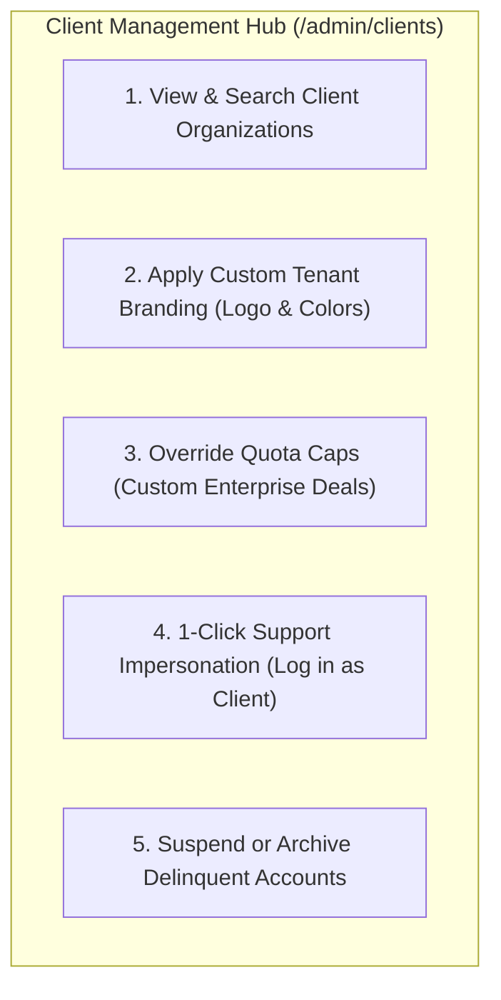
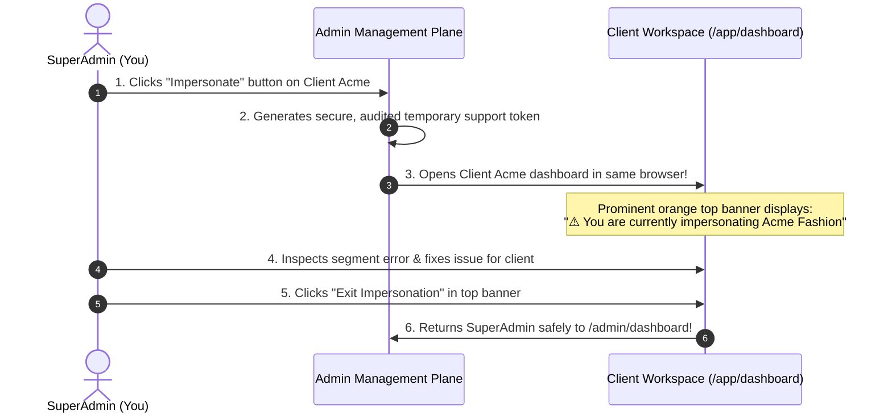

# 🏢 Tenant Management, Quotas & Support Impersonation

In a multi-tenant SaaS platform, every business organization that signs up is a **Client**. As a Platform SuperAdmin, you manage the complete lifecycle of these client organizations—from provisioning accounts and assigning custom pricing tiers to troubleshooting customer issues.

The **Client Management Hub** (`/admin/clients`) serves as your master administrative directory.

---

## 🔍 Exploring the Client Organizations Directory

Navigate to **Clients** (`/admin/clients`):

* **Search Bar**: Quickly locate any client by company name, owner email address, or registered phone number.
* **Status Filter**: View `Active`, `Suspended`, or `Trial` organizations.
* **Client Table Columns**:
  * **Organization Title**: e.g., *Acme Fashion Retail Pvt Ltd*.
  * **Account Owner**: Primary administrator's name and email.
  * **Current Plan**: e.g., *Pro Tier (Active)* or *Free Trial (3 Days Left)*.
  * **Total Team Users**: Count of active staff accounts inside this workspace.
  * **Message Volume**: Total WhatsApp and SMS messages dispatched this month.

---

## 🛠️ Provisioning a New Client Organization Manually

While clients typically self-register via your public landing page, you can provision accounts manually for VIP or enterprise clients:

1. Click the **+ New Client** button in the upper right.
2. Fill in the Organization Details:
   * **Company Name**: (e.g., *"Apex Healthcare Group"*).
   * **Owner Name & Email**: (e.g., `dr.sharma@apexhealth.in`).
   * **Initial Password**: Set a temporary password or check *Send activation invite*.
   * **Assign Plan**: Select their subscription tier (e.g., *Enterprise Tier*).
3. Click **Create Organization**.
4. The workspace is initialized with isolated database partitions, ready for the client to log in!

---

## 🎨 Custom White-Label Tenant Branding (`/admin/clients/{id}/branding`)

For high-paying enterprise clients who want their own brand identity:

1. On the client's row, click **Edit ➔ Client Branding**.
2. **Upload Custom Logo**: Replaces the default HubNotification logo in their navigation bar.
3. **Primary Brand Color**: Set their corporate hex color (e.g., `#0F52BA`).
4. **Custom Login Subtitle**: Customize the greeting displayed on their team members' login screens.
5. Click **Save Branding**. When the client's staff logs in, they see their company's official corporate branding!

---

## 🎭 Support Impersonation: Troubleshooting Without Asking for Passwords

When a client contacts support saying: *"My WhatsApp broadcast is showing an error when I select my Bangalore segment"*, you never need to ask for their password or request a screen-share session.

HubNotification includes **1-Click Support Impersonation**:

### Steps to Impersonate:
1. Locate the client in the `/admin/clients` directory.
2. Click the **Impersonate (👤)** button on their row.
3. Your browser immediately loads their client workspace (`/app/dashboard`) with their exact data, templates, and active chats.
4. **Notice the Orange Top Banner**: A prominent alert bar appears across the top: *"You are currently impersonating {Client Name}. Actions taken here affect live data."*
5. **Exit Impersonation**: Once you have diagnosed or fixed the issue, click the red button labeled **Exit Impersonation (🚪)** in the top banner. You are returned instantly to your master SuperAdmin console (`/admin/dashboard`)!

---

## 🚫 Suspending & Deleting Delinquent Accounts

If a client violates your terms of service or fails to pay their monthly subscription invoice:

* **Suspend Account**: Click **Actions ➔ Suspend Organization**.
  * The client's staff can no longer log in.
  * Outbound broadcast campaigns are immediately halted.
  * Their data remains safely preserved in case they pay and reactivate.
* **Reactivate Account**: Click **Reactivate** to instantly restore full access.
* **Delete Organization**: Permanent action. Deletes all associated contacts, message transcripts, and team accounts.

---

## 💡 SuperAdmin Best Practices

> [!TIP]
> **Audit Impersonation Sessions:** Every impersonation session is automatically recorded in the master **Platform Audit Log** (`/admin/audit-logs`) with the exact SuperAdmin username and timestamp, ensuring strict internal accountability.

> [!IMPORTANT]
> **Never Send Live Messages While Impersonating:** While impersonating a client for support, remember that clicking "Send" sends real messages from their connected WhatsApp phone number. Only perform read-only diagnostics unless explicitly authorized by the client.

> [!NOTE]
> **Custom Quota Overrides:** If an enterprise client purchases an add-on of 50,000 extra WhatsApp messages mid-month, you can override their monthly cap directly from **Edit Client ➔ Usage Limits** without forcing them to change their plan tier.
