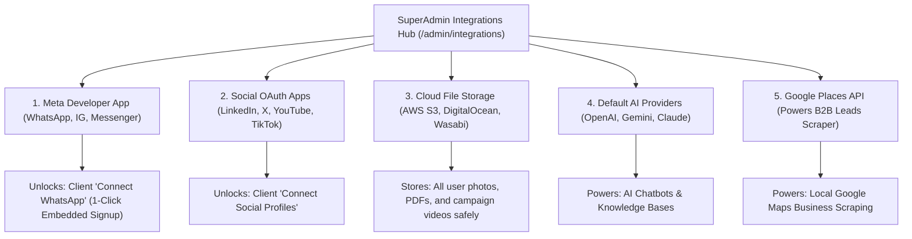

# 🔗 Master Platform Integrations (Meta, Social, Storage)

If you configure only one page in the entire SuperAdmin console, it must be **Integrations** (`/admin/integrations`).

This is the central engine room of the platform. By entering your master developer credentials here once, you **unlock one-click channel connections for all client businesses across the entire platform**!



---

## 📱 1. Meta Developer App Setup (The Most Critical Step)

Setting up the Meta Developer App is what enables your clients to click **Connect WhatsApp** on their dashboard and link their business phone numbers in seconds without developer tokens.

Navigate to **Integrations ➔ Meta App** (`/admin/integrations`):

### The 6 Key Fields:
1. **App ID & App Secret**: Obtained from your app at [developers.facebook.com](https://developers.facebook.com).
2. **System User Permanent Access Token**: Generated in Meta Business Manager with permissions: `whatsapp_business_management`, `whatsapp_business_messaging`, and `business_management`.
3. **Webhook Verify Token**: Any arbitrary secure secret string you choose (e.g., `hubnest_meta_verify_2026`).
4. **Embedded Signup Config ID (WhatsApp)**: From your Meta App's *Facebook Login for Business* product, configured with WhatsApp permissions.
5. **Embedded Signup Config ID (Instagram / Messenger)**: Configured with `instagram_manage_messages` and `pages_messaging` permissions.

---

### Step-by-Step Meta Webhook Configuration:
In your Meta Developer Console, point webhooks to your HubNotification server:

```
WhatsApp Cloud Webhook URL:
https://yourdomain.com/webhooks/whatsapp/global

Instagram & Messenger Webhook URL:
https://yourdomain.com/webhooks/meta/global
```
*(Verify Token = The exact string you entered in the Webhook Verify Token field above).*

Once saved and toggled to **Live Mode**, every client on your platform can instantly use Meta Embedded Signup!

---

## 🌐 2. Social Media OAuth Credentials

To allow clients to schedule posts to their official company channels without manual tokens:

| Network | Where to Create App | Redirect Callback URL to Set | Required Fields |
| :--- | :--- | :--- | :--- |
| **LinkedIn** | LinkedIn Developer Portal | `https://yourdomain.com/app/social/accounts/callback/linkedin` | Client ID & Client Secret |
| **Twitter / X** | X Developer Console | `https://yourdomain.com/app/social/accounts/callback/twitter` | API Key & API Secret |
| **YouTube** | Google Cloud Console | `https://yourdomain.com/app/social/accounts/callback/youtube` | Client ID & Client Secret |
| **TikTok** | TikTok for Developers | `https://yourdomain.com/app/social/accounts/callback/tiktok` | Client Key & Client Secret |

---

## 🗄️ 3. Cloud File Storage (AWS S3, DigitalOcean, Wasabi)

By default, uploaded campaign images, PDFs, and voice notes are stored on the local server disk. For enterprise high availability and lightning-fast worldwide delivery:

1. Locate the **Storage** section in `/admin/integrations`.
2. Choose your cloud provider: **Amazon S3**, **DigitalOcean Spaces**, or **Wasabi**.
3. Fill in the connection parameters:
   * **Access Key & Secret Key**
   * **Region**: (e.g., `us-east-1` or `blr1`)
   * **Bucket Name**: (e.g., `hubnotification-media-prod`)
   * **Custom CDN / Endpoint URL**: (optional, for Cloudflare CDN acceleration).
4. Click **Test Storage Connection (⚡)** to confirm file write/read permissions.
5. Click **Set as Default**. All future user uploads will stream directly to your scalable cloud bucket!

---

## 🧠 4. Platform AI LLM Fallback Keys

While client workspaces can bring their own AI keys, you can provide platform-level keys for **Google Gemini, OpenAI, or Anthropic Claude**:
* Acts as an out-of-the-box fallback so new clients can test AI chatbots immediately without needing to open developer accounts.
* You can meter and monetize this usage using the **AI Token Limit** in your subscription plans!

---

## 📍 5. Google Places API (Leads Scraper)

To power the **B2B Leads Scraper** (`/app/leads`):
* Enable the **Places API** in your Google Cloud Console.
* Generate an API Key and paste it into the **Google Places** card in `/admin/integrations`.
* This allows clients to search local businesses on Google Maps directly from the platform.

---

## 📜 Integrations Audit Trail (`/admin/integrations/audit-log`)

Every time a SuperAdmin adds, updates, or rotates an API credential:
* An immutable entry is recorded in the **Integration Audit Log**.
* Displays the operator's name, IP address, provider touched, and timestamp.
* Raw secrets are masked to prevent internal credential leakage.

---

## 💡 SuperAdmin Integration Best Practices

> [!TIP]
> **Use the 'Test Connection' Buttons:** Every provider card has a **Test** button. Always click it immediately after saving to confirm that your API keys are valid before clients start onboarding.

> [!IMPORTANT]
> **Meta App Live Mode:** Your Meta Developer App must be switched from **Development Mode** to **Live Mode** and have Advanced Access approved before external clients can log in.

> [!NOTE]
> **Zero Downtime Credential Rotation:** When rotating a Meta App Secret or S3 key, HubNotification updates the running service memory instantly without requiring server reboots.
