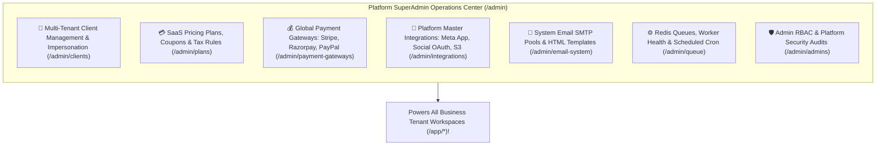
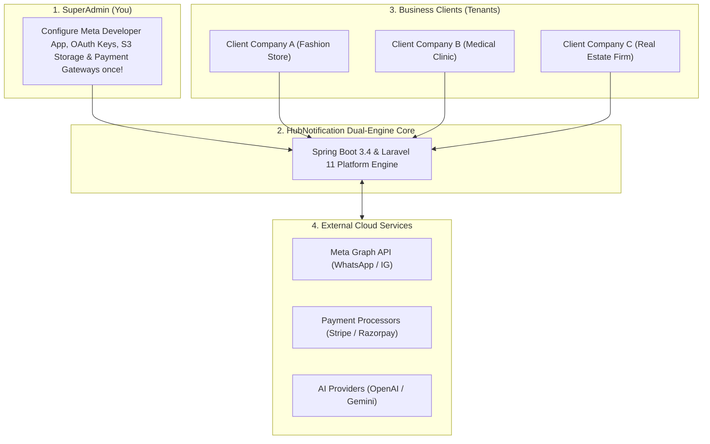

# 👑 Platform Super Administrator — Overview

Welcome to the **HubNotification Platform Super Administrator** user manual.

While an *Organization Administrator* manages a single company workspace (their own team, contacts, and WhatsApp number), the **Platform Super Administrator** operates the entire multi-tenant SaaS infrastructure. 

You control the master management plane (`/admin/*`): onboarding hundreds of business clients, creating subscription pricing plans, configuring global payment gateways, establishing platform-wide Meta Developer Apps, and monitoring background queue engines.

---

## 🧭 The SuperAdmin Control Center at a Glance

When you log in at `/admin/login`, you enter the **Executive Dashboard** (`/admin/dashboard`):

| Module | URL | What You Control |
| :--- | :--- | :--- |
| **Clients & Workspaces** | `/admin/clients` | List, provision, suspend, and troubleshoot tenant business accounts. Access **1-Click Impersonation** for customer support. |
| **SaaS Plans & Pricing** | `/admin/plans` | Create subscription tiers (Starter, Pro, Enterprise), monthly/yearly prices, message quota limits, and trial days. |
| **Payment Gateways** | `/admin/payment-gateways` | Configure Stripe, Razorpay, Cashfree, PayPal, and Paystack in Sandbox and Live modes. |
| **Master Integrations** | `/admin/integrations` | Configure your company's Meta Developer App (App ID, Secret, System User Token) that unlocks WhatsApp for all clients! |
| **System Email System** | `/admin/email-system` | Master SMTP pool for system emails (invites, password resets, receipts) and editable HTML email templates. |
| **Queue & Worker Health** | `/admin/queue` | Real-time Redis queue monitor, failed message retry, and cron scheduler verification. |
| **Admin RBAC** | `/admin/roles-permissions` | Create internal operator roles (Billing Admin, Tech Support Admin, Compliance Officer). |

---

## 🔑 How the Platform Architecture Fits Together

**The Core Concept**: You configure the complex cloud apps **once** at the platform level (Meta Developer App, Facebook Login for Business, Social OAuth). Every business client who signs up can then connect their own WhatsApp numbers or social media accounts with **one-click Embedded Signup** without ever touching raw developer keys!

---

## 🛠️ The SuperAdmin Daily Operations Checklist

1. **Morning Health Check (`/admin/dashboard`)**:
   * Review total platform messages dispatched in the last 24 hours.
   * Verify that active Redis job queues are operating with zero backlog.
2. **Review Failed Jobs (`/admin/queue`)**:
   * Check if any third-party gateway had a temporary outage and retry failed dispatch jobs with one click.
3. **Inspect Support Escalations (`/admin/support`)**:
   * Respond to platform assistance tickets submitted by client administrators.
4. **Audit Transaction Ledger (`/admin/transactions`)**:
   * Confirm that recurring subscription renewals through Stripe and Razorpay are capturing successfully.

---

## 💡 SuperAdmin Operational Best Practices

> [!TIP]
> **Use Safe Support Impersonation:** When a client contacts your support team saying *"My template won't send"*, use the **Impersonate** button on their client card to view their exact dashboard. You never need to ask the client for their password!

> [!IMPORTANT]
> **Always Test Payment Gateways in Sandbox First:** Before flipping a payment gateway toggle from *Test* to *Live*, execute a ₹1 or $1 test transaction to verify that webhook callback signatures are properly received.

> [!NOTE]
> **Isolated Multi-Tenancy:** Each client workspace is strictly isolated by database tenant guards (`current_workspace_id`). No client can ever see or access another organization's contacts, chats, or invoices.

---

## 📚 What You Will Master in This Section

1. [Managing Tenant Workspaces, Quotas & Support Impersonation](client-management.md)
2. [Creating SaaS Pricing Plans, Coupons & Tax Rates](saas-pricing-plans.md)
3. [Configuring Global Payment Gateways (Stripe, Razorpay, PayPal)](payment-gateways.md)
4. [Master Platform Integrations (Meta App, Social OAuth, S3)](global-integrations.md)
5. [Configuring Master SMTP & System Email HTML Templates](system-email-templates.md)
6. [Monitoring Redis Job Queues & Retrying Failed Dispatches](queue-system-health.md)
7. [Admin RBAC, Internal Staff Roles & Platform Audit Logs](admin-security-rbac.md)
