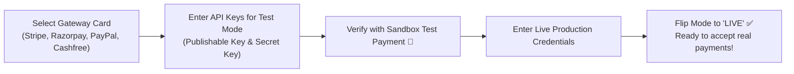
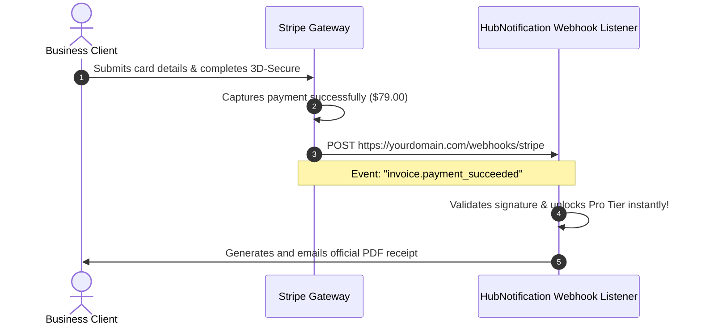

# 💰 Global Payment Gateways (Stripe, Razorpay, PayPal)

To collect recurring subscription payments from business clients around the world, HubNotification supports 12+ international and domestic payment processors.

Whether you need **Stripe** for international credit cards in the US and Europe, **Razorpay or Cashfree** for Indian UPI and NetBanking, or **Paystack** for African markets, you can configure them easily in **Payment Gateways** (`/admin/payment-gateways`).



---

## 🌐 Supported Payment Gateways & Credentials

| Gateway | Primary Regions Supported | Key Credential Fields |
| :--- | :--- | :--- |
| **Stripe** | Global, USA, Europe, UK, Singapore | Publishable Key (`pk_...`), Secret Key (`sk_...`), Webhook Secret (`whsec_...`). |
| **Razorpay** | **India** (Cards, UPI, NetBanking, Wallets) | Key ID (`rzp_...`), Key Secret. |
| **PayPal** | Global Consumer Checkout | Client ID, Secret. |
| **Cashfree** | **India** (High-Volume Payment Gateway) | App ID, Secret Key. |
| **Paystack** | Nigeria, Ghana, South Africa, Kenya | Public Key (`pk_...`), Secret Key (`sk_...`). |
| **Xendit** | Indonesia, Philippines, Southeast Asia | Secret API Key. |
| **Square** | North America, Retail POS Hybrid | Location ID, Access Token. |

---

## 🛠️ Step-by-Step Gateway Configuration (Stripe Example)

Navigate to **Payment Gateways** (`/admin/payment-gateways`):

1. Locate the **Stripe** card and click **Configure**.
2. **Mode Switch**: Set the toggle to **Test Mode** first.
3. Fill in your Stripe developer keys:
   * **Test Publishable Key**: Paste `pk_test_...`.
   * **Test Secret Key**: Paste `sk_test_...`.
   * **Test Webhook Secret**: Paste `whsec_...` (explained below).
4. Click **Save Gateway Settings**.
5. Once you verify successful test transactions, paste your **Live Credentials** (`pk_live_...` and `sk_live_...`) and toggle the mode switch to **Live**.

---

## 📡 Wiring Up Provider Webhook Endpoints

For your platform to automatically upgrade a client's plan the second their card is charged, the payment gateway must notify HubNotification via webhooks.

Point your payment provider's developer dashboard to the corresponding HubNotification webhook URL:

```
https://yourdomain.com/webhooks/stripe
https://yourdomain.com/webhooks/razorpay
https://yourdomain.com/webhooks/paypal
https://yourdomain.com/webhooks/cashfree
https://yourdomain.com/webhooks/paystack
```



### Steps in Stripe Dashboard:
1. Go to your **Stripe Dashboard ➔ Developers ➔ Webhooks ➔ Add Endpoint**.
2. Endpoint URL: `https://yourdomain.com/webhooks/stripe`.
3. Select events to listen to:
   * `checkout.session.completed`
   * `invoice.payment_succeeded`
   * `customer.subscription.deleted`
4. Click **Add Endpoint**.
5. Copy the **Signing secret** (`whsec_...`) and paste it into HubNotification's Stripe setup card.

---

## 📜 Master Transaction Ledger & Refunds (`/admin/transactions`)

To monitor every payment processed across all clients on the platform:

* Navigate to **Transactions** (`/admin/transactions`).
* Review the ledger:
  * **Transaction ID & Gateway Reference**
  * **Client Company Name**
  * **Gross Amount, Tax, and Currency**
  * **Payment Method** (e.g., *Visa •••• 4242* or *Google Pay UPI*)
* **Executing a Refund**:
  * If a client accidentally paid twice or requests a refund within your policy window:
  * Click the **Refund (↩️)** button on their transaction row.
  * Enter the refund amount (full or partial).
  * HubNotification communicates directly with Stripe/Razorpay to reverse the funds back to the customer's original payment method automatically!

---

## 💡 Payment Processing Best Practices

> [!TIP]
> **Enable Multiple Gateways for Geographic Flexibility:** Enable both **Stripe** and **Razorpay**. HubNotification automatically displays Razorpay to Indian clients paying in INR, and Stripe to international clients paying in USD or EUR!

> [!IMPORTANT]
> **Keep Sandbox Testing Organized:** Always test the full payment lifecycle in Test Mode—including successful payment, failed payment, and subscription cancellation—before launching publicly.

> [!NOTE]
> **Bank-Grade Security Compliance:** HubNotification never stores raw credit card numbers or CVVs on your server. All card entry fields are rendered via PCI-DSS compliant hosted iFrames provided directly by Stripe and Razorpay.
