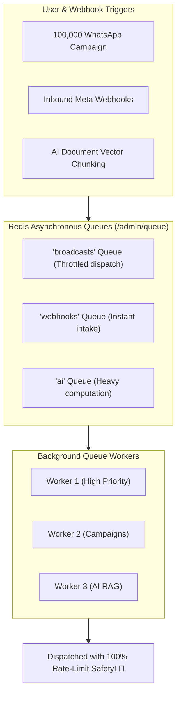
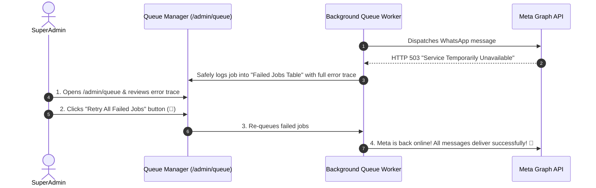

# ⚙️ Redis Job Queues, Workers & Cron Health

When a client launches a marketing campaign to 100,000 customers, the server does not freeze or make the user wait on the screen. Instead, HubNotification delegates the work to high-speed **Background Queues** powered by **Redis** and multi-threaded background workers.

The **Queue Management Monitor** (`/admin/queue`) and **Cron Setup Checker** (`/admin/cron-setup`) give SuperAdmins complete visibility into platform performance, job throughput, and error recovery.



---

## 🧭 Exploring the Queue Monitor (`/admin/queue`)

Navigate to **Queue** (`/admin/queue`):

### 1. Active Queue Health Meters
* **Queued Jobs**: Count of messages currently waiting in memory to be processed.
* **Processing Now**: Jobs currently being handled by active worker threads.
* **Completed Today**: Total background jobs successfully executed in the last 24 hours.
* **Failed Jobs**: Count of jobs that encountered unexpected third-party errors.

---

## ⚠️ Diagnosing & Retrying Failed Jobs

If an external service (such as Meta's API or a payment processor) experiences a temporary 2-minute outage, background jobs that fail during that window land safely in the **Failed Jobs Table**:



### How to Review a Failed Job:
1. In the Failed Jobs table, locate the failed record.
2. The table displays:
   * **Job Class**: (e.g., `SendWhatsappBroadcastJob` or `ProcessIncomingWebhookJob`).
   * **Exception Details**: Plain-language description of why it failed (e.g., *"Connection timed out after 10,000ms"*).
   * **Failed Timestamp**: Exact date and time.
3. **Operational Actions**:
   * **Retry Single Job (🔄)**: Click the retry icon next to that specific job to re-execute it immediately.
   * **Retry All (⚡)**: Click the purple button labeled **Retry All Failed Jobs** to re-dispatch the entire failed batch.
   * **Flush Stale Jobs (🗑️)**: Click **Flush All** to permanently discard old, unneeded test failures.

---

## ⏰ Cron Scheduler Health (`/admin/cron-setup`)

Many critical platform features rely on a repeating system clock:
* Firing scheduled future broadcasts (e.g., sending that Sunday 11:00 AM campaign).
* Checking for abandoned shopping carts after 60 minutes.
* Evaluating trial subscription expirations.

Navigate to **System ➔ Cron Setup** (`/admin/cron-setup`):

### Verification Checklist:
* **Status Pill**: Displays **`Cron Running ✅`** (Green) or **`Cron Inactive ⚠️`** (Orange).
* **Last Execution Timestamp**: Confirms that the background runner ticked within the last 60 seconds.
* **Server Command Reference**: If setting up a fresh cloud server or Docker instance, the page provides the exact one-line cron entry required:
  ```bash
  * * * * * cd /var/www/hubnotification && php artisan schedule:run >> /dev/null 2>&1
  ```

---

## 💡 System Health Best Practices

> [!TIP]
> **Check Queues After Massive Broadcasts:** When a major client launches a 50,000-message campaign, glance at the Queue Monitor. You can watch the `Queued Jobs` counter steadily count down to zero as your workers dispatch the messages.

> [!IMPORTANT]
> **Zero Message Loss Guarantee:** Because failed messages are captured in the Failed Jobs table rather than discarded, your clients will never lose a single broadcast message during unexpected network blips.

> [!NOTE]
> **Actuator Health Endpoints:** For enterprise DevOps teams using Kubernetes or Datadog, HubNotification exposes automated JSON health probes at `/healthz/db`, `/healthz/redis`, and `/healthz/queue`.
