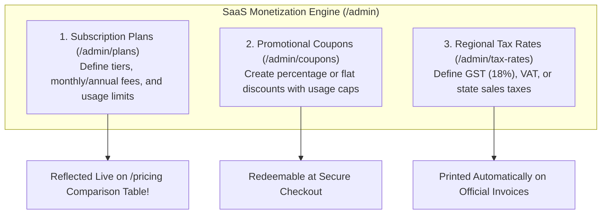
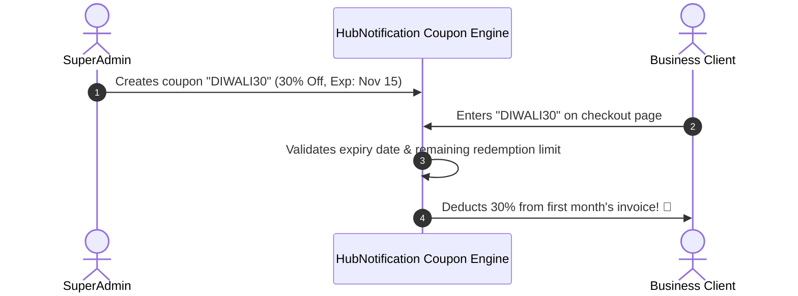

# 💳 SaaS Pricing Plans, Coupons & Tax Rates

To monetize your HubNotification platform, you need a flexible billing system. Some clients need entry-level packages for occasional messaging, while large retail chains need enterprise packages with high message quotas and dedicated support seats.

The **SaaS Billing Configuration Suite** (`/admin/plans`, `/admin/coupons`, and `/admin/tax-rates`) gives you complete freedom to design pricing models, seasonal discount codes, and tax compliance rules.

---

## 🛠️ Creating a Subscription Plan: Step-by-Step

Navigate to **Plans** (`/admin/plans`) and click the **+ Create Plan** button:

### 1. General Plan Information
* **Plan Name**: (e.g., *"Pro Growth Tier"*).
* **Slug**: Auto-generated URL identifier (e.g., `pro-growth`).
* **Description**: A short marketing tagline (e.g., *"Best for scaling retail brands and high-volume customer support"*).
* **Currency**: Select your default billing currency (e.g., `USD ($)` or `INR (₹)`).

### 2. Pricing & Trial Settings
* **Monthly Price**: (e.g., `$79` or `₹5,999`).
* **Yearly Price**: (e.g., `$790` or `₹59,990` — includes a built-in 2-month discount).
* **Free Trial Days**: Enter `14` to allow clients 14 days of free access before entering credit card details, or `0` for immediate payment.
* **Stripe Price IDs**:
  * Copy your `price_...` ID from your Stripe dashboard for monthly and annual billing. This powers automated recurring credit card debits.

---

### 3. Usage Limits & Quotas (The Hard Guardrails)

Control what each plan includes to protect your infrastructure:

| Limit Field | Sample Setting (Starter) | Sample Setting (Pro) | Sample Setting (Enterprise) |
| :--- | :---: | :---: | :---: |
| **Max WhatsApp Messages / Mo** | `2,500` | `25,000` | `250,000` |
| **Max Broadcast Campaigns / Mo** | `5` | `30` | `Unlimited (-1)` |
| **Max Contacts Stored** | `1,000` | `10,000` | `100,000` |
| **Team User Seats** | `3` | `10` | `Unlimited` |
| **AI Assistant Token Credits** | `50,000` | `500,000` | `5,000,000` |
| **Leads Scraper Credits / Mo** | `100` | `500` | `5,000` |

---

### 4. Feature Toggles & Marketing Bullets
* Check the feature switches you want to unlock for this tier:
  * ☑️ *Enable AI Chatbots & RAG Knowledge Base*
  * ☑️ *Enable Shopify & WooCommerce Store Sync*
  * ☑️ *Enable Visual Automation Builder*
  * ☑️ *Enable REST API Access & Webhooks*
* **Marketing Bullet Points**: Enter bullet points shown on the public `/pricing` table (e.g., *"Dedicated IP Delivery"*, *"Priority WhatsApp Support"*, *"Custom Domain Branding"*).
* Click **Save Plan**. It immediately appears on your public pricing page!

---

## 🎟️ Managing Promotional Coupon Codes (`/admin/coupons`)

Run holiday sales or offer special discounts to attract new businesses:

1. Navigate to **Plans ➔ Coupons** (`/admin/coupons`).
2. Click **+ New Coupon**.
3. Fill in the parameters:
   * **Coupon Code**: Type a memorable code in uppercase (e.g., `STARTUP50` or `WELCOME20`).
   * **Discount Type**: **Percentage (%)** (e.g., `20%`) or **Fixed Amount** (e.g., `$15` or `₹1,000`).
   * **Max Redemptions**: e.g., `100` (stops automatically after 100 clients claim it).
   * **Expiry Date**: Choose when the coupon expires.
4. Click **Create Coupon**.

---

## 🏛️ Regional Tax Rules & GST (`/admin/tax-rates`)

To comply with regional financial regulations:

1. Navigate to **Plans ➔ Tax Rates** (`/admin/tax-rates`).
2. Click **+ Add Tax Rate**.
3. Configure the Tax Rule:
   * **Tax Name**: (e.g., *"India Goods & Services Tax (GST)"* or *"EU VAT"*).
   * **Tax Percentage**: (e.g., `18%`).
   * **Country / Region**: Select applicable country (or set to *All*).
   * **Tax Type**: *Inclusive* (included in plan price) or *Exclusive* (added on top at checkout).
4. When clients complete payment, the tax breakdown is calculated and printed on their official monthly tax invoice.

---

## 💡 Pricing Strategy Best Practices

> [!TIP]
> **Use the 'Featured / Popular' Badge:** In `/admin/plans`, toggle the **Popular Badge** on your middle tier (Pro Plan). Eye-tracking studies show that highlighting the middle plan drives up to 60% of buyers toward that tier!

> [!IMPORTANT]
> **Plan Duplication:** When creating slight variations (e.g., a special non-profit tier), click the **Duplicate Plan (📋)** button on an existing plan to clone all limits in one second instead of re-entering values.

> [!NOTE]
> **Grandfathering Existing Subscribers:** If you raise prices on a plan tomorrow, clients who subscribed at the older price remain grandfathered at their original rate unless you manually migrate them.
