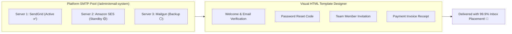
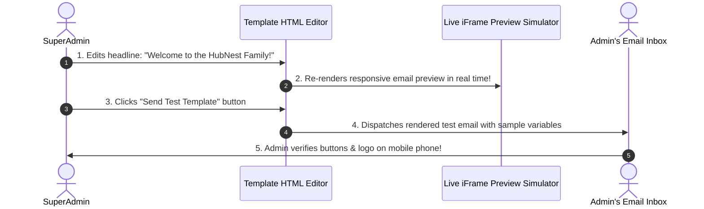

# 📧 System SMTP Pools & HTML Email Templates

System emails—such as welcome verification links, password reset codes, team invites, and monthly subscription receipts—represent your platform's voice. They must look polished, arrive in the inbox within seconds, and carry your official branding.

The **Email System Suite** (`/admin/email-system`) allows SuperAdmins to manage **multi-server SMTP failover pools** and customize every automated **system email HTML template** with a visual live preview.

---

## 🛠️ Configuring System SMTP Pools

Unlike client workspaces (which only configure a single email server for their own broadcasts), the Platform SuperAdmin can maintain **multiple SMTP servers** and switch the active backend in one click:

1. Navigate to **Email System ➔ Update SMTP** (`/admin/email-system`).
2. Click **+ Add SMTP Configuration**.
3. Fill in the connection parameters:
   * **Host**: (e.g., `smtp.sendgrid.net` or `email-smtp.us-east-1.amazonaws.com`).
   * **Port**: `587` (TLS) or `465` (SSL).
   * **Username & Password / API Key**.
   * **Sender Email**: (e.g., `notifications@hubnest.com`).
   * **Sender Name**: (e.g., `HubNest Platform`).
4. Click **Send Test Email**: Enter your email address to verify delivery.
5. Once verified, click **Set as Active**. All platform system notices will route through this verified server!

---

## 🎨 Customizing Automated System Email HTML Templates

Navigate to the **Email Templates** tab in `/admin/email-system`:

Here you will find every system email dispatched by the platform:

| Template Name | When It Triggers | Key Dynamic Variables Available |
| :--- | :--- | :--- |
| **Welcome / Email Verification** | When a new client signs up on your landing page. | `{{app_name}}`, `{{user_name}}`, `{{verify_url}}` |
| **Password Reset** | When a user clicks "Forgot Password". | `{{user_name}}`, `{{reset_url}}`, `{{expiry_minutes}}` |
| **Team Member Invitation** | When an administrator invites staff to a workspace. | `{{inviter_name}}`, `{{company_name}}`, `{{join_url}}` |
| **Subscription Payment Receipt** | When recurring payment succeeds. | `{{invoice_number}}`, `{{amount_paid}}`, `{{download_url}}` |
| **Quota Warning (90% Reached)** | When a client nears their monthly message limit. | `{{quota_name}}`, `{{used_percentage}}`, `{{upgrade_url}}` |
| **Support Ticket Reply** | When an administrator responds to a client helpdesk ticket. | `{{ticket_id}}`, `{{ticket_subject}}`, `{{reply_body}}` |

---

## 👁️ Visual Live Preview & Testing: Step-by-Step

Editing email templates is safe and visual:

1. Click on any template (e.g., **Team Member Invitation**).
2. The screen splits into two panes:
   * **Left Pane**: Rich HTML & text editor. Customize the greeting, insert your corporate logo URL, and edit paragraphs.
   * **Right Pane**: **Live Interactive Preview Simulator**. Watch how the email renders on desktop and mobile screens as you type!
3. **Inserting Smart Variables**:
   * Click **Insert Tag** to add placeholders like `{{user_name}}` or `{{company_name}}`.
   * The preview simulator automatically fills these with realistic sample data.
4. **Send a Test Email**:
   * Click **Send Test Email** at the bottom of the editor.
   * Verify that the email looks visually stunning and that the action buttons open properly.
5. Click **Save Template**.

---

## 💡 System Email Best Practices

> [!TIP]
> **Keep Action Buttons Prominent:** Ensure your main call-to-action button (e.g., **[Verify Email Address]** or **[Accept Invitation]**) is centered with high-contrast colors so mobile users can tap it easily.

> [!IMPORTANT]
> **Never Remove Essential Tags:** In security emails (like Password Reset), never delete the `{{reset_url}}` tag, as the user will be unable to complete the password reset without it.

> [!NOTE]
> **Multi-Language System Emails:** HubNotification automatically translates system email subjects based on the recipient's chosen language locale set in their user profile.
