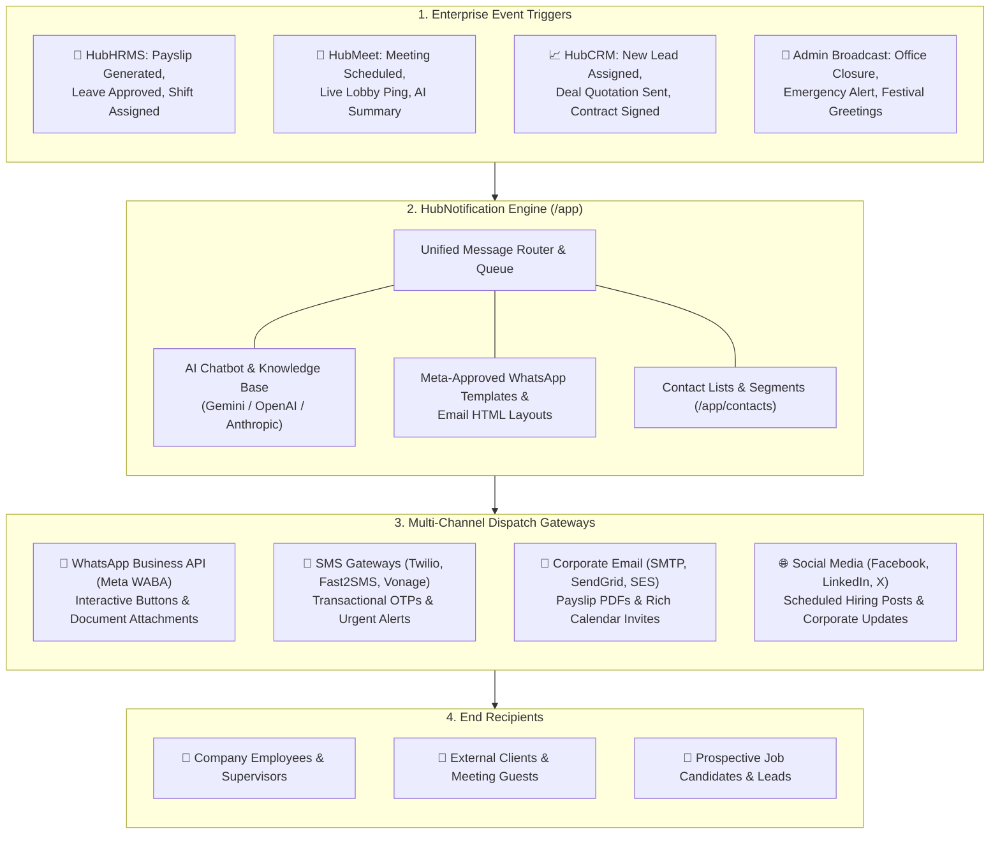
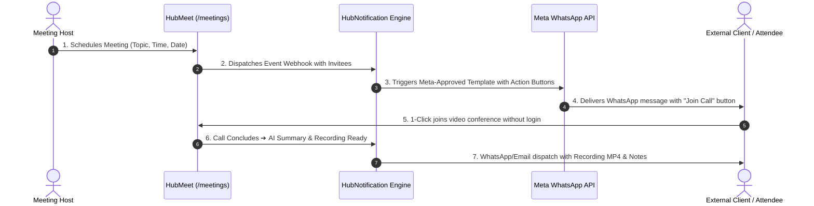

# 🔔 HubNotification Architecture & Cross-Module Integration

**HubNotification** (`apps/hubnotification` at `https://hubnotification.srjhubnest.com`) is the omnichannel communication, marketing automation, and transactional alert engine of the HubNest ecosystem.

While internal teams use the in-app notification bell (`🔔`) for day-to-day work, **HubNotification connects your enterprise directly to the outside world**—broadcasting transactional updates, OTPs, payslips, interview calls, and meeting links directly to **WhatsApp, SMS, Email, and Social Media**.

---

## 🏛️ Ecosystem Architecture & How Everything Connects

The diagram below demonstrates how **HubNotification** sits at the center, receiving triggers from **Hub HRMS, HubMeet, and HubCRM**, and dispatching them through external communication channels:

---

## 🧭 Step-by-Step: How Each Module Integrates & Works

### 1. 💼 Hub HRMS ➔ HubNotification (Employee Lifecycle & Alerts)

| HRMS Event | Channel Used | How It Works & What Gets Sent |
| :--- | :---: | :--- |
| **Monthly Payslip Disbursal** | **WhatsApp & Email** | Jab Finance team salary process karti hai, HubNotification employee ke WhatsApp aur email par password-protected **PDF Payslip** aur net amount summary automatically bhej deta hai. |
| **Shift Schedule & Overtime Alert** | **WhatsApp & SMS** | Jab Supervisor naya rotational roster ya overtime schedule assign karta hai, field workers ko SMS/WhatsApp message milta hai: *"Aapki shift kal 09:00 AM se hai."* |
| **Leave Approval / Rejection** | **In-App & Email** | Manager jab leave request accept ya reject karta hai, employee ko instant notification milta hai with remaining leave balances. |
| **Job Offer & Onboarding Link** | **WhatsApp & Email** | HR candidate ko hire karte waqt offer letter aur digital onboarding form ka link WhatsApp par bhejta hai. Candidate mobile se hi e-Sign complete kar sakta hai. |

---

### 2. 🎥 HubMeet ➔ HubNotification (Instant Video Invites & Summaries)

* **WhatsApp Meeting Invites with Action Buttons**: Client ko lambi email check karne ki zaroorat nahi hoti. HubNotification client ke WhatsApp par rich message bhejta hai with **[Join Meeting Now]** interactive button.
* **10-Minute Prior Chime Alert**: Meeting shuru hone se 10 minute pehle automated SMS/WhatsApp reminder alert trigger hota hai.
* **Post-Call Minutes of Meeting (MoM)**: Meeting conclude hone ke baad, HubMeet ka AI Summary aur Action Items PDF format me WhatsApp par auto-share ho jaata hai.

---

### 3. 📈 HubCRM ➔ HubNotification (Sales Pipeline & Customer Support)

* **Instant Lead Welcome**: Website par inquiry aate hi HubNotification AI Chatbot WhatsApp aur Instagram DM par instant welcome reply deta hai.
* **Quotation & Payment Reminders**: CRM se quotation generate hote hi customer ko WhatsApp par quotation PDF aur payment gateway link deliver hota hai.
* **Support Ticket Updates**: Customer support ticket create ya resolve hone par live SMS/WhatsApp status update jaata hai.

---

## 🎛️ How to Connect & Configure Channels (`/app/inbox/setup`)

HubNotification platform me 5 distinct channels connect karne ka setup guide:

### 1. 💬 WhatsApp Business API (Meta Embedded Signup)
1. Go to **Channel Setup** (`/app/inbox/setup`).
2. Click **Connect WhatsApp** ➔ Click **"Continue with Meta"**.
3. Facebook/Meta popup me apna WhatsApp Business Account (WABA) aur phone number select karein.
4. Token exchange aur webhooks background me automatically sync ho jaate hain.
5. Meta-Approved Templates (`/app/whatsapp/templates`) se instant transactional messages trigger hone lagte hain.

### 2. 📧 Corporate Email SMTP (`/app/broadcasts/email-server`)
1. Open Email Server settings.
2. Enter SMTP credentials (Host: `smtp.gmail.com` / `smtp.sendgrid.net`, Port: `587`, TLS encryption).
3. Set your company `From Email` (e.g., `hr@hubnest.com`).
4. Click **Send Test Email** to verify before activating.

### 3. 📱 SMS Gateways (`/app/broadcasts/sms-gateways`)
Connect your preferred bulk SMS gateway:
* **India Routes**: Fast2SMS (DLT approved Sender ID and API key).
* **Global Routes**: Twilio, Vonage (Nexmo), Plivo, Amazon SNS.

### 4. 🤖 AI Chatbots & Auto-Replies (`/app/ai/chatbots`)
* Connect your Google Gemini, OpenAI, ya Anthropic API keys under `/app/ai/providers`.
* Apni company ki FAQ docs ya HR policy PDF upload karke **Knowledge Base** banayein.
* WhatsApp ya Instagram number par AI Bot assign karein taaki wo customers aur employees ke queries ka 24/7 accurate instant reply de sake.

---

## 💡 Best Practices

> [!TIP]
> **Use WhatsApp for High-Open-Rate Alerts:** Critical notifications (jaise meeting link ya shift change) ke liye WhatsApp templates use karein, kyunki WhatsApp ka open rate email se 4x zyada (98%) hota hai.

> [!IMPORTANT]
> **DLT Compliance for Indian SMS:** India me bulk SMS send karne ke liye telecom DLT registration aur approved template ID enter karna anivarya hai.

> [!NOTE]
> **Unified Team Inbox:** Sabhi channels (WhatsApp, Instagram, Facebook Messenger) se aane wale replies ek single screen **`/app/inbox`** par aate hain, jahan support team canned responses aur internal notes use kar sakti hai.
