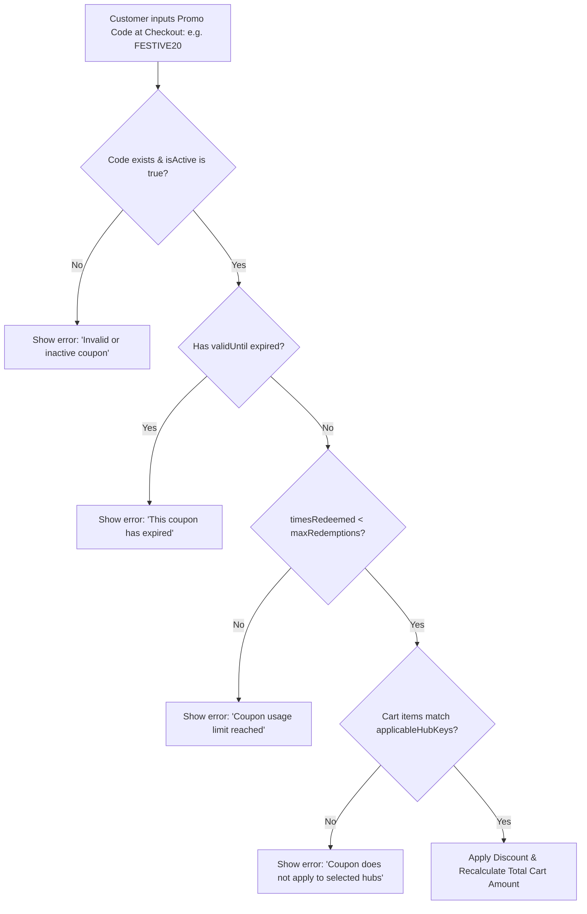
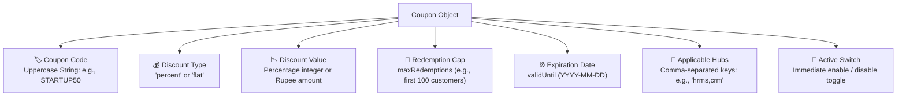

# Promotional Coupons & Discount Engine

Welcome to the **Promotional Coupons & Discount Engine Guide**. Targeted promotional discounts, seasonal marketing campaigns (such as festive Diwali offers or Year-End renewals), and strategic partner incentives play an essential role in customer acquisition and retention.

The **Coupons** console (`/coupons`) in the Master Admin Console provides Billing Controllers with fine-grained control over discount promo codes: configuring percentage or flat rupee reductions, setting redemption caps, establishing expiration deadlines, and restricting discounts to specific product hubs.

---

## 1. How the Discount Calculation Engine Operates

When a customer enters a promo code on the public checkout page, the platform validates the code against active rules in real time:

### Supported Discount Mechanisms
1. **Percentage Discounts (`percent`):** Deducts a percentage of the eligible cart subtotal (e.g., `20%` off). The discount value cannot exceed 100%.
2. **Flat Rupee Discounts (`flat`):** Deducts a fixed currency amount in Indian Rupees (e.g., `₹2,000` off). If the flat discount exceeds the cart value, the cart floor is automatically capped at ₹0 (preventing negative checkout amounts).

---

## 2. Coupon Data Attributes & Schema

When defining a promotional coupon in the **Coupons** console:

### Parameter Reference Table

| Field Name | Description | Example Configuration | Commercial Impact |
| :--- | :--- | :--- | :--- |
| **`code`** | Unique alphanumeric promo string. | `DIWALI2026` or `FOUNDER90` | Case-insensitive in checkout; stored in uppercase. |
| **`discountType`** | Mode of currency deduction. | `percent` or `flat` | Determines calculation algorithm. |
| **`discountValue`** | Magnitude of the discount. | `20` *(for 20%)* or `5000` *(for ₹5,000 off)* | Applied directly against eligible cart line items. |
| **`maxRedemptions`** | Maximum allowed redemptions. | `50` *(or blank for unlimited)* | Prevents budget overruns on viral campaigns. |
| **`timesRedeemed`** | Real-time counter of uses. | `34` redemptions | Increments automatically upon successful payment. |
| **`validUntil`** | Cut-off expiration date. | `2026-12-31` | Enforces campaign deadlines at 23:59:59 UTC. |
| **`applicableHubKeys`** | Targeted product restriction. | `crm,calling` *(or blank for all hubs)* | Restricts discount to specific products. |
| **`isActive`** | Master operational toggle. | `true` (Active) / `false` (Paused) | Allows instant deactivation without losing data. |

---

## 3. Step-by-Step Coupon Management Workflows

### Workflow A: Creating a New Promotional Coupon
1. Navigate to **Billing** > **Coupons** (`/coupons`).
2. At the top of the page, click **Add Coupon** to reveal the coupon creation drawer.
3. Complete the required parameters:
   - **Coupon Code:** Enter an uppercase identifier (e.g., `SPRINGGROWTH`).
   - **Discount Type:** Select **Percentage (`percent`)** or **Flat (`flat`)**.
   - **Discount Value:** Enter the numeric value (e.g., `25` for 25% or `2500` for ₹2,500).
   - **Max Redemptions:** Enter an integer cap (e.g., `100`), or leave empty for unlimited.
   - **Valid Until:** Pick an expiration date using the calendar selector.
   - **Applicable Hubs:** Enter comma-separated hub keys (e.g., `hrms,crm`) to restrict the promotion, or leave blank to apply to all products.
   - **Active:** Ensure the checkbox is checked.
4. Click **Create Coupon**. The new promo code appears in the active coupons list.

### Workflow B: Pausing an Active Campaign
If a marketing campaign hits its allocated budget early:
1. Locate the coupon code in the list.
2. Uncheck the **Active** checkbox for that row.
3. Click **Save Changes**.
4. The coupon becomes immediately invalid for any new checkout attempts.

### Workflow C: Deleting an Expired Coupon
1. Locate the expired or obsolete coupon in the table.
2. Click the red **Delete** button.
3. Confirm deletion. The promo code is permanently purged from the active database.

---

## 4. Financial Risk Governance & Anti-Fraud Controls

To safeguard platform profit margins during high-traffic promotional events:
1. **Never Create 100% Flat Discounts Without Redemption Caps:** Always set a strict `maxRedemptions` bound on high-value promotional codes to prevent automated bot redemptions.
2. **Audit Hub Applicability on High-Margin Products:** Exclude consumption-heavy hubs (such as Calling Hub VoIP trunks or WhatsApp Cloud API messages) from 50%+ discount codes to avoid subsidizing third-party carrier costs.
3. **Monitor Single-Tenant Abuse:** Periodically cross-reference `timesRedeemed` against customer emails in **Checkout Sessions** to ensure single clients are not repeatedly redeeming introductory startup discounts.
