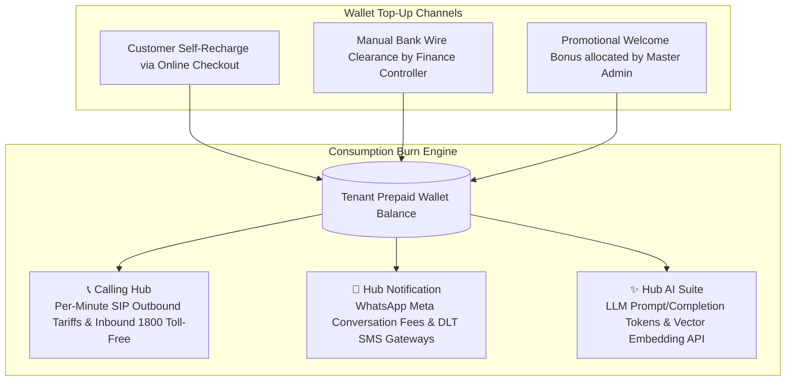
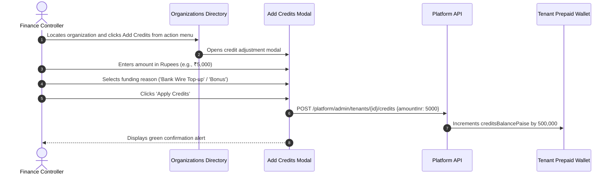

# Pre-Paid Usage Credits & Token Top-Ups

Welcome to the **Pre-Paid Usage Credits & Token Top-Ups Guide**. While core platform applications (such as HubHRMS and HubCRM) operate on fixed per-seat monthly subscriptions, real-time communications and artificial intelligence operate on consumption-based metering models.

Outbound VoIP telephone calls, WhatsApp Cloud API message deliveries, DLT SMS transmissions, and generative AI LLM token inferences burn incremental infrastructure costs. HubNest manages these metered services through a unified **Pre-Paid Tenant Credits Wallet** (`creditsBalancePaise`).

This guide details how usage wallets function, how consumption tariffs are deducted, and how Billing Controllers manually adjust balances or allocate promotional credits.

---

## 1. The Pre-Paid Credit Wallet Architecture

Every tenant organization possesses a centralized prepaid currency balance stored in integer paise:



### Metered Product Tariffs
1. **Calling Hub (VoIP Telephony):** Outbound voice calls deduct credits per second based on the destination rate card (e.g., `₹0.40 / minute` for Indian mobile numbers).
2. **Hub Notification (Omnichannel Dispatcher):** Outbound WhatsApp marketing and utility templates deduct official Meta conversation charges plus gateway delivery fees.
3. **Hub AI Suite:** Large Language Model (LLM) queries deduct micro-paise per 1,000 input/output tokens based on the underlying neural engine selected (OpenAI, Claude, or Gemini).

---

## 2. Inspecting Tenant Balances in Master Admin

To inspect an organization's prepaid credit reserves:
1. Navigate to **Organizations** (`/tenants`).
2. Locate the organization. The **Credits Balance** column displays the live formatted INR value (e.g., `₹2,450.00`).
3. Click on the row to open the **Tenant Detail Drawer**.
4. In the **Billing** tab, review the exact balance alongside historical usage burn rates.

```mermaid
stateDiagram-v2
    [*] --> Healthy: Balance > ₹500.00 (Normal Operations)
    Healthy --> LowBalance: Balance drops below ₹100.00
    LowBalance --> Healthy: Customer Recharges Wallet
    LowBalance --> Exhausted: Balance reaches ₹0.00
    Exhausted --> SuspendedServices: Outbound Calls & WhatsApp Messages Paused
    SuspendedServices --> Healthy: Top-Up Applied; Services Auto-Resume
```

---

## 3. Step-by-Step: Adding or Adjusting Tenant Credits

When an enterprise customer wires payment for telephony minutes or when issuing customer service goodwill credits:



### Step-by-Step Procedure
1. In the **Organizations** directory, locate the customer's organization.
2. Click the **Three-Dots (`...`)** menu on the right edge of their row.
3. Select **Add Credits**.
4. The **Credit Adjustment Modal** appears:
   - **Credit Amount (INR):** Enter the rupee amount (e.g., `500`, `2500`, `10000`). The console converts this to integer paise.
   - **Reason Code / Notes:** Select or enter the business reason:
     - *Bank Wire Offline Top-Up (Verified Receipt)*
     - *Promotional Evaluation Grant (Sales Bonus)*
     - *Service Disruption Compensation / Goodwill*
5. Click **Apply Credits**.
6. The tenant's wallet increments immediately, and an entry is logged in the permanent audit trail.

---

## 4. Wallet Exhaustion & Grace Period Safeguards

To prevent unexpected business disruptions during active customer service operations:
- **Low Balance Notification (10% Threshold):** When a tenant's balance drops below ₹100, the system dispatches an automated email to the tenant's billing contact warning that credits are low.
- **In-Progress Call Protection:** If an active telephone call is in progress when the balance reaches zero, the call is permitted to finish gracefully without abrupt disconnection.
- **Grace Period Auto-Suspension:** Once the balance reaches ₹0.00, subsequent outbound dialing and bulk WhatsApp campaigns are temporarily paused until a recharge occurs. Inbound call reception and standard web portal browsing remain active.

---

## 5. Financial Best Practice Summary
- **Always Record UTR on Manual Credit Top-Ups:** When adding credits following a direct bank transfer, reference the banking UTR in internal notes to ensure accurate monthly ledger reconciliations.
- **Set Realistic Evaluation Bonuses:** When granting complimentary credits to prospective clients during evaluation trials, allocate between `₹200` and `₹500` (sufficient for 500+ voice minutes or 1,000+ WhatsApp messages).
- **Audit Negative Balances:** Periodically run wallet health reports to ensure no carrier sync latency has caused accounts to drift into negative balance territory.
