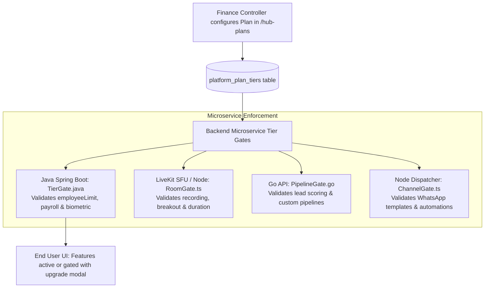
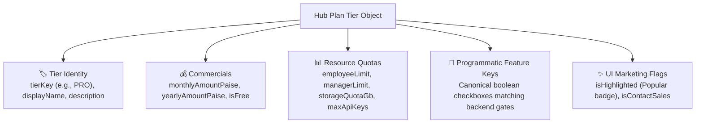
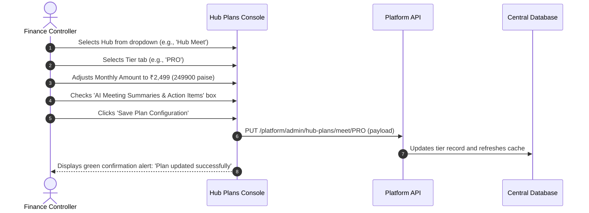

# Multi-Hub Plan Packaging, Tiers & Feature Gating

Welcome to the **Multi-Hub Plan Packaging, Tiers & Feature Gating Guide**. Creating attractive, scalable subscription packages while maintaining strict backend entitlement boundaries is fundamental to commercial SaaS success.

The **Hub Plans** console (`/hub-plans`) allows Billing Controllers to define subscription tiers (`STARTER`, `PRO`, `ENTERPRISE`), specify monthly and yearly pricing in Indian Rupees, configure resource quotas (such as employee limits and video meeting caps), and toggle programmatic feature gates across all business microservices.

---

## 1. Plan Architecture & Backend Tier Gating

When a customer subscribes to a plan tier, their permissions propagate automatically across all microservice backend APIs:

### Key Principles of Tier Gating
1. **Zero Hardcoded Pricing:** Prices, limits, and feature lists are stored dynamically in the platform database. Modifying pricing in the admin console updates customer checkout pages immediately.
2. **Programmatic Feature Keys (`featureKeys`):** While the `features` array displays human-readable marketing bullets on public pricing cards, the `featureKeys` array defines the strict programmatic strings that backend code evaluates.
3. **Annual Discount Incentivization:** Setting a discounted `yearlyAmountPaise` encourages annual upfront payment and improves enterprise cash flow.

---

## 2. Plan Tier Anatomy & Parameter Fields

When creating or modifying a plan tier in the **Hub Plans** console:

### Field Definitions

| Parameter Field | Data Type | Administrative Meaning | Example Production Value |
| :--- | :--- | :--- | :--- |
| **`tierKey`** | String | Immutable uppercase tier code used in API logic. | `STARTER`, `PRO`, `ENTERPRISE` |
| **`displayName`** | String | Customer-facing marketing name. | `Enterprise Growth Plan` |
| **`monthlyAmountPaise`** | Integer (Paise) | Monthly subscription fee. | `499900` *(₹4,999.00 / month)* |
| **`yearlyAmountPaise`** | Integer (Paise) | Discounted annual commitment fee. | `4999000` *(₹49,990.00 / year — 2 months free)* |
| **`employeeLimit`** | Integer | Maximum active employee profiles in HRMS. | `100` *(or null for unlimited)* |
| **`concurrentMeetingsLimit`** | Integer | Maximum concurrent video conferences in Meet. | `10` simultaneous rooms |
| **`storageQuotaGb`** | Integer | Cloud document and recording storage capacity. | `50` GB |
| **`maxApiKeys`** | Integer | Maximum developer API tokens per tenant. | `5` keys |
| **`isHighlighted`** | Boolean | Renders the "Most Popular / Recommended" badge. | `true` (Enabled) |
| **`isContactSales`** | Boolean | Replaces the direct checkout button with "Contact Sales". | `true` for custom enterprise tiers |

---

## 3. The Canonical Feature Registry by Hub

When configuring feature toggles for a plan, select the desired capabilities from the interactive checkbox grid:

### 1. Hub Meet Feature Registry
- `recording`: Cloud HD Recording (LiveKit Egress to S3).
- `breakout_rooms`: Dynamic sub-group discussion rooms.
- `ai_summary`: AI Meeting Transcripts & Action Items.
- `live_translation`: Real-time spoken caption translation.
- `ai_dubbed_audio`: Real-time synthetic multi-language voice dubbing.
- `whiteboard`: Collaborative digital whiteboard & sticky notes.
- `noise_filter`: AI neural background noise suppression.
- `custom_branding`: Tenant logo & vanity domain on conference rooms.
- `enterprise_sso`: Corporate SAML 2.0 / OIDC identity federation.

### 2. Hub HRMS Feature Registry
- `employee_management`: Core personnel directory & digital onboarding.
- `attendance`: Geolocation check-ins & biometric terminal sync.
- `leave_management`: Automated leave balance & accrual policies.
- `payroll`: Automated salary register, TDS calculation & payslip PDFs.
- `shift_management`: Multi-shift rotation rosters & overtime tracking.
- `recruitment`: Talent acquisition pipeline & candidate screening.
- `performance_management`: 9-Box talent calibration & KPI appraisals.
- `lms`: Internal employee learning modules & quizzes.
- `esign`: Digital cryptographic offer letter signing.
- `multi_branch`: Multi-branch franchises & regional cost centers.
- `global_payroll`: International contractor payouts & multi-currency.

### 3. Hub CRM Feature Registry
- `leads`: Omnichannel lead capture & automatic scoring.
- `pipeline`: Visual Kanban deal stages & drag-and-drop progression.
- `sales_automation`: Automated email drip sequences & task reminders.
- `whatsapp`: Integrated WhatsApp customer conversations.
- `finance`: Quotations, estimates & sales order billing.
- `custom_pipelines`: Unlimited custom pipelines for sales & renewals.
- `ai_lead_scoring`: Machine-learning conversion likelihood predictions.
- `dedicated_infra`: Dedicated database storage replica for high volume.

### 4. Hub Notification Feature Registry
- `whatsapp_templates`: Meta Cloud API template builder & broadcasts.
- `campaigns`: Multi-channel SMS and Email broadcast manager.
- `automations`: Visual drag-and-drop workflow automation canvas.
- `lead_scraper`: B2B Google Maps lead extraction tool.
- `ai_features`: RAG knowledge bases & autonomous customer chatbots.
- `ecommerce`: Store integration for Shopify, WooCommerce, and carts.
- `white_label`: Custom white-labeled chat widgets.

---

## 4. Step-by-Step: Updating a Plan Tier

When releasing a new pricing structure or adding a feature to the `PRO` tier:

1. Navigate to **Billing** > **Plans** (`/hub-plans`).
2. Use the top **Select Hub** dropdown to select the target product (e.g., *Hub Meet*).
3. The available tiers (`STARTER`, `PRO`, `ENTERPRISE`) render as tabs across the screen. Click the desired tier tab.
4. Modify commercial parameters:
   - Enter the new **Monthly Price** in INR (the console automatically converts to paise).
   - Enter the **Yearly Price** (typically 10x monthly price to offer 2 months free).
5. Adjust resource limits: update the **Employee Limit** or **Storage Quota**.
6. Check or uncheck capabilities in the **Feature Registry** grid.
7. Click **Save Plan Configuration**. All future checkouts and existing tier evaluations adopt the updated configuration immediately.

---

## 5. Managing Modular Add-Ons

For features sold as modular add-ons rather than full tier upgrades:
- Scroll to the **Add-Ons Management** section at the bottom of the page.
- Review active add-ons (e.g., *Extra 500GB Storage Vault — ₹1,999/mo*).
- Click **Create Add-On** to define a new modular SKU with its monthly price and description.

---

## 6. Financial Governance Best Practices
- **Never Change `tierKey` on an Active Tier:** Renaming `PRO` to `PROFESSIONAL` will break existing subscription relationships in the database. Always keep the immutable key intact and update only the `displayName`.
- **Coordinate Major Price Increases:** When increasing tier prices, consult with customer success to grandfather existing active subscribers onto legacy rates before publishing updated cards.
- **Verify Integer Paise Accuracy:** Always double-check that ₹4,999 is stored as `499900` paise to avoid 100x pricing miscalculations.
