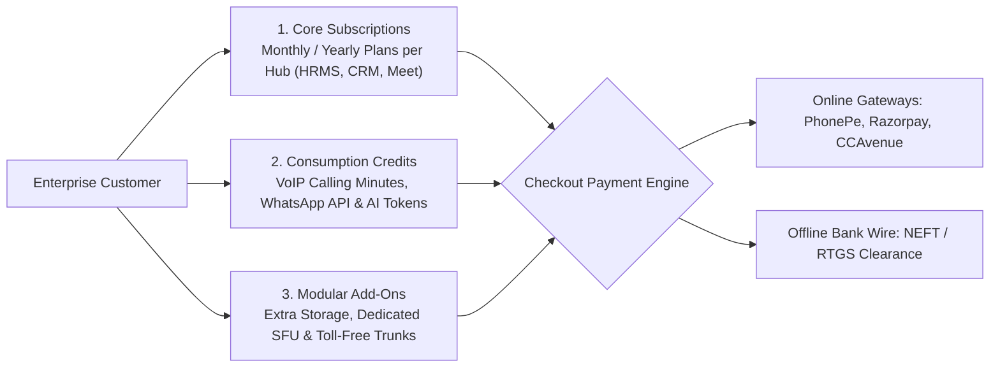
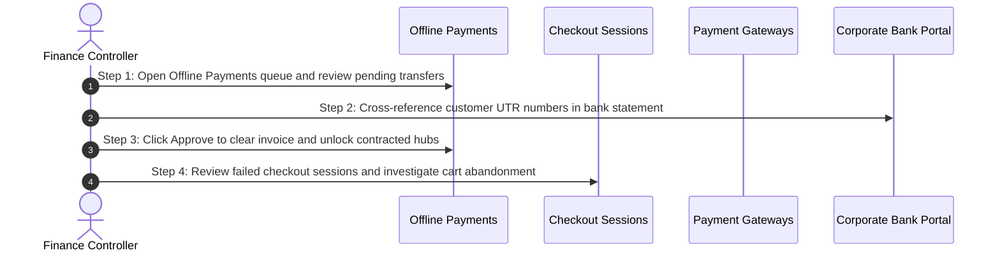

# Financial Operations Command Center & Revenue Overview

Welcome to the **Billing, Revenue & Financial Controller Manual**. In an enterprise multi-product SaaS ecosystem, managing recurring revenue, diverse payment gateways, manual wire transfers, promotional discounts, and consumption credit wallets requires meticulous financial governance.

As a Billing & Finance Controller, you oversee the commercial engine of the HubNest platform from the **Billing** section of the Master Admin Console (`@hubnest/platform-admin`). You package subscription plans, manage digital payment gateway credentials, verify manual bank deposits, and track checkout conversions.

---

## 1. Commercial Architecture & Revenue Streams

The HubNest monetization model comprises three complementary revenue streams:

1. **Core Subscription Tiers:** Tiered recurring contracts (`STARTER`, `PRO`, `ENTERPRISE`) packaged individually or bundled across business hubs.
2. **Prepaid Consumption Wallets:** Usage balances for metered telephony minutes, WhatsApp outbound messaging tariffs, and generative AI LLM token usage.
3. **Modular Add-Ons & Hardware:** Fixed recurring fees for specialized features such as dedicated SFU media clusters, 1800 National Toll-Free trunk leases, and expanded document storage vaults.

---

## 2. Currency Precision & Paise Integer Model

To prevent floating-point rounding discrepancies during invoice generation and tax calculations, HubNest stores all financial values internally as **integer paise** (where 100 paise = ₹1.00 INR):

| Database Value (`amountPaise`) | Display Value in Admin UI | Customer Billing Meaning |
| :--- | :--- | :--- |
| `99900` | **₹999.00** | Starter HubHRMS Monthly Subscription. |
| `499900` | **₹4,999.00** | Pro Multi-Hub Bundle Monthly License. |
| `5000000` | **₹50,000.00** | Enterprise Annual Softphone SIP Trunk Contract. |

> [!NOTE]
> **Automatic Currency Formatting:**
> The Master Admin Console automatically parses paise values into Indian Rupee formatting with standard comma placement (e.g., `₹1,25,000.00`) for effortless financial auditing.

---

## 3. Daily Financial Operations Checklist

Follow this 4-step checklist at the beginning of every business day:

### Step 1: Reconcile Offline Bank Transfers
- Navigate to **Billing** > **Offline Payments** (`/offline-payments`).
- Review transactions submitted via NEFT, RTGS, or IMPS.
- Match the customer's billing legal name, GSTIN, and reported transaction amount against your corporate bank statement.
- Click **Approve** to instantly activate the customer's contracted hubs.

### Step 2: Monitor Online Gateway Settlement Health
- Navigate to **Billing** > **Payments** (`/payment-gateways`).
- Check that the active online gateway (e.g., **Razorpay** or **PhonePe**) has passed its automated daily connectivity handshake test.

### Step 3: Review Live Checkout Sessions
- Click **Billing** > **Invoices** (`/checkout-sessions`).
- Filter sessions by status:
  - 🟢 **`active`:** Successful checkout transactions.
  - 🟡 **`pending`:** Customer initiated checkout but has not yet completed payment.
  - 🔴 **`failed`:** Card declined, UPI timeout, or netbanking session rejected by bank.

### Step 4: Audit Coupon Redemptions
- Click **Billing** > **Coupons** (`/coupons`).
- Review coupon redemption velocity to ensure promotional campaigns remain within budgeted enterprise margin targets.

---

## 4. Billing Navigation Quick Reference

| Administrative Target | Menu Path | Primary Financial Function |
| :--- | :--- | :--- |
| **Hub Plans & Tiers** | Billing > `Plans` | Configure monthly/yearly pricing, employee limits, and feature gates. |
| **Active Subscriptions** | Billing > `Subscriptions` | Track active customer licenses, unlocked hubs, and monthly contract totals. |
| **Checkout Sessions** | Billing > `Invoices` | Inspect public checkout logs, customer emails, and session timestamps. |
| **Payment Gateways** | Billing > `Payments` | Manage credentials and test connectivity for PhonePe, Razorpay, and CCAvenue. |
| **Promotional Coupons** | Billing > `Coupons` | Create flat or percentage discount promo codes with usage caps. |
| **Offline Bank Payments** | Billing > `Offline Payments` | Approve or reject manual wire transfers and clear tax invoices. |
| **Prepaid Credits** | Billing > `Credits` | Inspect usage wallets and allocate promotional telephony credits. |

---

## 5. Next Steps in this Guide
- To design subscription tiers and feature checklists, read [Multi-Hub Plan Packaging & Feature Gating](hub-plans-feature-gating.md).
- To configure merchant credentials, explore [Payment Gateway Setup (PhonePe, Razorpay, CCAvenue)](payment-gateways-config.md).
- To clear wire transfers, review [Manual Bank Transfer Approval & Invoice Clearance](offline-payments-clearance.md).
- To launch discount codes, visit [Promotional Coupons & Redemption Controls](coupons-discount-engine.md).
- To manage consumption balances, explore [Pre-Paid Usage Credits & Token Top-Ups](credits-wallet-usage.md).
