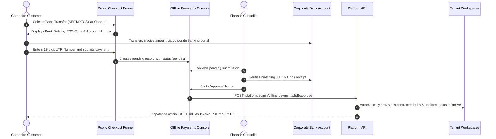
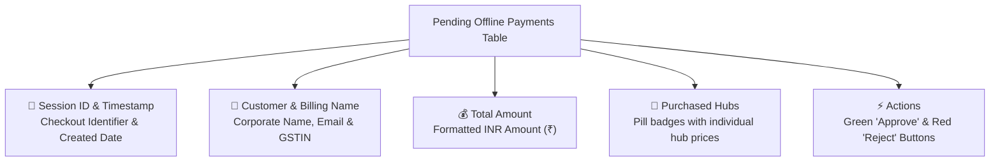

# Manual Bank Transfer Approval & Invoice Clearance

Welcome to the **Manual Bank Transfer Approval & Invoice Clearance Guide**. While small businesses frequently pay for SaaS software using corporate credit cards or UPI, enterprise clients and government agencies universally mandate direct bank transfers (NEFT, RTGS, IMPS, or wire transfers) through their centralized procurement departments.

The **Offline Payments** console (`/offline-payments`) serves as the financial clearinghouse for manual wire transfers. As a Billing & Finance Controller, you review incoming transfer notices, cross-reference transaction reference numbers (UTR) against corporate bank accounts, and execute one-click approvals to automatically unlock contracted business hubs.

---

## 1. How the Offline Payment Flow Operates

The offline payment journey is structured to provide immediate procurement instructions to the customer while ensuring services are unlocked only after verified funds settlement:

---

## 2. Navigating the Offline Payments Queue (`/offline-payments`)

To review pending wire transfers, click **Billing** > **Offline Payments** in the sidebar.

### Table Column Guide
- **Customer & Billing Entity:** Displays the customer's verified email alongside their legal business name and **15-character GSTIN** (Goods & Services Tax Identification Number).
- **Total Amount (INR):** Formatted Indian Rupee value calculated from integer paise (e.g., `₹59,000.00` including 18% GST).
- **Items & Unlocked Hubs:** Itemized breakdown of products included in the checkout session (e.g., *Hub HRMS: ₹29,990 + Hub CRM: ₹19,990 + extra storage: ₹9,020*).
- **Created Date:** Exact date and time when the customer submitted their bank transfer notification.

---

## 3. Step-by-Step Approval Workflow

When clearing a pending bank transfer:

### Step 1: Verification of Funds Receipt
1. Open your corporate online banking portal (e.g., HDFC Corporate Netbanking or ICICI Corporate Banking).
2. Navigate to your **Account Statement** or **Transaction History**.
3. Search for the customer's reported transaction amount or 12-digit **Unique Transaction Reference (UTR)** number.
4. Confirm that the exact funds have cleared into your account.

### Step 2: Approving the Transaction in Master Admin
1. In the **Offline Payments** table, locate the matching customer row.
2. Verify that the **Total Amount** matches the credit amount on your bank statement.
3. Click the green **Approve** button on the right side of the row.
4. The button displays a spinning loader (`Approving...`) while the API executes the following automated actions:
   - Marks the checkout session as **`active`**.
   - Grants the contracted product hubs in the tenant's profile.
   - Generates an official, numbered **GST Tax Invoice PDF** marked as `PAID`.
   - Dispatches the paid invoice and login credentials to the customer's email via Central SMTP.
5. The row disappears from the pending queue and moves to the permanent **Subscriptions** archive.

---

## 4. Rejecting an Unverified or Duplicate Submission

If a customer submits an invalid UTR, an incorrect amount, or a duplicate test submission:

1. Click the red **Reject** button for that row.
2. A confirmation prompt displays: *"Reject this payment? The checkout session will be cancelled."*
3. Click **OK**.
4. The system cancels the checkout session, rejects the pending order, and dispatches an automated notification advising the client to contact billing support.

---

## 5. Indian Statutory & GST Compliance Requirements

For tax compliance under Indian GST regulations:
- **Validating GSTIN Format:** Ensure the customer's 15-character GSTIN follows the statutory pattern:
  `29ABCDE1234F1Z5` *(2 digits state code + 10 digits PAN + 1 entity digit + 'Z' + 1 checksum digit)*.
- **State Code Matching:** The system evaluates the first two digits of the GSTIN against your corporate state code to automatically apply **CGST + SGST (9% + 9%)** for intra-state sales or **IGST (18%)** for inter-state transactions.
- **Invoice Number Sequencing:** Every approved offline payment is assigned a continuous, non-repeating tax invoice number adhering to corporate accounting standards.

---

## 6. Financial Reconciliation Best Practices
- **Daily Queue Zeroing:** Aim to clear all pending offline payments within **2 business hours** of banking settlement so clients do not experience onboarding delays.
- **Double-Check Partial Payments:** If a client transfers ₹40,000 against a ₹50,000 invoice (e.g., deducting TDS or bank charges), do not click Approve immediately; contact the client to request a revised purchase order or TDS certificate (Form 16A).
- **Match Remitter Account Names:** Confirm that the name on the bank remitter advice matches the registered corporate subscriber to prevent money laundering (AML) non-compliance.
