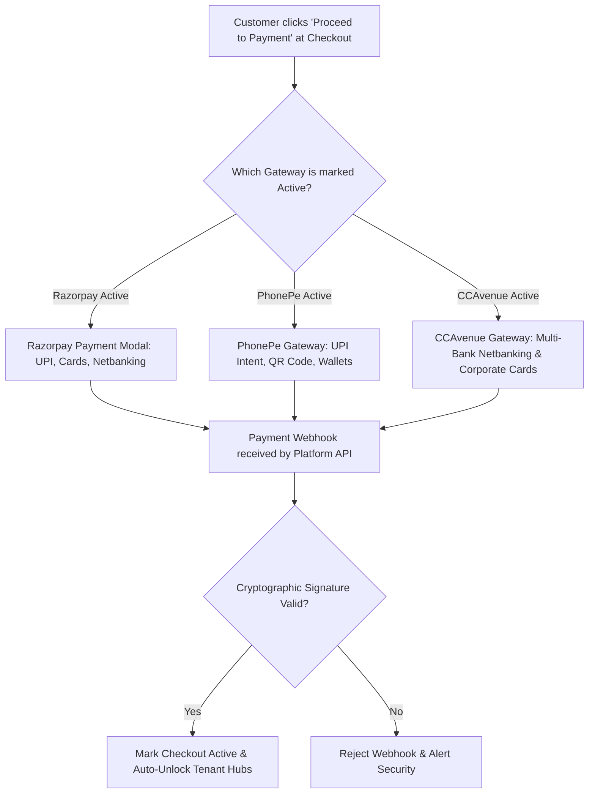
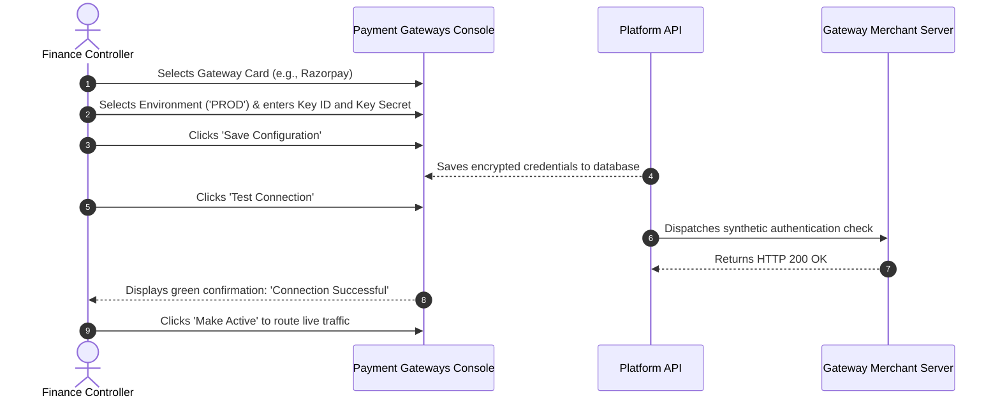

# Payment Gateway Setup & Credentials (PhonePe, Razorpay, CCAvenue)

Welcome to the **Payment Gateway Configuration & Setup Guide**. To deliver a smooth checkout experience for Indian and international corporate subscribers, HubNest supports direct integration with three premier digital payment aggregators: **PhonePe**, **Razorpay**, and **CCAvenue**.

From the **Payment Gateways** console (`/payment-gateways`), Billing Controllers manage merchant credentials, toggle between Sandbox (Test) and Production environments, run live connection diagnostics, and select which payment provider actively handles public customer checkout traffic.

---

## 1. Gateway Processing Architecture

When a prospective customer initiates checkout on the public marketing portal, the platform routes the transaction through the currently active gateway:

---

## 2. Supported Gateways & Required Merchant Credentials

The Master Admin Console provides tailored credential input forms for each gateway. All sensitive cryptographic keys (such as API Secrets and Salt Keys) are masked on display to preserve security.

### 1. PhonePe Payment Gateway
- **Primary Use Case:** Seamless UPI Intent, mobile payment flow, and QR-code payments for Indian businesses.
- **Required Configuration Fields:**
  - **Environment:** `SANDBOX` (UAT testing) or `PROD` (Live transactions).
  - **Merchant ID:** Your assigned PhonePe Enterprise Merchant identifier (e.g., `M23061604832`).
  - **Salt Key:** High-entropy cryptographic salt key supplied by PhonePe operations *(Masked)*.
  - **Salt Index:** Key version identifier (typically `1` or `2`).

---

### 2. Razorpay Payment Gateway
- **Primary Use Case:** Enterprise credit cards, corporate debit cards, UPI, international cards, and automated recurring mandate checkout.
- **Required Configuration Fields:**
  - **Environment:** `SANDBOX` or `PROD`.
  - **Key ID:** Public API key identifier (e.g., `rzp_live_8X9K3L...` or `rzp_test_...`).
  - **Key Secret:** Private API secret string used to sign orders and verify webhooks *(Masked)*.

---

### 3. CCAvenue Payment Gateway
- **Primary Use Case:** Comprehensive coverage of Indian public-sector bank netbanking portals and corporate procurement cards.
- **Required Configuration Fields:**
  - **Environment:** `SANDBOX` or `PROD`.
  - **Merchant ID:** 6-digit numeric CCAvenue merchant account number.
  - **Access Code:** 16-character alphanumeric public access key.
  - **Working Key:** 32-character encryption key for payload encryption *(Masked)*.

---

## 3. Step-by-Step Gateway Configuration Workflow

### Step 1: Inputting Merchant Credentials
1. Navigate to **Billing** > **Payments** (`/payment-gateways`).
2. Locate the target gateway card (e.g., **Razorpay**).
3. Select the operational environment:
   - **`SANDBOX`:** Used during development or pre-launch testing. No real money is transferred.
   - **`PROD`:** Production mode handling live banking transactions.
4. Fill in the required merchant credentials. If you are updating an existing gateway, leaving masked fields blank preserves the saved secret.
5. Click **Save Configuration**.

### Step 2: Testing Connection Health
Before switching live customer traffic to any gateway, verify that the credentials and network route are operating correctly:
1. On the gateway card, click the **Test Connection** button.
2. The platform API initiates an encrypted diagnostic request directly to the provider's API.
3. **If Healthy:** A green badge appears displaying: *"Connection Test Successful — Latency: 142ms"*.
4. **If Faulty:** A red diagnostic alert identifies the specific issue (e.g., *Invalid Key Secret / Authentication Failed* or *Merchant account is in inactive state*).

### Step 3: Setting the Active Payment Gateway
Only one gateway is designated as the primary active provider for standard website checkout at any given time:
1. Once your configured gateway passes its connection test, click **Make Active**.
2. A confirmation prompt displays: *"Set {GatewayName} as the primary active gateway for all checkout sessions?"*
3. Click **Confirm**.
4. The gateway card receives the blue **Active Gateway** badge, and all new customer checkout attempts are routed immediately through this provider.

---

## 4. Webhook Security & Signature Verification

To guarantee that checkout activations cannot be spoofed by fraudulent actors:
- When a customer completes payment on PhonePe or Razorpay, the provider's server sends an automated cryptographic webhook to:
  `https://api.srjhubnest.com/platform/billing/webhook/{gateway}`
- The Platform API recalculates the HMAC-SHA256 signature using the stored `Key Secret` or `Salt Key`.
- If the cryptographic signature matches exactly, the transaction is marked `active`, the customer receives an automated invoice email, and their tenant hubs are provisioned instantly.

---

## 5. Gateway Troubleshooting Guide

| Diagnostic Error | Root Cause | Administrative Remediation |
| :--- | :--- | :--- |
| **"Authentication Failed (401 Unauthorized)"** | Key Secret or Salt Key has a typo or includes trailing whitespace. | Re-copy the secret from your merchant dashboard. Ensure no spaces are pasted at the end of the string. |
| **"Merchant Account Inactive / Suspended"** | The provider account has pending KYC documents or bank verification requirements. | Log into your merchant portal (e.g., `dashboard.razorpay.com`) and complete outstanding compliance tasks. |
| **"Checksum Mismatch on Webhook"** | The webhook secret in the provider dashboard differs from the stored salt key. | Ensure the webhook secret configured in the provider's webhook settings matches the admin console salt key. |
| **"Customers reporting UPI App Timeout"** | Gateway API latency spike or bank server outage. | Temporarily switch the active gateway to an alternate provider (e.g., from PhonePe to Razorpay) using the **Make Active** button. |

---

## 6. Financial Controller Best Practice Checklist
- [ ] Never input production API credentials while the environment selector is set to `SANDBOX`.
- [ ] Run the **Test Connection** suite immediately after updating any merchant credential.
- [ ] Maintain an active fallback gateway (e.g., keep both PhonePe and Razorpay verified) so you can switch providers with one click during banking downtimes.
- [ ] Regularly monitor gateway settlement cycles to verify that funds are transferred to your corporate bank account on schedule.
