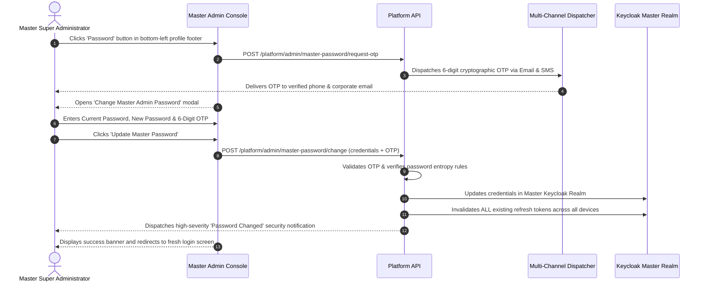
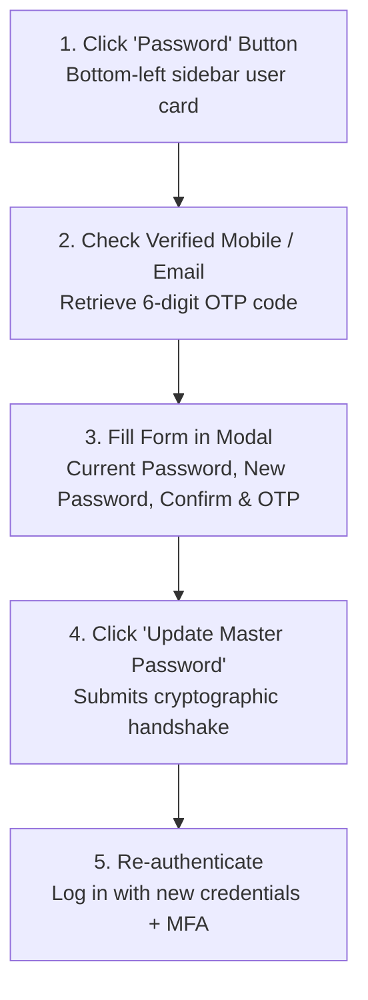

# Master Admin Password Security & Multi-Channel Recovery

Welcome to the **Master Admin Password Security & Multi-Channel Recovery Guide**. The Platform Super Administrator account commands unilateral authority across all corporate tenants, database records, payment gateways, and system infrastructure. Consequently, protecting master credentials and executing secure password rotations are critical to organizational security.

This guide details the multi-channel verification model used to change master admin passwords via the **Change Master Admin Password Modal** (`ChangeMasterAdminPasswordModal.tsx`), password complexity requirements, automated session invalidation, and emergency disaster recovery procedures.

---

## 1. Multi-Channel Security Handshake

Unlike standard end-user password resets that rely solely on email links, changing the Master Admin password requires a strict multi-channel challenge-response protocol:



### Defense-in-Depth Protections
1. **Multi-Channel Out-of-Band OTP:** The 6-digit verification code is simultaneously delivered to the administrator's verified email and SMS phone number. An attacker possessing only the current password cannot execute a rotation without physical access to the administrator's mobile device or mailbox.
2. **Global Session Invalidation:** Upon password change, Keycloak instantly terminates every active session and refresh token across all browser tabs, desktop clients, and mobile devices.
3. **High-Severity Security Telemetry:** An alert email is dispatched immediately containing the originating public IP address, browser user-agent, and city location.

---

## 2. Password Complexity & Policy Requirements

The Master Admin password policy enforces strict cryptographic entropy to withstand offline dictionary and rainbow-table attacks:

| Password Requirement | Minimum Specification | Validation Error Message |
| :--- | :--- | :--- |
| **Minimum Length** | At least **12 characters** (16+ recommended). | *"Password must be at least 12 characters long."* |
| **Character Diversity** | Must contain at least one uppercase letter (`A-Z`). | *"Include at least one uppercase letter."* |
| | Must contain at least one lowercase letter (`a-z`). | *"Include at least one lowercase letter."* |
| | Must contain at least one numeric digit (`0-9`). | *"Include at least one number."* |
| | Must contain at least one special symbol (`!@#$%^&*`). | *"Include at least one special character."* |
| **Password History** | Cannot match the last **5 previously used passwords**. | *"You cannot reuse a recent password."* |

---

## 3. Step-by-Step Password Rotation Workflow

To perform a scheduled quarterly password change or respond to an operational security alert:



### Procedure
1. Log into the Master Admin Console at `https://admin.srjhubnest.com`.
2. Locate the user profile card at the very bottom of the left sidebar navigation.
3. Click the red **Password** button (featuring the lock icon).
4. The system automatically sends an OTP to your verified channels.
5. In the **Change Master Admin Password Modal**:
   - **Current Password:** Enter your existing master password.
   - **New Password:** Enter your new high-entropy password adhering to the complexity rules.
   - **Confirm New Password:** Re-enter the new password to confirm matching.
   - **6-Digit Verification Code:** Enter the OTP received via SMS or email.
6. Click **Update Master Password**.
7. All active sessions are terminated. You are redirected to the Keycloak login screen to re-authenticate with your new credentials.

---

## 4. Emergency Disaster Recovery (Break-Glass Protocol)

In the catastrophic event that all Master Administrators lose access, credentials are forgotten, or an out-of-band communication channel is offline, the platform maintains a secure **Break-Glass Disaster Recovery Protocol**:

### Tier 1: AWS Secrets Manager Credentials Hint
- The root administrative bootstrap credentials are cryptographically stored in **AWS Secrets Manager** under:
  `arn:aws:secretsmanager:ap-south-1:*:secret:hubnest/production/master-admin-credentials`
- Systems engineers holding AWS IAM root infrastructure permissions can decrypt the secret to retrieve emergency administrative access.

### Tier 2: Keycloak Direct Container CLI Access (`kcadm.sh`)
If the web console is unreachable, infrastructure engineers can reset root credentials directly via the Keycloak container shell:

```bash
# Connect to Keycloak Docker / Kubernetes Pod
kubectl exec -it keycloak-master-pod -n identity -- /bin/bash

# Authenticate as local admin using Master Realm
./opt/keycloak/bin/kcadm.sh config credentials \
  --server http://localhost:8080 \
  --realm master \
  --user admin \
  --password "$KEYCLOAK_BOOTSTRAP_PASSWORD"

# Update Master SuperAdmin password
./opt/keycloak/bin/kcadm.sh set-password \
  -r hubnest \
  --username "superadmin@hubnest.com" \
  --new-password "SecureNewTemporaryPassword123!" \
  --temporary
```

---

## 5. Security Summary Checklist for Master Credentials
- [ ] Rotate Master SuperAdmin passwords at least once every **90 days**.
- [ ] Never store master passwords in unencrypted notes, Slack messages, or shared browser autofill caches.
- [ ] Ensure that at least two verified executive mobile numbers are linked for OTP failover.
- [ ] Test the Break-Glass AWS Secrets Manager retrieval workflow during annual disaster recovery drills.
