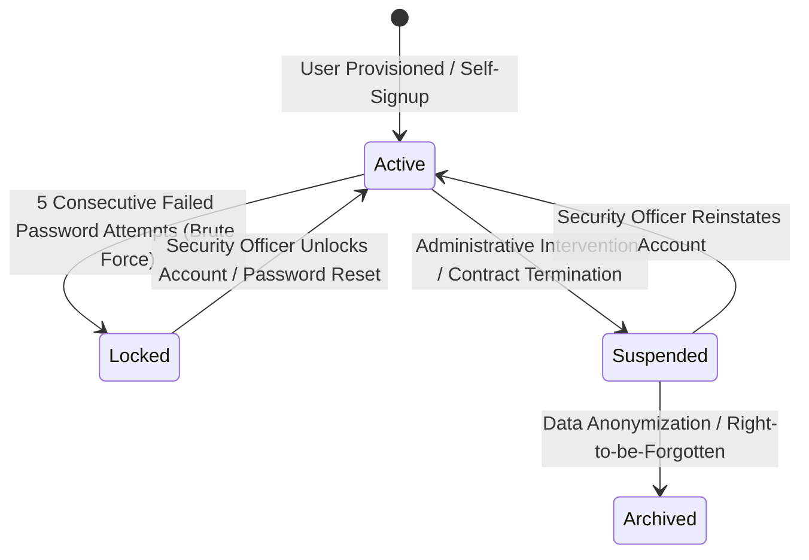
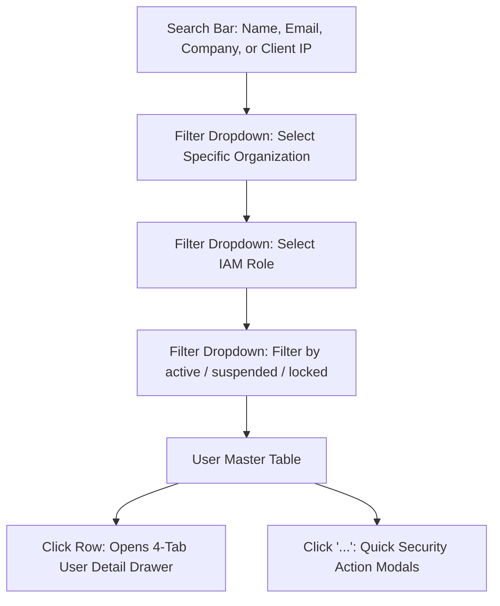

# Cross-Tenant User Directory & Account Governance

Welcome to the **Cross-Tenant User Directory & Account Governance Guide**. In a multi-tenant enterprise cloud, users range from platform superadministrators and customer tenant administrators to frontline sales executives, call center telecallers, and remote staff.

The **Users** console (`/users`) provides a unified, cross-tenant identity directory. As a Platform Security & IAM Officer, you manage account lifecycles across all client organizations, search and filter users, inspect hub permission grants, reset credentials, and lock compromised accounts.

---

## 1. Global User Account Lifecycle & States

Every user account in the central Keycloak identity directory exists in one of three operational states:

| Account Status | Visual Badge | System Behavior | Administrative Action Required |
| :--- | :--- | :--- | :--- |
| **Active** | 🟢 `active` | User can authenticate across web, desktop, and mobile apps. JWT tokens issued normally. | Routine audit; enforce MFA where required. |
| **Suspended** | 🟡 `suspended` | Logins immediately blocked across all hubs. Existing refresh tokens revoked. | Investigate customer dispute or pending legal hold before reinstating. |
| **Locked** | 🔴 `locked` | Temporarily frozen by automated brute-force protection after repeated invalid password attempts. | Verify identity via out-of-band channel, unlock account, and issue password reset. |

---

## 2. Navigating the Users Directory (`/users`)

To access the directory, click **Users** from the main navigation sidebar.

### Table Column Guide
- **User Identity:** User's full name alongside their verified corporate email address.
- **Organization & Tenant:** The company name and slug where this user's primary records reside.
- **Assigned IAM Role:** System or tenant role (e.g., `SUPER_ADMIN`, `TENANT ADMIN`, or `FINANCE_ADMIN`).
- **MFA Status:** Shield icon indicating whether Multi-Factor Authentication is active (🟢 Green Shield = MFA Enabled; ⚪ Grey = Disabled).
- **Last Active & IP:** Timestamp of the most recent API activity alongside the originating public IP address.
- **Status:** Operational badge (`active`, `suspended`, `locked`).

---

## 3. The 4-Tab User Detail Drawer

Clicking on any user row opens the **User Detail Drawer**, providing complete identity telemetry:

### Tab 1: Profile & Identity
- Displays system User UUID, full legal name, verified corporate email, direct telephone number, and organization association.
- Indicates whether the user is designated as a **Tenant Administrator** (granting root authority inside their company's workspace).

### Tab 2: Active Sessions
- Lists all currently authenticated devices and browser tabs holding valid refresh tokens.
- Displays device operating system (e.g., *Windows 11*, *macOS Sonoma*, *Android 14*), client IP address, geographical location (e.g., *Mumbai, India*), and last-seen timestamp.
- Features a red **Terminate Session** button adjacent to each session.

### Tab 3: Login History
- Chronological audit stream recording the last 50 authentication events.
- Displays exact timestamp, IP address, device user-agent string, and login outcome (`SUCCESS`, `INVALID_CREDENTIALS`, `MFA_FAILED`).

### Tab 4: Hub Grants & Entitlements
- Itemizes the user's specific access rights across individual connected business hubs:
  - **Hub HRMS:** e.g., Role: *HR Director* (Grant ID: `grnt-9481`)
  - **Hub CRM:** e.g., Role: *Sales Executive*
  - **Calling Hub:** e.g., Role: *Telecaller (Softphone Active)*
  - **Hub Meet:** e.g., Role: *Event Host*

---

## 4. Step-by-Step Security Workflows

### Workflow A: Resetting a User's Password
When an employee forgets their password or suspects credential compromise:
1. In **Users** (`/users`), locate the user's email address.
2. Click the **Three-Dots (`...`)** menu on the right edge of their row.
3. Select **Reset Password**.
4. In the confirmation dialog, choose your delivery method:
   - **Send Password Reset Link:** Dispatches a secure, single-use, time-bound (15-minute) reset token to the user's verified corporate email.
   - **Generate Temporary Password:** Generates a high-entropy temporary password that forces an immediate change upon first login.
5. Click **Confirm Reset**.

### Workflow B: Enforcing Multi-Factor Authentication (MFA)
To comply with enterprise security guidelines for administrative staff:
1. In the user row action menu, select **Toggle MFA**.
2. If MFA is currently disabled, select **Enforce MFA**.
3. Upon their next login attempt, the user will be prompted to scan a TOTP QR code using their authenticator app (Google Authenticator, Microsoft Authenticator, or 1Password) before access is granted.

### Workflow C: Unlocking a Brute-Force Locked Account
When an executive is locked out after entering an old password multiple times:
1. Filter the users table by **Status: Locked**.
2. Locate the user and click **Three-Dots (`...`)** > **Unlock Account**.
3. Confirm the action. Keycloak clears the failed login counter, and the user can authenticate immediately.

### Workflow D: Suspending a Terminated Employee
When an employee resigns or is terminated by customer HR:
1. Search for the employee's corporate email.
2. Click **Three-Dots (`...`)** > **Suspend User**.
3. Confirm the prompt: *"Suspend user account across all hubs?"*
4. Click **Confirm Suspension**. The system immediately invalidates all active sessions and blocks new login attempts.

---

## 5. Account Governance Best Practices
- **Require MFA on All Tenant Admins:** Ensure that every user holding the `TENANT ADMIN` or `SUPER_ADMIN` role has a green MFA shield badge.
- **Investigate Multiple Locked Accounts on Single Tenants:** If 10+ accounts within a single organization become `locked` within an hour, notify the tenant administrator immediately; this often signals an external credential-stuffing attack against their corporate email domain.
- **Audit Stale Accounts:** Periodically filter for users with no activity in over 90 days and coordinate with tenant HR to suspend unneeded accounts, freeing up paid license seats.
