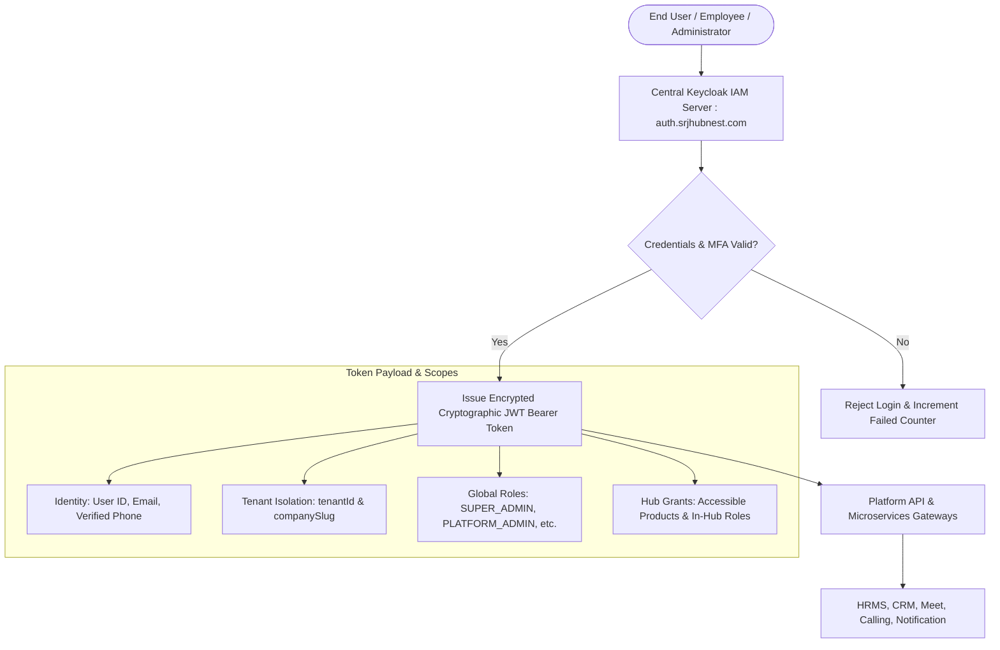
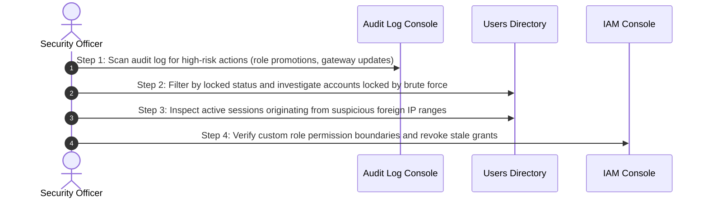

# Platform Security & IAM Command Center Overview

Welcome to the **Platform Security & IAM Officer Manual**. In a multi-tenant enterprise cloud hosting thousands of corporate users, proprietary business documents, biometric attendance logs, and financial records, platform security and identity governance form the foundational bedrock of trust.

As a Platform Security & IAM Officer, you manage identity lifecycles across the entire HubNest ecosystem from the **Users** and **IAM & Permissions** consoles. You govern global user directories, inspect active device sessions, remotely terminate compromised credentials, configure granular Role-Based Access Control (RBAC) matrices, and enforce multi-factor authentication policies.

---

## 1. Centralized Identity Architecture (Keycloak IAM)

HubNest relies upon a centralized, open-standards **Keycloak Identity & Access Management (IAM)** infrastructure implementing OAuth 2.0 and OpenID Connect (OIDC):

### Core Security Tenets
1. **Zero-Trust Token Validation:** Every incoming API request must present a cryptographically signed JWT. Microservices inspect token signatures against Keycloak public certificates without relying on shared database state.
2. **Strict Tenant Keying:** Tokens explicitly encapsulate the user's `tenantId`. Database query interceptors automatically append `WHERE tenant_id = ?` to prevent cross-tenant data leakage.
3. **Decoupled System Roles vs. Hub Grants:** A user may possess administrative authority in one hub (e.g., HR Director in HRMS) while being a standard participant in another (e.g., Attendee in HubMeet).

---

## 2. Platform IAM Role Hierarchy

The platform defines 11 specialized administrative and operational roles:

| System IAM Role Key | Role Title | Functional Authority & Security Boundary |
| :--- | :--- | :--- |
| **`SUPER_ADMIN`** | Master Super Administrator | Full unrestricted command across all organizations, billing gateways, system settings, and security. |
| **`PLATFORM_ADMIN`** | Platform Operations Lead | Manages tenant lifecycles, user directories, and hub provisioning without access to raw payment gateway secrets. |
| **`SECURITY_ADMIN`** | Chief Security & Compliance Officer | Manages IAM roles, permission matrices, session terminations, audit trails, and MFA policies. |
| **`FINANCE_ADMIN`** | Billing & Finance Controller | Manages subscription plans, payment gateways, offline wire transfers, and discount coupons. |
| **`OPERATIONS_ADMIN`** | Customer Success & Tenant Ops | Provisions company workspaces, extends trials, adjusts seat quotas, and triages demo requests. |
| **`SUPPORT_ADMIN`** | Tier-3 Helpdesk Support Lead | Inspects user accounts, diagnoses SSO bridge tokens, and handles customer troubleshooting. |
| **`PRODUCT_ADMIN`** | Product Feature Lead | Governs connected product consoles, API endpoints, and feature flag registries. |
| **`DEVELOPER_ADMIN`** | Platform API & Integrations Eng | Manages developer API tokens, webhooks, and CORS gateway origins. |
| **`ANALYTICS_ADMIN`** | BI & Revenue Intelligence Analyst | Read-only access to platform metrics, MRR forecasts, and usage summaries. |
| **`READ_ONLY`** | External Compliance Auditor | Read-only visibility across logs and tenant rosters for SOC 2 and ISO audits. |
| **`TENANT ADMIN`** | Corporate Customer Administrator | Root administrator within a single tenant workspace (e.g., HR Director of Acme Corp). |

---

## 3. Daily Security Hygiene Checklist

Follow this 4-step checklist at the start of each security shift:

### Step 1: High-Risk Action Audit
- Navigate to **Audit Log**.
- Scan the last 24 hours for security-critical actions:
  - `user_mfa_toggle`: Did an administrator disable MFA on an account?
  - `payment_gateway_update`: Were payment gateway credentials altered?
  - `tenant_suspend`: Was an organization suspended without an open escalation ticket?

### Step 2: Investigate Locked Accounts
- Navigate to **Users** (`/users`).
- In the **Status** filter, select **Locked**.
- Accounts locked due to 5+ consecutive failed password attempts should be evaluated for credential-stuffing attacks.

### Step 3: Foreign IP Range & Session Inspection
- In the **Users** directory, open suspicious user profiles.
- Review the **Active Sessions** tab. If an employee account displays concurrent active sessions from geographically impossible locations (e.g., Mumbai and Moscow within 10 minutes), terminate the session immediately and force a password reset.

### Step 4: Review Elevated Permissions
- Navigate to **IAM & Permissions** (`/roles`).
- Confirm that no unauthorized users have been granted `SUPER_ADMIN` or `SECURITY_ADMIN` privileges.

---

## 4. Security Navigation Quick Reference

| Administrative Target | Menu Path | Primary Security Function |
| :--- | :--- | :--- |
| **Global Users Directory** | Main Navigation > `Users` | Search cross-tenant users, reset passwords, toggle MFA, lock/unlock accounts. |
| **IAM & Permissions** | Main Navigation > `IAM & Permissions` | Configure system and custom roles; adjust granular permissions across 6 categories. |
| **Audit Log Console** | Support & Governance > `Audit Log` | Inspect immutable audit trails, actor attribution, and before/after diffs. |
| **Platform Settings** | Support & Governance > `Platform Settings` | Review CORS allowed origins, Keycloak realm parameters, and master SMTP. |

---

## 5. Next Steps in this Guide
- To manage cross-tenant accounts and statuses, read [Cross-Tenant User Directory & Account Governance](global-user-registry.md).
- To monitor sessions and enforce 2FA, explore [Live Active Sessions, Remote Kill & 2FA Governance](session-management-mfa.md).
- To configure RBAC permission matrices, review [IAM Roles & Granular Permission Scopes](master-rbac-permission-matrix.md).
- To protect master credentials, visit [Master Admin Password Security & Multi-Channel Recovery](admin-credentials-recovery.md).
