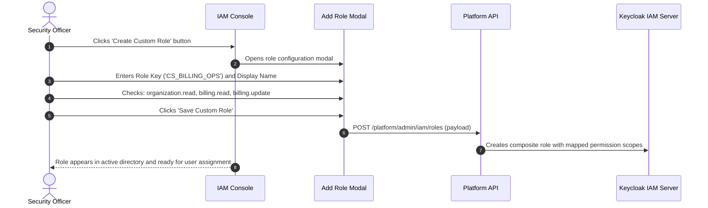

# Master RBAC Roles & Granular Permission Matrix

Welcome to the **Master RBAC Roles & Granular Permission Matrix Guide**. Role-Based Access Control (RBAC) is the primary security boundary governing what actions administrators and users can execute across the HubNest multi-tenant ecosystem.

The **IAM & Permissions** console (`/roles`) provides Security Officers with centralized control over role definitions, system vs. custom role creation, granular permission scopes across 6 functional categories, and in-hub role mappings.

---

## 1. The RBAC Architecture: System vs. Custom Roles

HubNest categorizes IAM roles into two distinct operational classes:

```mermaid
flowchart TD
    IAM[Master IAM Console : /roles]
    
    subgraph System Immutable Roles (isSystem: true)
        IAM --> R1["👑 SUPER_ADMIN<br/>Full Unrestricted Root Authority"]
        IAM --> R2["🛡️ SECURITY_ADMIN<br/>IAM, Permissions, Audit & MFA"]
        IAM --> R3["💰 FINANCE_ADMIN<br/>Billing, Plans, Gateways & Refunds"]
        IAM --> R4["🏢 OPERATIONS_ADMIN<br/>Tenants, Trials & Seat Quotas"]
        IAM --> R5["🎧 SUPPORT_ADMIN<br/>User Diagnostics & SSO Bridges"]
        IAM --> R6["📖 READ_ONLY<br/>Auditor & Compliance View Only"]
    end
    
    subgraph Custom Dynamic Roles (isSystem: false)
        IAM --> C1["✨ Custom Role A: Regional Support Lead"]
        IAM --> C2["✨ Custom Role B: Billing Operations Auditor"]
        IAM --> C3["✨ Custom Role C: Trial Onboarding Specialist"]
    end
```

1. **System Roles (`isSystem: true`):** Built-in platform roles engineered with permanent baseline security boundaries. Their system keys and root permissions cannot be deleted or weakened, guaranteeing operational stability.
2. **Custom Roles (`isSystem: false`):** User-defined roles created by Security Officers to meet tailored organizational workflows. You can grant specific combinations of permissions without granting broad superuser access.

---

## 2. The 6 Functional Permission Categories

The platform decomposes administrative capabilities into 17 granular permission scopes grouped into 6 functional domains:

| Category | Permission Scope Key | Human Label | Security Scope & Enforced Boundary |
| :--- | :--- | :--- | :--- |
| **Organization Management** | `organization.read` | Read Organizations | View organization profiles, usage summaries, and metrics. |
| | `organization.create` | Create Organization | Provision new tenant workspaces and vanity slugs. |
| | `organization.update` | Update Organization | Modify legal company profiles, seat quotas, and metadata. |
| | `organization.suspend` | Suspend Organization | Execute administrative suspensions or reinstatements. |
| **User & Identity** | `user.read` | Read Users | View cross-tenant user directory, login histories, and sessions. |
| | `user.create` | Create User | Provision new platform administrators and user accounts. |
| | `user.update` | Update User | Reset passwords, toggle MFA, and modify assigned roles. |
| | `user.delete` | Delete / Anonymize User | Deactivate accounts and execute GDPR right-to-be-forgotten purges. |
| **Billing & Revenue** | `billing.read` | Read Billing | Inspect active subscriptions, invoices, and checkout logs. |
| | `billing.update` | Update Billing | Configure payment gateway credentials and subscription plan tiers. |
| | `refund.create` | Issue Refunds & Credits | Process invoice refunds and manually adjust credit wallet balances. |
| **Product Entitlements** | `product.enable` | Enable Products | Grant hub licenses (HRMS, CRM, Calling, Meet, Notification). |
| | `product.disable` | Disable Products | Revoke hub licenses from tenant organizations. |
| **System & Infrastructure** | `system.read` | Read System Telemetry | Inspect microservice health, latency, queues, and SFU clusters. |
| | `system.configure` | Configure System | Modify platform settings, master SMTP, and CORS origin domains. |
| **Audit & Security** | `audit.read` | Read Audit Logs | View the immutable platform audit journal and actor actions. |
| | `security.manage` | Security & IAM Control | Create/edit custom IAM roles, modify RBAC matrices, and kill sessions. |

---

## 3. Navigating the 3 IAM Console Tabs

The **IAM & Permissions** console (`/roles`) provides three focused tabs:

### Tab 1: IAM Roles Overview (`iam`)
- Displays all system and custom roles as interactive cards.
- Clicking any role reveals its assigned permission scopes with green checkmarks.
- Displays the **Add Custom Role** action button.

### Tab 2: Master Permission Matrix (`matrix`)
- Comprehensive two-dimensional grid: Roles across rows and the 17 permission scopes across columns.
- Provides immediate visual comparison of privilege boundaries between roles.

### Tab 3: Connected Hub Roles (`hubs`)
- Itemizes the in-hub operational roles supported by each business application:
  - **Hub HRMS:** *Company Admin, HR Specialist, Department Manager, Employee Self-Service*.
  - **Hub CRM:** *Sales Rep, Sales Manager, Marketing Specialist, Finance Lead, Support Agent*.
  - **Hub Meet:** *Meeting Host, Participant, Room Administrator, API Integrator*.
  - **Calling Hub:** *Call Center Agent, Campaign Specialist, Telephony Ops, Super Admin*.

---

## 4. Step-by-Step: Creating a Custom IAM Role

When designing a specialized role (e.g., a "Customer Success Billing Specialist" who needs to view organizations and clear offline payments without access to system settings or user passwords):



### Procedure
1. Navigate to **IAM & Permissions** (`/roles`).
2. In the top-right corner, click **Create Custom Role**.
3. In the creation modal, complete the identity fields:
   - **Role Key:** Uppercase alphanumeric string (e.g., `AUDITOR_FINANCE`).
   - **Display Name:** Human-readable label (e.g., *Financial Compliance Auditor*).
   - **Description:** Concise summary of operational authority.
4. In the **Permission Scopes Checklist**, check the specific permissions required (e.g., `organization.read`, `billing.read`, and `audit.read`).
5. Click **Create Role**.
6. The role is registered in Keycloak and becomes immediately selectable in the **Users** directory when assigning permissions to staff.

---

## 5. Security & Principle of Least Privilege
> [!IMPORTANT]
> **Adhere to the Principle of Least Privilege:**
> - Never assign `SUPER_ADMIN` to operational support or billing staff.
> - Only grant `security.manage` and `system.configure` to verified senior systems engineers.
> - Ensure external compliance auditors are strictly assigned the `READ_ONLY` role.
> - Periodically audit custom roles and delete obsolete or unassigned roles to maintain a clean security surface.
