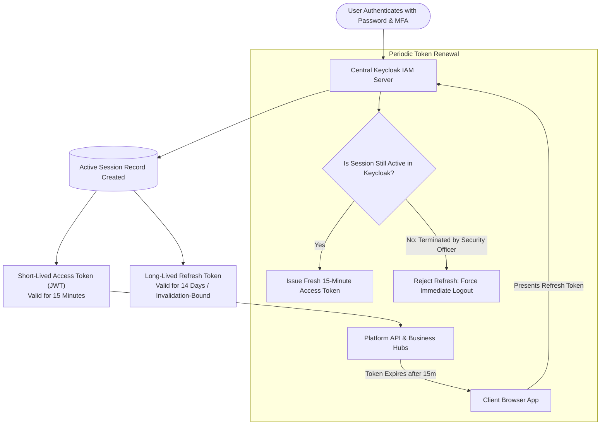
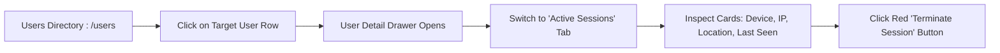
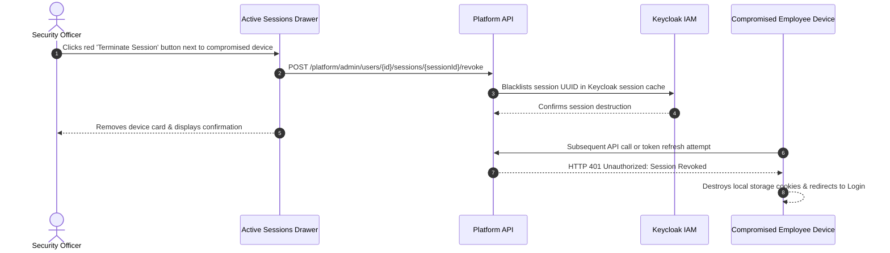

# Live Active Sessions, Remote Kill & 2FA Governance

Welcome to the **Live Active Sessions, Remote Kill & 2FA Governance Guide**. In a modern hybrid workforce, employees access corporate applications from company-issued laptops, personal home workstations, and mobile devices across diverse networks.

The **Active Sessions & MFA** management tooling in the Master Admin Console (`/users`) equips Security Officers with real-time visibility into authenticated sessions across all corporate tenants. You can monitor device telemetry, detect concurrent geographical anomalies, instantly terminate compromised sessions with a single click, and enforce Multi-Factor Authentication (MFA) policies.

---

## 1. Session Lifecycle & Token Refresh Model

HubNest implements the OAuth 2.0 / OpenID Connect token refresh lifecycle managed by Keycloak:

### Telemetry Captured per Session
- **Session Identifier (`sessionId`):** Cryptographic UUID uniquely tracking that device connection.
- **Device & Operating System:** Parsed client User-Agent string (e.g., *Windows 11 / Chrome 129*, *macOS Sequoia / Safari 18*, *Android 14 / Edge Mobile*).
- **Client IP Address:** Public IPv4/IPv6 address of the originating network interface.
- **Geographical Location:** GeoIP-resolved city and country (e.g., *Bengaluru, India* or *London, United Kingdom*).
- **Last Seen Timestamp:** Real-time pulse indicating when the device last communicated with platform APIs.
- **Current Session Flag (`isCurrent`):** Highlights the session currently used by the administrator to prevent accidental self-lockouts.

---

## 2. Inspecting Active Sessions

To monitor the active sessions for any employee or administrator:

1. Navigate to **Users** (`/users`).
2. Search for the target user by email or name.
3. Click the user row to open the **User Detail Drawer**.
4. Select the **Active Sessions** tab (Tab 2).
5. All concurrent authenticated devices appear as structured cards displaying device icons, IP addresses, city locations, and active duration.

---

## 3. Remote Session Termination ("Remote Kill")

When an employee reports a lost laptop, an account experiences suspicious activity, or an employee is terminated:

### Single Session Kill Procedure
1. Locate the suspicious or stale session card in the **Active Sessions** tab.
2. Click the red **Terminate Session** button.
3. In the confirmation dialog, click **Confirm Termination**.
4. The refresh token is instantly revoked in Keycloak. Any subsequent API request from that device is rejected with HTTP `401 Unauthorized`, and the user is redirected to the login screen.

### Terminate All Other Sessions
If a user suspects that unauthorized parties have accessed their account:
1. In the **Active Sessions** tab, click the master button: **Kill All Other Sessions**.
2. Keycloak invalidates every active session record across all mobile devices, laptops, and browser tabs, while preserving only the session currently utilized by the security officer.

---

## 4. Multi-Factor Authentication (MFA) Governance

Multi-Factor Authentication adds an essential second layer of protection, preventing account takeovers even if an employee's primary password is compromised.

### Supported MFA Mechanisms
- **Time-Based One-Time Passwords (TOTP):** Compatible with standard mobile authenticator applications (Google Authenticator, Microsoft Authenticator, Authy, and 1Password).
- **Corporate SMS OTP:** Secure one-time numerical passcodes delivered to the user's verified mobile phone via the Central SMS Gateway.

### Enforcing MFA on an Account
1. In the **Users** directory, locate the user row.
2. Click **Three-Dots (`...`)** > **Toggle MFA**.
3. Select **Enforce MFA**.
4. Upon their next login, the user must scan a cryptographic QR code to link their authenticator app before accessing any HubNest application.

### Resetting MFA for a Lost Device
When an executive purchases a new phone and loses access to their authenticator app:
1. In the user row action menu, select **Toggle MFA**.
2. Select **Reset MFA**.
3. The existing authenticator pairing is wiped. The user is prompted to set up their new device upon their next successful password login.

---

## 5. Security Best Practice Checklist
- [ ] Enforce MFA on **100%** of accounts possessing `SUPER_ADMIN`, `PLATFORM_ADMIN`, or `TENANT ADMIN` privileges.
- [ ] Investigate any session presenting an IP address from an unexpected country immediately.
- [ ] Terminate sessions that have remained inactive for over **14 days**.
- [ ] When offboarding an employee, always execute **Terminate All Sessions** prior to marking the account as `suspended`.
