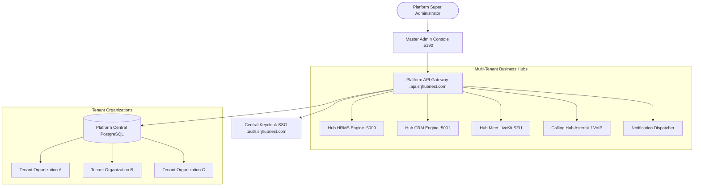
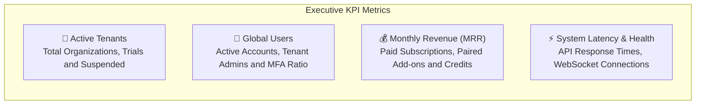
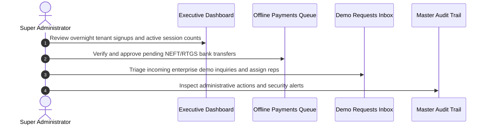

# Platform Super Admin Command Center & Architecture Overview

Welcome to the **HubNest Platform Master Administration Guide**. As the Platform Super Administrator or SaaS Owner, you sit at the apex of the entire HubNest multi-tenant ecosystem. From this centralized control plane, you oversee tenant organizations, manage enterprise subscription plans, monitor cross-hub telemetry, and govern global identity and security across all connected business applications.

This manual provides complete operational guidance for navigating the Master Admin Console (`@hubnest/platform-admin`), interpreting executive KPIs, and maintaining system health.

---

## 1. SaaS Monorepo Architecture & Multi-Tenant Model

HubNest is architected as an enterprise-grade multi-tenant monorepo. While each enterprise client operates in its own logically isolated workspace with dedicated tenant keys, all client organizations communicate through a unified identity federation and API routing bus.

### Core Architecture Tenets
1. **Logical Tenant Isolation:** Every organization receives a unique immutable `tenantId` and vanity slug (e.g., `acme-corp`). Data records across all microservices are strictly keyed by tenant identifier.
2. **Federated Identity Bus (Keycloak IAM):** Users log in once via the central Keycloak identity provider. Permissions are granted via time-bound JSON Web Tokens (JWT) containing cross-hub claim scopes.
3. **Decoupled Hub Licensing:** Organizations only pay for and access the specific hubs enabled in their contract (HRMS, CRM, Calling, Meet, or Notification).
4. **Centralized Billing & Payments:** All checkout sessions, manual bank transfer receipts, and gateway credentials (PhonePe, Razorpay, CCAvenue) converge into the Platform Admin billing engine.

---

## 2. Executive Dashboard & Real-Time KPIs

Upon logging into the Master Admin Console at `https://admin.srjhubnest.com`, you are greeted by the **Executive Overview Dashboard**. This command view aggregates live data from the database, Keycloak session stores, and payment gateways into 4 primary KPI cards and visual health graphs:

### Primary KPI Metric Cards
- **Total Organizations:** The count of registered corporate accounts, color-coded by operational status:
  - 🟢 **Active:** Paid or approved organizations in full production use.
  - 🟡 **Trial:** Organizations currently in their complimentary 14-day evaluation window.
  - 🔴 **Suspended:** Workspaces temporarily frozen due to overdue payments or administrative review.
  - ⚪ **Archived:** Decommissioned tenant records preserved for compliance history.
- **Active User Footprint:** The global count of end-user profiles across all tenants, indicating platform adoption velocity.
- **Monthly Recurring Revenue (MRR):** Total recurring revenue calculated in Indian Rupee paise and formatted cleanly in standard INR (`₹`), factoring in active tier subscriptions and add-on modules.
- **Connected Product Status:** Real-time health badges for all 7 platform hubs:
  - **HRMS:** Workforce, payroll, and attendance engine.
  - **CRM:** Sales pipeline, deal stages, and customer directory.
  - **Calling Hub:** Asterisk VoIP trunks and carrier interconnects.
  - **HubMeet:** LiveKit WebRTC video clusters and recording egress servers.
  - **HubNotification:** WhatsApp Meta Cloud API, DLT SMS gateways, and SES SMTP dispatchers.
  - **HubRecruiter:** JobNest ATS job distribution pipelines.
  - **Hub AI:** Vector embedding databases and LLM inference proxies.

---

## 3. Daily Super Admin Morning Routine

To maintain high availability and proactive client satisfaction, follow this 4-step checklist at the start of every business day:

### Step 1: Health & Metric Reconnaissance
- Check the top-bar status indicators. If any hub displays a yellow or red indicator, click the hub badge to inspect latency metrics and open incident logs.
- Review the **New Organizations (Last 24 Hours)** counter to detect unexpected signup spikes or abuse patterns.

### Step 2: Clear Pending Offline Payments
- Navigate to **Billing** > **Offline Payments** from the left navigation drawer.
- If corporate clients transferred funds via NEFT/RTGS/IMPS, cross-reference bank transaction IDs and click **Approve** to instantly activate their purchased hubs without billing delay.

### Step 3: Triage Enterprise Demo Inquiries
- Click **Support & Demos** > **Demo Requests**.
- Review enterprise prospects who submitted inquiries through the marketing website. Mark qualified leads as `Contacted` and assign them to senior sales representatives.

### Step 4: Security & Audit Sanity Check
- Click **Audit Log** to inspect mutating administrative actions.
- Verify that every role assignment, payment gateway update, or tenant suspension was executed by authorized team members.

---

## 4. Master Navigation Structure

The Master Admin navigation sidebar is divided into 4 specialized functional sections:

| Navigation Group | Sub-Items & Routes | Target Administrative Function |
| :--- | :--- | :--- |
| **Main Navigation** | `Dashboard (/)` `Organizations (/tenants)` `Users (/users)` `IAM & Permissions (/roles)` | Tenant directory, global user registry, and cross-platform RBAC governance. |
| **Products** | `HRMS (/products/hrms)` `CRM (/products/crm)` `Recruiter (/products/recruiter)` `Calling (/products/calling)` `Toll-Free (/products/tollfree)` `Notification (/products/notification)` `Meet (/products/meethub)` `AI (/products/ai)` | Deep-link administrative consoles, SSO bridge token minting, and direct endpoint monitors. |
| **Billing** | `Plans (/hub-plans)` `Subscriptions (/subscriptions)` `Invoices (/checkout-sessions)` `Payments (/payment-gateways)` `Coupons (/coupons)` `Credits (/billing/credits)` | Subscription tier feature gating, live checkout logs, payment gateway credentials, and manual bank approvals. |
| **Support & Governance** | `Support & Demos (/demo-requests)` `Announcements & CMS (/cms)` `Platform Settings (/settings)` | Inbound enterprise lead qualification, marketing website content blocks, master SMTP, and CORS security. |

---

## 5. Security & Multi-Channel Admin Protection

Because the Master Admin account possesses unrestricted administrative authority across all corporate tenants, security controls are strictly enforced:

> [!CAUTION]
> **Zero Password Sharing Policy:**
> Master SuperAdmin credentials must never be shared or stored in plain-text documents. Every administrator must authenticate with their unique email address and hardware/TOTP Multi-Factor Authentication.

### Emergency Password Change & Telemetry
In the event of a suspected security compromise or routine quarterly key rotation:
1. Click the **Password** button located in the bottom-left sidebar user profile card.
2. The **Change Master Admin Password** modal appears.
3. Enter your current password, your new high-entropy password (minimum 12 characters with uppercase, numbers, and symbols), and the real-time OTP sent to your verified administrator email/mobile.
4. Click **Update Password**. The platform instantly invalidates all active tokens across all devices and logs the security event to the immutable audit database.

---

## 6. Next Steps in this Guide
- To manage tenant organizations, review [Master Tenant Provisioning & Status Controls](tenant-lifecycle-management.md).
- To troubleshoot client workspaces without passwords, read [One-Click Tenant Impersonation & Hub SSO Bridges](tenant-impersonation-sso.md).
- To configure individual product suites, explore [Multi-Product Hub Provisioning & Master Consoles](product-consoles-activation.md).
