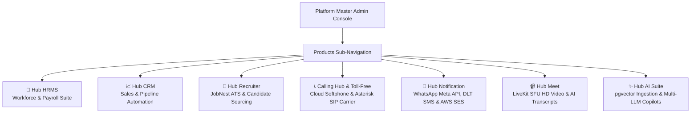
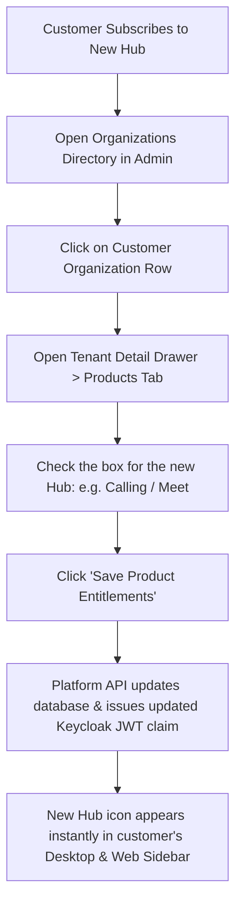

# Multi-Product Hub Provisioning & Master Consoles

Welcome to the **Multi-Product Hub Provisioning & Master Consoles Guide**. The HubNest ecosystem is comprised of specialized business microservices—ranging from workforce payroll and CRM sales automation to real-time WebRTC video conferencing and cloud telephony softphones.

As a Platform Super Administrator, you manage the connectivity, API gateway routes, SSO consumer pathways, and tenant entitlement grants for all 7 integrated product suites from the **Products** section of the Master Admin Console.

---

## 1. Connected Product Suites Overview

Each product console provides:
1. **Live Health & Operational Status:** Instant visual confirmation of whether the microservice is `active`, undergoing maintenance, or `coming_soon`.
2. **Endpoint Matrix:** Direct links and status badges for the customer web app, SSO consumer callback route, and backend REST/WebSocket API gateway.
3. **Master Credentials & Secrets Hint:** Information on how the root SuperAdmin role authenticates into that service (e.g., via AWS Secrets Manager or federated Keycloak claims).
4. **Feature Registry:** Comprehensive list of modules and capabilities enabled by that product suite.

---

## 2. Product-by-Product Console Specifications

### 1. Hub HRMS (Workforce & Payroll) — `/products/hrms`
- **Category:** Workforce & Payroll Suite
- **Primary Endpoints:**
  - Web App: `https://hrms.srjhubnest.com`
  - SSO Exchange Consumer: `https://hrms.srjhubnest.com/api/auth/sso/consume`
  - API Gateway: `https://api.srjhubnest.com/hrms` (Port 5009)
- **Key Administrative Capabilities:**
  - Multi-tier company onboarding, branch and department setup.
  - Biometric machine sync and GPS geolocation attendance tracking.
  - Indian statutory compliance (PF, ESI, Professional Tax, TDS) and automated salary slip generation.
  - 9-Box performance matrix calibration and asset lifecycle tracking.

---

### 2. Hub CRM (Customer Relations) — `/products/crm`
- **Category:** Sales & Pipeline Automation
- **Primary Endpoints:**
  - Web App: `https://crm.srjhubnest.com`
  - SSO Consumer Gateway: `https://crm.srjhubnest.com/api/v1/auth/sso/consume`
  - Backend API Gateway: `https://api.srjhubnest.com/crm` (Port 5001)
- **Key Administrative Capabilities:**
  - Unlimited custom visual Kanban deal pipelines and lead scoring rules.
  - Omnichannel lead ingestion (website forms, WhatsApp inquiries, CSV imports).
  - Activity timelines, automated drip email sequences, and revenue forecasting.
  - Native integration with Calling Hub softphone dialer for one-click calling.

---

### 3. Hub Recruiter (JobNest ATS) — `/products/recruiter`
- **Category:** Talent Acquisition & Hiring
- **Primary Endpoints:**
  - Master Admin Panel: `https://admin.srjjobnest.com`
  - Recruiter Web Portal: `https://recruiter.srjjobnest.com`
  - SSO Callback Gateway: `https://admin.srjjobnest.com/sso/callback`
  - JobNest Backend API: `https://api.srjjobnest.com/api/v1`
- **Key Administrative Capabilities:**
  - Multi-board job publishing across national career portals.
  - AI resume parsing, candidate skill intelligence, and automatic keyword scoring.
  - Video interview scheduling with automated interviewer scorecards.

---

### 4. Calling Hub & Toll-Free 1800 — `/products/calling`
- **Category:** Telephony & Voice Infrastructure (Powered by `voipbin` and Asterisk)
- **Primary Endpoints:**
  - Telephony Carrier Gateway: `https://calling.srjhubnest.com`
  - Asterisk SIP Signaling: `sip.srjhubnest.com:5060`
  - Media Relays: WebRTC RTP UDP `10000–20000`
- **Calling Product Dedicated Management (`CallingProduct.tsx`):**
  - **Organization Verification:** Reviewing KYC/identity verification states (`none`, `pending`, `verified`, `rejected`) for organizations purchasing virtual numbers.
  - **DID Phone Number Inventory:** Allocating local landlines, mobile numbers, and National 1800 Toll-Free numbers to corporate tenants.
  - **Per-Minute SIP Rate Cards:** Setting wholesale and retail calling tariffs across domestic and international destinations.
  - **Agent Softphone Capacity:** Monitoring concurrent call volumes and queue distribution health.

---

### 5. Hub Notification (Omnichannel Dispatcher) — `/products/notification`
- **Category:** Communications & Messaging
- **Primary Endpoints:**
  - Web App: `https://hubnotification.srjhubnest.com`
  - SSO Consumer Gateway: `https://hubnotification.srjhubnest.com/auth/sso/consume`
  - Dispatcher API: `https://api.srjhubnest.com/notification`
- **Key Administrative Capabilities:**
  - Meta Embedded Signup management for WhatsApp Cloud API.
  - Indian Telecom DLT registration, Principal Entity IDs, and Header approval tracking.
  - High-throughput transactional email delivery via AWS Simple Email Service (SES).
  - Visual automated flow builders and real-time delivery receipt (DLR) telemetry.

---

### 6. Hub Meet (HD Video Conferencing) — `/products/meethub`
- **Category:** Real-Time Collaboration
- **Primary Endpoints:**
  - Meet Web App: `https://hubmeet.srjhubnest.com`
  - SSO Token Callback: `https://hubmeet.srjhubnest.com/sso/callback`
  - LiveKit SFU Signaling: `wss://livekit.srjhubnest.com`
- **Key Administrative Capabilities:**
  - LiveKit selective forwarding unit (SFU) cluster health and room occupancy.
  - Cloud Egress recording server status and S3 storage archiving.
  - Enterprise meeting policies: E2EE room encryption, waiting room defaults, and AI transcription models.

---

### 7. Hub AI (Enterprise Intelligence Suite) — `/products/ai`
- **Category:** Artificial Intelligence & Copilots
- **Primary Endpoints:**
  - AI Gateway API: `https://api.srjhubnest.com/ai`
- **Key Administrative Capabilities:**
  - Vector embeddings and semantic document search powered by PostgreSQL `pgvector`.
  - Multi-LLM routing (OpenAI GPT-4o, Anthropic Claude 3.5, Google Gemini 1.5) with automatic fallback.
  - Per-tenant token quota enforcement, preventing API credit overruns.

---

## 3. How to Grant or Revoke Hub Access for Tenants

When an enterprise customer subscribes to an additional product (e.g., adding Calling Hub to an existing HRMS account):

1. Navigate to **Organizations** (`/tenants`).
2. Search and click on the customer's organization.
3. In the detail drawer, switch to the **Products** tab.
4. Check the box corresponding to the desired hub (e.g., `Calling` or `Meet`).
5. Click **Save Changes**.
6. The customer's users will immediately see the new hub appear in their HubNest OS Desktop App sidebar and web launcher upon their next navigation click.

---

## 4. Best Practices for Product Administration
- **Verify Microservice Health Prior to Enterprise Demos:** Before conducting high-profile enterprise demonstrations, open the respective product console and confirm that the API Gateway endpoint and SSO Consumer are responding with HTTP `200 OK`.
- **Enforce Calling KYC Standards:** Never allocate outbound virtual phone numbers or Toll-Free trunks to organizations with an `unverified` identity status to prevent telemarketing spam and regulatory penalties.
- **Monitor Token Quotas on Hub AI:** Keep a vigilant watch on token consumption in the AI console to avoid unexpected third-party inference billing spikes.
