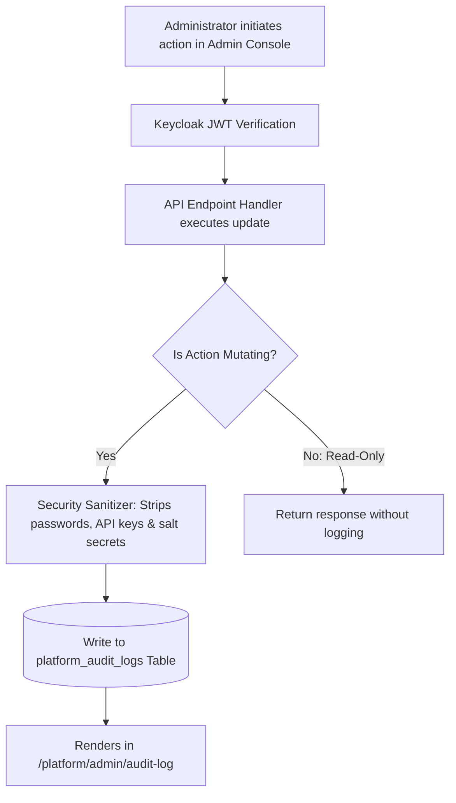
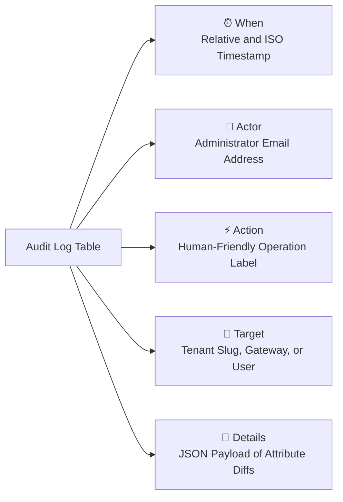
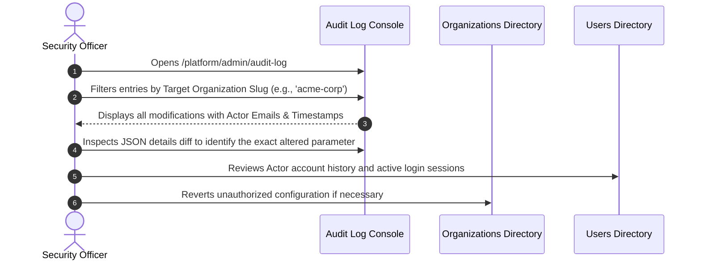

# Administrative Audit Logs & Security Trails

Welcome to the **Platform Security Audit Trails Guide**. In an enterprise SaaS environment serving regulated industries (such as financial services, healthcare, and telecommunications), administrative transparency and accountability are non-negotiable.

The **Audit Log** module in the HubNest Platform Master Admin Console records an immutable, chronological journal of every mutating action executed by platform administrators. Whether an administrator grants hub entitlements, reconfigures a payment gateway, alters pricing tiers, or suspends a tenant, the action is cryptographically timestamped and attributed to the responsible actor.

---

## 1. How the Platform Audit Engine Operates

Every administrative API request that modifies database records passes through an auditing interceptor in `platform-api`:

### Critical Security Principles
1. **Secrets Are Never Logged:** The audit serializer explicitly scrubs sensitive credentials (such as Payment Gateway Salt Keys, Razorpay Secrets, and Keycloak client secrets). The log records *which* gateway was configured and whether it was enabled, but never exposes raw tokens.
2. **Immutable Append-Only Records:** Audit log entries cannot be modified or deleted through the administration UI, providing a dependable evidentiary chain for compliance audits (SOC 2 Type II, ISO 27001, and GDPR).
3. **Actor Attribution:** Every record includes the verified email address of the authenticated Keycloak session actor.

---

## 2. Navigating the Audit Log Console

To inspect administrative records, click **Audit Log** from the left navigation drawer.

### Table Column Definitions

| Column | Description | Example Value |
| :--- | :--- | :--- |
| **When** | Exact date and time when the administrative action occurred. | `2026-10-16 14:32:05 UTC` *(5 mins ago)* |
| **Actor** | Verified email address of the logged-in administrator. | `superadmin@hubnest.com` |
| **Action** | Standardized, human-readable action description. | `Granted hub access` |
| **Target** | The specific entity affected by the modification. | `acme-corp` *(Organization)* |
| **Details** | Collapsible JSON block detailing changed fields. | `{"hubKey": "calling", "role": "admin"}` |

---

## 3. Comprehensive Action Code Registry

The table below catalogs the primary administrative action codes captured by the system:

| Internal Action Key | Human-Readable Label | Trigger Scenario |
| :--- | :--- | :--- |
| `grant_hub_role` | **Granted hub access** | Administrator enabled a product hub (e.g., Calling or Meet) for an organization. |
| `revoke_hub_role` | **Revoked hub access** | Administrator disabled a product hub from a tenant workspace. |
| `payment_gateway_update` | **Updated payment gateway** | Merchant credentials or sandbox mode toggled for PhonePe, Razorpay, or CCAvenue. |
| `payment_gateway_activate` | **Activated payment gateway** | Administrator switched the primary active payment gateway. |
| `tenant_suspend` | **Suspended organization** | Tenant account was placed into administrative suspension. |
| `tenant_reactivate` | **Reactivated organization** | Suspended tenant was restored to active production status. |
| `plan_tier_change` | **Updated plan tier** | Tenant upgraded or downgraded between `STARTER`, `PRO`, and `ENTERPRISE`. |
| `trial_extend` | **Extended evaluation trial** | Additional trial days (e.g., +14 days) were granted to an organization. |
| `credits_adjust` | **Adjusted credit balance** | Pre-paid telephony or notification wallet balance was credited or debited. |
| `offline_payment_approve` | **Approved offline payment** | Manual bank transfer (NEFT/RTGS) was cleared, unlocking contracted hubs. |
| `offline_payment_reject` | **Rejected offline payment** | Incomplete or unverified bank transfer session was cancelled. |
| `user_mfa_toggle` | **Modified MFA policy** | Two-factor authentication was enforced or reset for an administrative user. |
| `user_status_change` | **Changed user status** | User profile transitioned between `active`, `suspended`, or `locked`. |

---

## 4. How to Conduct a Security Incident Investigation

When investigating an unauthorized configuration change or customer dispute:

### Investigation Procedure
1. **Identify the Target:** In the Audit Log search bar, enter the affected organization slug (e.g., `acme-corp`), payment gateway name, or user email.
2. **Review the Actor:** Confirm the email address listed in the **Actor** column. Check whether that administrator had legitimate business justification or an open ticket to perform the action.
3. **Inspect the Details Payload:** Click on the JSON details snippet to review the before-and-after values.
4. **Cross-Check Active Sessions:** If the action was unauthorized, navigate to **Users** (`/users`), search for the actor's email, inspect their active login sessions and IP addresses, and immediately click **Lock Account** or **Kill Active Sessions** to neutralize the threat.

---

## 5. Compliance & External Audit Export
For SOC 2 or annual financial audits:
- The underlying `platform_audit_logs` table can be exported directly via read-only SQL replica queries or scheduled data warehouse ETL pipelines (e.g., Snowflake or AWS Athena).
- Logs are retained for a minimum of **365 days** to comply with international enterprise data retention mandates.
- Cryptographic hash chaining ensures records cannot be tampered with in storage without triggering integrity alarms.
