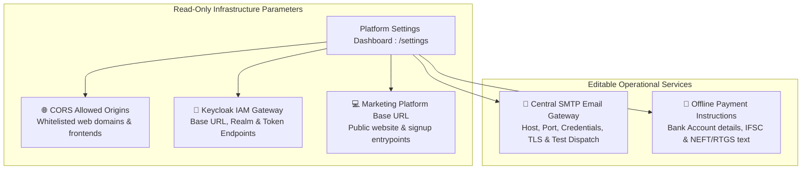
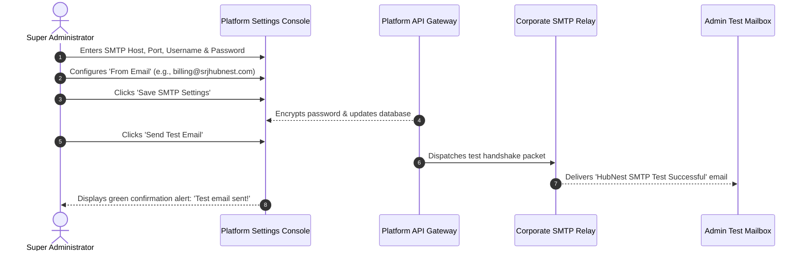
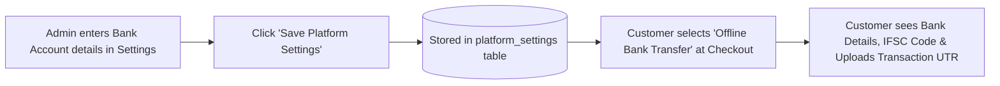

# Master Platform Settings & Central SMTP Configuration

Welcome to the **Master Platform Settings & Central SMTP Guide**. As the Platform Super Administrator, ensuring that cross-origin browser policies (CORS) are properly configured, identity realms are connected, and automated transactional emails (such as invoices, welcome letters, and password resets) are delivered reliably is critical to seamless operations.

The **Platform Settings** console (`/settings`) provides centralized control over environmental parameters, identity realm configurations, transactional email delivery, and customer-facing bank payment instructions.

---

## 1. System Settings Architecture

The Platform Settings console separates system configurations into two distinct tiers:



1. **Read-Only Infrastructure Parameters:** Core environment variables inherited from AWS/Kubernetes infrastructure deployment. These provide instant runtime visibility into your platform topology without the risk of accidental misconfiguration.
2. **Editable Operational Settings:** Dynamic parameters saved directly to the database via `PUT /platform/admin/platform-settings`. These allow administrators to update corporate SMTP servers or bank payment details without restarting microservices.

---

## 2. Infrastructure & Environment Parameters

When you open **Platform Settings** (`/settings`), the top section displays the active environment variables:

| Parameter Key | Administrative Purpose | Example Production Setting |
| :--- | :--- | :--- |
| **CORS Allowed Origins** | Specifies which web domains are permitted to communicate with `platform-api` via cross-origin browser requests. | `https://*.srjhubnest.com`<br/>`https://admin.srjhubnest.com`<br/>`http://localhost:3000` *(dev only)* |
| **Keycloak Base URL** | The fully qualified domain of the central Keycloak identity server. | `https://auth.srjhubnest.com` |
| **Keycloak Realm** | The master authentication realm housing all user accounts, client IDs, and role definitions. | `hubnest` |
| **Platform Web Base URL** | The URL of the public-facing marketing site and customer checkout funnel. | `https://srjhubnest.com` |

> [!NOTE]
> **Modifying Infrastructure Parameters:**
> If a new customer domain or white-label portal requires addition to the `corsAllowedOrigins` list, this parameter is updated through your deployment environment configuration (e.g., Kubernetes Helm values or AWS ECS task definitions) to maintain infrastructure-as-code discipline.

---

## 3. Configuring the Central SMTP Email Gateway

All automated transactional emails originating from the central checkout funnel—such as PDF tax invoices, subscription confirmation receipts, and offline payment submission notices—are dispatched through the Central SMTP Gateway.



### Step-by-Step SMTP Setup Procedure
1. Navigate to **Platform Settings** from the left navigation drawer.
2. Scroll to the **Central SMTP Gateway** card.
3. Complete the required connection fields:
   - **SMTP Host:** Your outgoing mail server hostname (e.g., `email-smtp.ap-south-1.amazonaws.com` or `smtp.sendgrid.net`).
   - **SMTP Port:** Use port `587` (STARTTLS) or port `465` (SSL). Port `587` is strongly recommended for enterprise deliverability.
   - **Enable TLS:** Toggle this checkbox to ensure all email communications are encrypted in transit.
   - **SMTP Username:** Your email service account identifier or AWS SES Access Key ID.
   - **SMTP Password:** Your SMTP secret key. Once saved, the platform automatically masks this field (displaying `••••1234`) to prevent shoulder-surfing.
   - **From Email Address:** The verified sender email (e.g., `invoices@srjhubnest.com` or `billing@srjhubnest.com`).
   - **From Display Name:** The friendly brand name attached to outgoing emails (e.g., `HubNest Enterprise Billing`).
4. Click **Save Settings**.

### Verifying Email Delivery with the Test Dispatcher
Before relying on the SMTP server for customer billing, verify the configuration:
1. Click the **Send Test Email** button adjacent to the save button.
2. The platform dispatches a real-time test message to your logged-in administrator email address.
3. If successful, a green alert appears: *"Test email dispatched successfully. Check your inbox."*
4. If the test fails, an informative error banner reveals the exact SMTP handshake fault (e.g., *Authentication failed: 535 Invalid credentials* or *Connection timed out on port 587*).

---

## 4. Configuring Offline Payment Instructions

For enterprise clients in India and overseas who prefer paying annual contracts via direct wire transfer (NEFT, RTGS, IMPS, or SWIFT) rather than credit cards:



### Editing Bank Transfer Instructions
1. In **Platform Settings**, scroll to the **Offline Bank Transfer Instructions** card.
2. Enter the complete wire transfer instructions in the markdown text editor:
   ```text
   Please transfer the total invoice amount to our corporate bank account:
   
   - Beneficiary Name: SRJ HubNest Enterprise Solutions Pvt. Ltd.
   - Bank Name: HDFC Bank Ltd.
   - Account Number: 50200084920192
   - Account Type: Current Account
   - IFSC Code: HDFC0001824
   - Bank Branch: MG Road Corporate Branch, Bangalore
   
   After completing your transfer, enter your 12-digit UTR/Transaction Reference
   Number and attach a screenshot of the payment receipt below. Your hubs will
   be activated within 2 business hours upon verification.
   ```
3. Click **Save Instructions**.
4. The updated instructions appear immediately on the customer-facing checkout page whenever a client selects the **Bank Transfer (NEFT/RTGS)** payment option.

---

## 5. Security Best Practices for Platform Settings
- **Never Use Personal Email Addresses:** Always configure dedicated, monitored corporate distribution lists (e.g., `billing@srjhubnest.com`) as the `From Email` rather than an individual employee's inbox.
- **Ensure SPF, DKIM & DMARC Records Match:** Verify that your domain DNS records include your SMTP server's SPF include statement (e.g., `include:amazonses.com`) and DKIM public keys to guarantee emails land in client inboxes rather than spam folders.
- **Review CORS Entries Periodically:** Remove decommissioned staging or testing domains from `corsAllowedOrigins` to maintain a tight security boundary.
