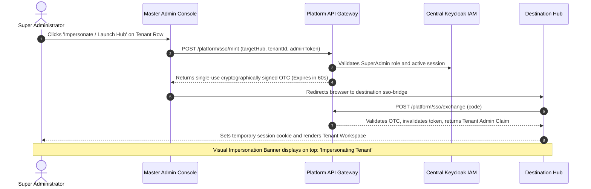
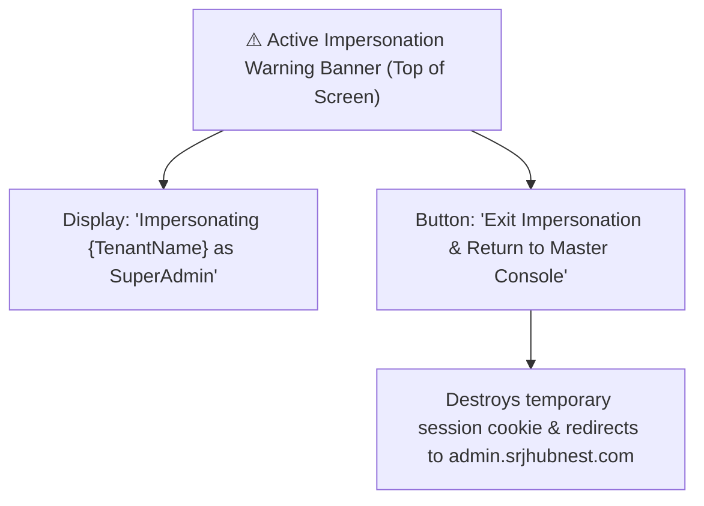

# One-Click Tenant Impersonation & Hub SSO Bridges

Welcome to the **Tenant Impersonation & SSO Bridges Guide**. In enterprise SaaS support operations, customer inquiries frequently require viewing an application exactly as the client experiences it. However, asking customers for their private passwords is a severe security violation that breaches zero-trust compliance standards.

HubNest resolves this dilemma through **Cryptographic One-Time Code (OTC) Impersonation Bridges**. As a Platform Super Administrator, you can jump directly into any tenant's workspace or administrative console with a single click—fully authenticated, with zero password sharing, and with complete cryptographic audit logging.

---

## 1. How One-Click SSO Impersonation Operates

The impersonation architecture relies on a secure token-exchange handshake between the Master Admin Console, the Central Platform API, Keycloak IAM, and the destination business hub:

### Security Guardrails
1. **Short-Lived Ephemeral Tokens:** The minted OTC is valid for exactly **60 seconds**. If not exchanged immediately by the browser, it expires and cannot be replayed.
2. **Single-Use Invalidation:** As soon as the destination hub consumes the code, it is permanently marked as redeemed in the platform database.
3. **No Password Exposure:** Neither the client nor the Super Administrator ever sees or inputs raw credentials.
4. **Immutable Audit Trail:** Every impersonation event generates a permanent security record documenting the administrator's email, target organization ID, destination hub, IP address, and timestamp.

---

## 2. Step-by-Step Impersonation Workflows

### Method 1: Impersonating a Specific Tenant Workspace
When troubleshooting an issue reported by a specific customer:
1. Navigate to **Organizations** (`/tenants`).
2. Search for the customer's organization by name or slug.
3. Click the **Three-Dots (`...`)** menu on the right edge of their row.
4. Hover over **Login as Tenant** and select the destination hub:
   - **Launch Hub HRMS:** Opens the employee portal and HR management console for that tenant.
   - **Launch Hub CRM:** Opens their deal pipeline, lead database, and customer interaction history.
   - **Launch Calling Hub:** Opens their softphone configuration, DID routing, and IVR call tree.
   - **Launch Hub Meet:** Opens their meeting scheduling dashboard and room controls.
   - **Launch Hub Notification:** Opens their WhatsApp templates, live inbox, and broadcast manager.
5. A new browser tab launches. The SSO bridge seamlessly validates the session, and you land directly inside the customer's workspace.

### Method 2: Launching Master Product Consoles
When you need to access global platform-wide administrative consoles rather than a single tenant's workspace:
1. In the Master Admin sidebar, expand the **Products** dropdown.
2. Select the target product:
   - **HRMS (`/products/hrms`)**
   - **CRM (`/products/crm`)**
   - **Recruiter (`/products/recruiter`)**
   - **Calling (`/products/calling`)**
   - **Notification (`/products/notification`)**
   - **Meet (`/products/meethub`)**
3. On the product overview page, review the connection status and live endpoints.
4. Click the primary action button: **Launch {Hub} Admin Console (SSO)**.
5. The system mints a master superadmin token and authenticates you into the root administration tier of that product suite.

---

## 3. The Active Impersonation Session Experience

While browsing an application under an impersonated session, HubNest displays prominent visual reminders to protect customer data:

### Rules of Engagement During Impersonation
> [!IMPORTANT]
> **Adhere to Enterprise Privacy Standards:**
> - **View-Only Principle:** Use impersonation primarily for diagnostic observation, reproducing reported UI bugs, or verifying configuration settings.
> - **Never Modify Financial Records:** Do not edit employee salary figures, bank account details, or customer invoices without explicit, written customer ticket authorization.
> - **Exit Promptly:** Once the diagnostic investigation is complete, click **Exit Impersonation** immediately to destroy the temporary authentication cookies.

---

## 4. Troubleshooting SSO Bridge & Impersonation Failures

| Failure Message / Symptom | Probable Root Cause | Administrative Resolution |
| :--- | :--- | :--- |
| **"Single Sign-On Code Expired"** | The browser took longer than 60 seconds to complete the destination redirect. | Close the tab, return to the Master Admin Console, and click **Login as Tenant** again to mint a fresh token. |
| **"Invalid Tenant ID or Inactive Hub"** | The target organization has not been granted access to that specific hub. | In the Master Admin Console, open the tenant's detail drawer, click the **Products** tab, and verify that the target product checkbox is enabled. |
| **"Token Verification Failed / Unauthorized"** | Clock drift between the Keycloak authentication server and the destination application host. | Check server NTP synchronization. Ensure system clocks are accurate within 1,000 milliseconds. |
| **"CORS Error on SSO Callback"** | The destination hub's origin domain is not whitelisted in the platform settings. | Navigate to **Platform Settings** (`/settings`) and verify that the hub's domain is present in the `corsAllowedOrigins` array. |

---

## 5. Security Summary Checklist for Support Staff
- [ ] Verify customer consent or an open helpdesk ticket number before initiating an impersonation session.
- [ ] Never download or export sensitive client CSV files to unmanaged personal devices.
- [ ] Confirm that your Master Admin session is protected by Multi-Factor Authentication (MFA).
- [ ] Always terminate sessions using the **Exit Impersonation** button when testing concludes.
