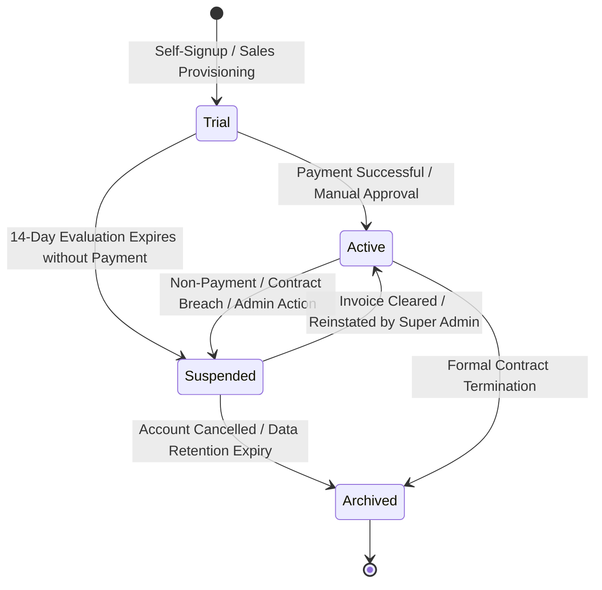

# Master Tenant Provisioning & Organization Lifecycle Management

Welcome to the **Master Tenant Lifecycle Management Guide**. In a multi-tenant enterprise architecture, client organizations (tenants) are the foundational unit of governance. Every corporate subscriber exists as an isolated tenant containing their own employee directory, CRM deals, Softphone call logs, and video meeting archives.

As a Platform Super Administrator, you possess unilateral authority to provision new company workspaces, adjust licensing tiers, extend trials, grant or revoke hub access, and suspend or archive rogue or delinquent accounts.

---

## 1. Organization Lifecycle States

Every organization in HubNest moves through clearly defined operational states:



| Lifecycle State | Visual Badge | System Behavior & User Experience | Permitted Administrative Actions |
| :--- | :--- | :--- | :--- |
| **Trial** | 🟡 `trial` | Full access to evaluated hubs for a strict 14-day duration. Top banner displays remaining days. | Extend trial (+14 days), Upgrade to paid tier, Adjust credit balance. |
| **Active** | 🟢 `active` | Full uninterrupted access to contracted hubs. Recurring billing active or prepaid. | Edit profile, Change tier, Add credits, Modify feature flags, Suspend. |
| **Suspended** | 🔴 `suspended` | Logins blocked with "Account Suspended — Contact Billing" message. Scheduled jobs and outbound dialers paused. | Reactivate account, Clear outstanding balance, Archive workspace. |
| **Archived** | ⚪ `archived` | Read-only preserved state. Workspace decommissioned; data staged for compliance retention or purge. | Permanent purge (Database admin only), Audit review. |

---

## 2. Navigating the Organizations Directory (`/tenants`)

To inspect and manage organizations, click **Organizations** from the main navigation sidebar.

```mermaid
graph TD
    Search[Search Bar: Filter by Company, Slug, Owner Email] --> Filter[Dropdowns: Filter by Plan Tier & Operational Status]
    Filter --> Table[Master Organization Table: Name, Plan, Products, MRR, Users, Status]
    Table --> Drawer[Click any row: Opens Comprehensive 6-Tab Tenant Detail Drawer]
    Table --> Menu[Click Three-Dots (...): Quick Action Modals]
```

### Table Column Guide
- **Organization & Slug:** Displays the legal corporate name alongside its system-generated routing slug (e.g., `Acme Global (acme-global)`).
- **Owner Contact:** The primary account administrator's email and phone number.
- **Active Products:** Visual pill tags indicating enabled hubs:
  - `HRMS` (Blue), `CRM` (Purple), `Calling` (Emerald), `AI Suite` (Amber), `Notification` (Indigo), `Recruiter` (Pink), `Meet` (Cyan).
- **Users Count:** Total active employee and administrator seats provisioned inside this organization.
- **MRR (Paise/INR):** Real-time Monthly Recurring Revenue generated by this organization.
- **Status:** Current operational state badge (`active`, `trial`, `suspended`, `archived`).

---

## 3. The 6-Tab Tenant Detail Drawer

Clicking on any organization row slides out the **Tenant Detail Drawer** from the right side of the screen. This allows you to inspect and modify tenant configurations without losing your table filter context:

### Tab 1: Profile Overview
- **Legal Entity Information:** Company Name, Slug, Country, and Industry sector (e.g., IT & Software, Healthcare, Manufacturing).
- **Owner Account Details:** Name and direct corporate email of the primary executive sponsor.
- **Timestamps:** Exact account registration date and last recorded user activity timestamp.

### Tab 2: Billing & Commercials
- **Current Plan Tier:** Current subscription package (`STARTER`, `PRO`, or `ENTERPRISE`).
- **Trial Expiration Tracker:** Countdown display of remaining evaluation days with direct **Extend Trial** button.
- **Prepaid Credits Balance:** Available consumption wallet balance (in Indian Rupees/Paise) used for outbound VoIP telephony and WhatsApp API messaging.
- **MRR Calculation:** Net contracted revenue contribution.

### Tab 3: Products & Entitlements
- Checkbox switches for each of the 7 enterprise hubs.
- Toggling a product instantly enables or disables access across all users within that organization without requiring server restarts.

### Tab 4: Usage & Scalability
- Total provisioned user seats vs. plan license limits.
- Softphone call volume, meeting room hours utilized, and document storage consumption.

### Tab 5: Feature Flags (Overrides)
- Granular per-tenant feature toggles that override default tier limits (e.g., enabling early-access AI meeting dubbing or biometric attendance for a pilot customer).

### Tab 6: Audit History
- Real-time stream of all administrative actions performed on this organization, including who changed the plan, when credits were added, and timestamps of state transitions.

---

## 4. Step-by-Step Administrative Workflows

### Workflow A: Extending a Customer's Evaluation Trial
When a high-value enterprise prospect requests additional time to complete their security evaluation:
1. Locate the organization in the directory using the search bar.
2. Click the **Three-Dots (`...`)** menu on the right edge of the table row.
3. Select **Extend Trial**.
4. In the modal, specify the additional evaluation duration (default is `14` days).
5. Click **Confirm Extension**. The system recalculates `trialEndsAt`, updates Keycloak token grants, and displays a green confirmation alert.

### Workflow B: Upgrading or Changing a Plan Tier
When an organization upgrades from `STARTER` to `ENTERPRISE`:
1. Open the organization's row action menu and click **Change Plan**.
2. Select the target tier from the dropdown:
   - **STARTER:** Base employee limits, standard CRM pipeline, essential video meetings.
   - **PRO:** Increased user quotas, advanced analytics, custom workflow automations.
   - **ENTERPRISE:** Unlimited user seats, priority SLA, dedicated SFU media clusters, custom SSO integration.
3. Click **Update Plan Tier**. The new limits and feature gates take effect immediately across all employee sessions.

### Workflow C: Adding Pre-Paid Telephony & Notification Credits
Organizations utilizing Calling Hub or WhatsApp Cloud API require credit balances:
1. In the action menu, select **Add Credits**.
2. Enter the credit amount in Indian Rupees (e.g., `₹500` or `₹5,000`).
3. Select the funding reason: *Sales Bonus Credit*, *Customer Service Reversal*, or *Manual Invoice Payment*.
4. Click **Apply Credits**. The tenant's wallet balance increases in real time, preventing automated outbound dialer interruptions.

### Workflow D: Suspending a Delinquent Organization
> [!WARNING]
> **Operational Impact of Suspension:**
> Suspending an organization terminates all active user sessions within 60 seconds, halts automated marketing campaigns, and rejects inbound SIP softphone calls. Use only in cases of confirmed fraud, non-payment, or formal security escalation.

1. From the action menu, select **Suspend Organization**.
2. A confirmation prompt displays: *"Are you sure you want to suspend {CompanyName}? All user logins will be immediately blocked."*
3. Enter your administrative reason in the text box (e.g., *Invoice #INV-9281 overdue by 45 days*).
4. Click **Confirm Suspension**. The organization badge changes to red `suspended`.

### Workflow E: Reactivating a Suspended Workspace
When the customer clears their outstanding balance:
1. Open the action menu for the suspended tenant.
2. Click **Reactivate Organization**.
3. Confirm the prompt. Access is restored instantaneously; employees can log in immediately with their existing credentials.

---

## 5. Best Practice Guidelines for Tenant Governance
- **Never Alter Slugs on Live Tenants:** Modifying an organization's slug alters their subdomain routing and will break existing bookmark links for end users.
- **Audit Feature Flag Overrides:** Periodically review Tab 5 (Feature Flags) to ensure temporary trial flags are either transitioned into standard paid plan tiers or deactivated.
- **Maintain Accurate Owner Records:** Ensure the primary owner email is verified so critical billing invoices, password reset notices, and security alerts reach responsible client stakeholders.
