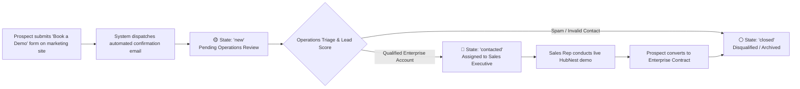
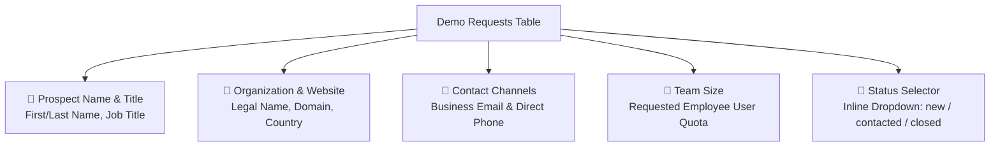
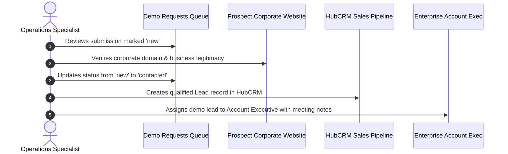

# Enterprise Demo Requests & Inbound Lead Qualification

Welcome to the **Enterprise Demo Requests & Inbound Lead Qualification Guide**. Large corporate organizations, government institutions, and high-growth enterprises typically request a personalized product demonstration before executing software contracts.

Inquiries submitted through the marketing site's "Book a Demo" portal stream directly into the **Demo Requests** console (`/demo-requests`) in the Master Admin Console. As a Tenant Operations Specialist, you triage these high-value submissions, evaluate prospect eligibility, assign leads to dedicated sales executives, and transition leads through the qualification lifecycle.

---

## 1. The Inbound Demo Qualification Lifecycle

From the moment an enterprise prospect submits their corporate information, the lead progresses through a 3-stage qualification funnel:

| Lead Status | Status Badge | Operational Meaning | Recommended Next Action |
| :--- | :--- | :--- | :--- |
| **New** | 🟡 `new` | Inbound submission received within the last 24 hours. Awaiting operational review. | Inspect email domain, company size, and assign appropriate sales rep. |
| **Contacted** | 🔵 `contacted` | Sales rep has initiated outreach (via telephone, WhatsApp, or Google Meet calendar invite). | Monitor deal progression; ensure follow-up occurs within 24 business hours. |
| **Closed** | ⚪ `closed` | Opportunity concluded (either successfully provisioned as a new tenant or disqualified). | Lead archived; compliance history preserved. |

---

## 2. Navigating the Demo Requests Queue (`/demo-requests`)

To review inbound submissions, navigate to **Support & Governance** > **Support & Demos** in the sidebar.

### Table Column Guide
- **Prospect & Title:** The submitter's full name and organizational role (e.g., *Rajesh Sharma — Chief Technology Officer*).
- **Company Name & Website:** Clickable corporate URL allowing quick background checks on company legitimacy.
- **Contact Details:** Verified business email and direct telephone number with country calling code.
- **Number of Users:** The prospective employee seat count (e.g., `50-250 users` or `1,000+ users`), serving as the primary sizing signal.
- **Status:** Interactive dropdown selector allowing immediate status transitions.
- **Submitted At:** Exact date and time when the submission was captured.

---

## 3. Step-by-Step Lead Qualification Workflow

When reviewing a newly arrived demo request:

### Step 1: Corporate Domain Verification
- Inspect the prospect's email address. Enterprise opportunities will feature corporate domains (e.g., `cto@reliance-enterprises.com` or `it@manipalhospitals.com`).
- Submissions using free public mailboxes (e.g., `@gmail.com` or `@yahoo.com`) should be evaluated carefully; if the company name is legitimate, they can be routed to standard sales.

### Step 2: Sizing & Product Matching
- Review the **Requested Users** parameter:
  - **1 to 25 Users:** Self-serve candidate. Recommend self-signup for the standard 14-day online trial.
  - **25 to 100 Users:** Mid-market candidate. Assign to an Inside Sales Representative.
  - **100+ to 1,000+ Users:** Enterprise strategic opportunity. Immediately escalate to a Senior Enterprise Account Executive.

### Step 3: Transitioning Status & Sales Handoff
1. In the **Status** column dropdown for that row, click the current status badge.
2. Select **`contacted`**.
3. The badge updates to blue `contacted` immediately via API.
4. Open **HubCRM** or ping the assigned sales specialist with the prospect's contact details, requested products, and company profile.

---

## 4. Handling Automated System Acknowledgments
- Every submitter receives an automatic confirmation email dispatched through the Central SMTP Gateway.
- The acknowledgment email confirms receipt of their request and provides a direct calendar booking link (powered by HubMeet scheduling) allowing the prospect to self-book a demonstration slot without manual back-and-forth email scheduling.

---

## 5. Operations Best Practice Checklist
- [ ] Triage all `new` submissions within **30 minutes** during standard business hours.
- [ ] Check whether the prospect's company already has an active trial in **Organizations** to avoid duplicate outreach.
- [ ] If a submission contains obvious spam (e.g., testing text strings or invalid phone numbers), transition the status directly to `closed` to maintain clean pipeline analytics.
- [ ] Follow up with assigned sales representatives if leads remain in `contacted` status for more than 48 hours without a scheduled demonstration.
