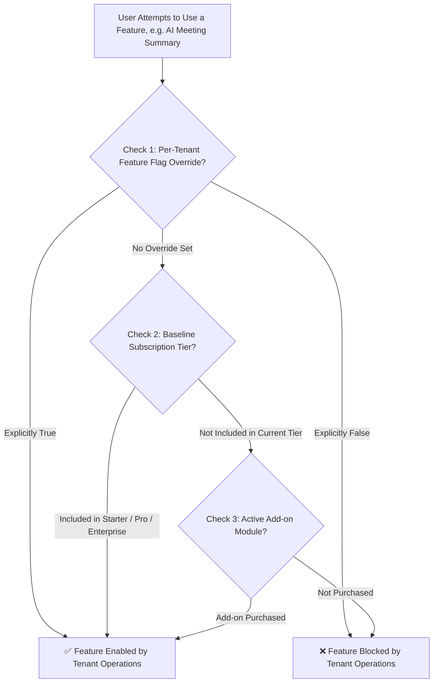
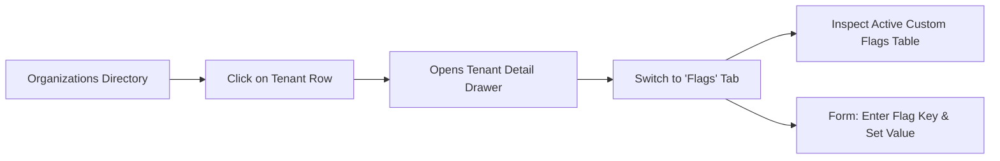

# Per-Tenant Feature Flags & Hub Entitlement Overrides

Welcome to the **Per-Tenant Feature Flags & Entitlements Guide**. In enterprise software deployments, client contracts frequently feature tailored requirements. A customer subscribed to a `PRO` plan may negotiate early access to an advanced AI meeting summary feature, or a specialized healthcare client may require custom biometric attendance integration before upgrading to an Enterprise tier.

HubNest resolves these custom enterprise requirements through **Per-Tenant Feature Flag Overrides**. This guide explains how feature gating functions, how to override default plan permissions for individual organizations, and how to resolve entitlement disputes.

---

## 1. Feature Entitlement Hierarchy

Feature access in HubNest is evaluated across a 3-tier hierarchy:

1. **Tier 1 (Highest Priority): Per-Tenant Feature Flag Overrides:** Explicit boolean toggles (`true` or `false`) configured for that specific tenant in the Master Admin Console.
2. **Tier 2: Baseline Subscription Tier Plan:** Standard capabilities packaged within `STARTER`, `PRO`, or `ENTERPRISE` tiers.
3. **Tier 3: Modular Add-Ons:** Standalone add-on licenses purchased alongside base plans (e.g., WhatsApp E-Commerce catalog sync or 1800 Toll-Free trunks).

---

## 2. Navigating the Flags Tab in Tenant Detail Drawer

To inspect or adjust feature flags for any organization:

1. Navigate to **Organizations** (`/tenants`).
2. Click on the customer's organization row to slide open the **Tenant Detail Drawer**.
3. Select the **Flags** tab (Tab 5).
4. The drawer displays all active per-tenant overrides alongside an **Add / Modify Flag** form.

---

## 3. Canonical Feature Keys by Product Suite

When configuring an override, the **Flag Key** must match the canonical string recognized by the respective microservice backend:

### Hub Meet (Video Conferencing)
| Feature Flag Key | Feature Label | Target Capability |
| :--- | :--- | :--- |
| `recording` | Cloud HD Recording | Enables LiveKit Egress video recording to S3. |
| `breakout_rooms` | Breakout Rooms | Enables host to divide participants into smaller discussion groups. |
| `ai_summary` | AI Meeting Summaries | Generates automatic transcripts, meeting summaries, and action items. |
| `live_translation` | Live Captions & Translation | Translates multi-language spoken captions in real-time. |
| `ai_dubbed_audio` | AI Dubbed Voice Audio | LiveKit Agent synthesizes real-time dubbed audio streams. |
| `whiteboard` | Interactive Whiteboard | Unlocks collaborative whiteboard and sticky-note annotations. |
| `noise_filter` | AI Noise Cancellation | Suppresses background dog barking, typing, and HVAC hum. |
| `enterprise_sso` | SAML / OIDC Corporate SSO | Direct corporate Active Directory federation. |

### Hub HRMS (Workforce & Payroll)
| Feature Flag Key | Feature Label | Target Capability |
| :--- | :--- | :--- |
| `payroll` | Automated Payroll Engine | Salary slips, tax deductions, and bank disbursement exports. |
| `biometric_attendance` | Biometric Hardware Sync | Direct TCP sync with ZKTeco and Matrix fingerprint/facial terminals. |
| `skills_matrix` | Skills & Competency Matrix | Employee skill inventory and department gap analysis. |
| `bgv` | Background Verification | Third-party background and police verification workflows. |
| `esign` | Digital Document E-Signing | Integrated cryptographic document signing for offer letters. |
| `global_payroll` | Multi-Currency Global Payroll | Cross-border contractor and remote employee disbursements. |
| `multi_branch` | Multi-Branch Franchises | Regional franchise governance and branch-level segregation. |

### Hub CRM (Sales Automation)
| Feature Flag Key | Feature Label | Target Capability |
| :--- | :--- | :--- |
| `ai_lead_scoring` | AI Predictive Lead Scoring | Machine learning ranking of lead conversion probability. |
| `custom_pipelines` | Unlimited Custom Pipelines | Visual Kanban stages for specialized sales and renewal funnels. |
| `sales_automation` | Automated Drip Sequences | Event-triggered email and task workflows. |
| `finance` | Quotes, Invoices & Billing | Native quotation and sales invoice generator. |
| `dedicated_infra` | Dedicated Database Replica | Provisioning isolated database storage for high-volume accounts. |

### Hub Notification (Omnichannel Dispatcher)
| Feature Flag Key | Feature Label | Target Capability |
| :--- | :--- | :--- |
| `whatsapp_templates` | Meta WhatsApp Cloud API | Custom template approval and multi-variable broadcasts. |
| `lead_scraper` | B2B Google Maps Scraper | Automated local business lead extraction tool. |
| `ai_features` | Autonomous AI Chatbots | Knowledge base RAG chatbots and after-hours auto-replies. |
| `ecommerce` | E-Commerce Store Sync | Shopify, WooCommerce, and payment gateway cart sync. |
| `white_label` | White-Label Portal Branding | Removing HubNest footer branding from web chat widgets. |

---

## 4. Step-by-Step: Adding or Removing a Feature Override

### Workflow A: Enabling a Custom Feature Override
When an account executive closes a contract with an agreement to grant Cloud HD Recording to a `STARTER` client:
1. Open the customer's organization in the **Tenant Detail Drawer** > **Flags** tab.
2. In the **Feature Key** input, enter: `recording`.
3. In the **Value** toggle, select **`true` (Enabled)**.
4. Click **Apply Flag**.
5. The flag appears in the active overrides table. Cloud recording unlocks immediately in the customer's HubMeet interface.

### Workflow B: Reverting to Default Plan Behavior
When a temporary 30-day trial for an advanced feature concludes:
1. Open the **Flags** tab for the organization.
2. In the active overrides table, locate the feature flag (e.g., `ai_summary`).
3. Click the red **Trash Can / Delete** icon adjacent to the row.
4. Confirm deletion. The system immediately removes the override, and the tenant reverts to standard plan tier permissions.

---

## 5. Resolving Customer Entitlement Disputes

| Customer Complaint | Diagnostic Investigation | Resolution Procedure |
| :--- | :--- | :--- |
| *"We upgraded to PRO, but Whiteboard is still disabled in our meetings."* | Check if an older override `whiteboard: false` is lingering in the Flags tab. | Delete the legacy `false` override in the Flags tab so the new PRO plan default (`true`) takes effect. |
| *"Our recruiters cannot access the AI resume parser."* | Check if `ai_features` or `recruiter` product is enabled. | In the Detail Drawer, open the **Products** tab to ensure Hub Recruiter is checked, and verify `ai_features: true`. |
| *"The system says our employee limit is exceeded, but our contract says 500."* | Organization plan tier is set to `STARTER` (Limit 25) rather than `PRO` or custom tier. | Update the Plan Tier to `ENTERPRISE` or add an explicit quota override. |

---

## 6. Best Practices for Feature Governance
- **Never Use Arbitrary Flag Keys:** Always cross-reference the canonical key registry in Section 3. Typing `ai-summary` instead of `ai_summary` will not be recognized by the LiveKit backend.
- **Review Overrides Quarterly:** Conduct quarterly reviews of active flags to transition permanent customizations into custom contracted pricing plans.
