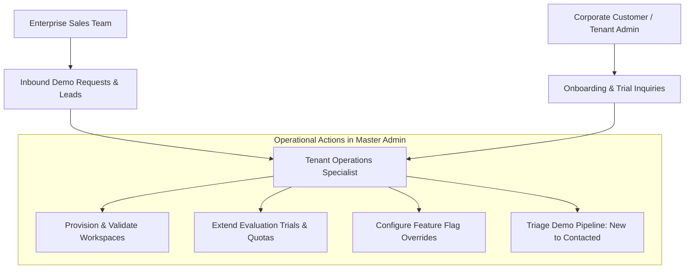
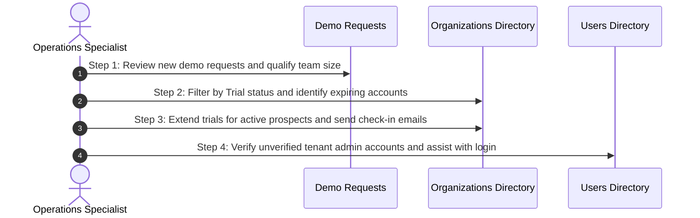

# Tenant Operations Overview & Daily Checklist

Welcome to the **Tenant Operations & Customer Success Manual**. As a Tenant Operations Specialist or Customer Success Lead, your primary mission is ensuring that corporate subscribers experience a smooth, reliable onboarding journey, receive immediate assistance during evaluation trials, and maintain properly configured workspace environments.

While the Platform Super Administrator focuses on infrastructure topology, billing gateways, and high-level platform policies, you operate directly on tenant accounts—updating organizational metadata, extending trials for strategic prospects, resolving entitlement questions, and routing inbound enterprise demo requests.

---

## 1. The Role of the Tenant Operations Specialist

Tenant Operations serves as the operational bridge between enterprise customers, the direct sales team, and the platform engineering organization:

### Core Responsibilities
- **Workspace Onboarding:** Assisting newly subscribed corporate accounts with initial company profile setup, domain routing, and primary owner credential verification.
- **Trial & Evaluation Governance:** Monitoring active trial accounts, reviewing usage velocity, and extending evaluation periods for qualified enterprise prospects.
- **Entitlement & Quota Adjustments:** Adjusting employee headcount limits, manager seats, and storage quotas in accordance with custom enterprise contracts.
- **Demo Pipeline Management:** Triaging inquiries submitted via the public "Book a Demo" portal, validating prospect eligibility, and assigning leads to the appropriate account executives.

---

## 2. Daily Tenant Operations Workflow

Follow this 4-step checklist at the start of each business shift:

### Step 1: Triage Inbound Demo Requests
- Navigate to **Support & Demos** > **Demo Requests** (`/demo-requests`).
- Review all submissions marked with the yellow `new` status badge.
- Inspect the prospect's company name, business email, requested user count, and country.
- Update qualified leads to `contacted` and notify the assigned sales specialist via internal messaging.

### Step 2: Monitor Expiring Evaluation Trials
- Navigate to **Organizations** (`/tenants`).
- In the **Status** filter dropdown, select **Trial**.
- Sort or scan the list for organizations with fewer than 3 days remaining on their trial clock.
- Check their **Last Active** timestamp and user count. If the customer is actively testing the platform, reach out with proactive assistance.

### Step 3: Grant Requested Trial Extensions
- For prospects actively presenting HubNest to their internal executive boards, open their row action menu and grant a 14-day trial extension.
- Confirm the new `trialEndsAt` timestamp updates in the detail drawer.

### Step 4: Resolve Blocked Tenant Administrators
- If an organization owner reports that they have not received their initial onboarding invitation, open **Users** (`/users`).
- Search for the owner's email address, check if the account is `active`, and click **Send Password Reset Link** or verify their assigned organization slug.

---

## 3. Operational Navigation Quick Reference

| Administrative Target | Menu Location | Primary Operations Task |
| :--- | :--- | :--- |
| **Organizations Directory** | Main Navigation > `Organizations` | Inspect company profiles, extend trials, toggle hub entitlements, and adjust quotas. |
| **Demo Requests Queue** | Support & Governance > `Support & Demos` | Review inbound website leads, change lead status (`new` ➔ `contacted` ➔ `closed`). |
| **Global Users Directory** | Main Navigation > `Users` | Assist tenant admins with login difficulties, verify email addresses, and inspect sessions. |
| **Hub Product Consoles** | Products > `{HubName}` | Verify endpoint status and launch direct product environments for customer support. |

---

## 4. Tenant Operations Best Practice Guidelines

> [!TIP]
> **Proactive Customer Engagement:**
> High-converting enterprise trials occur when operations teams reach out on Day 3 and Day 10 of an evaluation. Use the **Tenant Detail Drawer** (Usage Tab) to check if the client has added employees or scheduled meetings before reaching out.

- **Always Document the Reason for Trial Extensions:** When extending a trial, maintain an internal support ticket referencing the prospective deal size or customer contact person.
- **Never Change Company Slugs Without Written Confirmation:** Slugs dictate browser URLs. Changing `acme-corp` to `acme-global` without coordination will cause active employees to land on error pages.
- **Check KYC Status for Telephony Customers:** Before provisioning Calling Hub or allocating 1800 virtual numbers, confirm that the client's corporate identity documents have been submitted.

---

## 5. Next Steps in this Guide
- To manage legal entities and domain slugs, read [Company Profiles, Subdomains & Contact Governance](organization-profiles-domains.md).
- To adjust quotas and trial clocks, explore [Trial Management, Quotas & Employee Tier Allocations](trial-extensions-limits.md).
- To configure custom feature overrides, review [Per-Tenant Feature Flags & Hub Entitlement Overrides](feature-flags-entitlements.md).
- To triage inbound customer leads, visit [Enterprise Demo Requests & Lead Qualification](demo-leads-pipeline.md).
