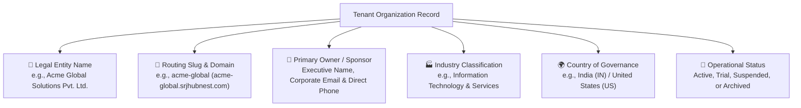
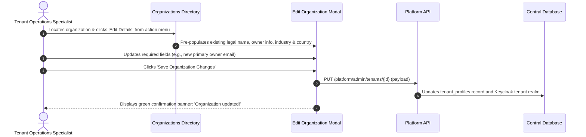

# Company Profiles, Subdomains & Contact Governance

Welcome to the **Company Profiles, Subdomains & Contact Governance Guide**. Every enterprise subscriber on the HubNest platform is represented by a unique organizational record. Maintaining accurate company metadata, correctly configured routing slugs, and verified executive contact details ensures that employees can access their workspaces without routing errors and that legal and billing notices reach responsible decision-makers.

This guide details the procedure for editing company profiles, managing vanity subdomain slugs, and governing tenant contact information within the Master Admin Console.

---

## 1. Organization Metadata Anatomy

An organization record in HubNest comprises 6 core metadata dimensions:

### Metadata Fields & System Roles

| Attribute Field | Description | System Purpose & Consumer |
| :--- | :--- | :--- |
| **Legal Company Name** | Registered statutory name of the enterprise. | Displayed on official tax invoices, payslips, email headers, and contract documents. |
| **Routing Slug** | Unique lowercase alphanumeric identifier (e.g., `acme-corp`). | Forms the vanity URL: `https://{slug}.srjhubnest.com`. Identifies tenant databases in multi-tenant queries. |
| **Owner Full Name** | Name of the primary corporate sponsor or CIO. | Used for executive correspondence, contract renewals, and account governance. |
| **Owner Corporate Email** | Verified primary administrative email. | Receives root Keycloak credentials, monthly invoice receipts, and critical security alerts. |
| **Primary Phone** | Direct telephone or mobile contact number. | Used by support teams for emergency priority incidents and 2FA SMS recovery. |
| **Industry Sector** | Industry classification (e.g., Healthcare, FinTech). | Used to benchmark feature adoption and tailor default compliance templates. |
| **Country** | Two-letter ISO country code (e.g., `IN`, `US`, `AE`). | Governs applicable tax regimes (e.g., Indian GST vs. US Sales Tax), currency, and data residency. |

---

## 2. Editing an Organization Profile

When a customer undergoes a corporate rebranding, changes legal entity names, or updates their primary billing contact:

### Step-by-Step Edit Workflow
1. Navigate to **Organizations** (`/tenants`).
2. Search for the organization by name, slug, or owner email using the search bar.
3. Click the **Three-Dots (`...`)** menu on the right side of the row.
4. Select **Edit Details**.
5. The **Edit Organization Profile Modal** opens with existing values pre-populated:
   - **Company Name:** Update the legal name if amended.
   - **Owner Full Name:** Enter the current primary corporate administrator's name.
   - **Owner Email:** Ensure the email domain matches the corporate domain (e.g., `@acme.com`).
   - **Phone Number:** Enter the full international E.164 phone number (e.g., `+919876543210`).
   - **Industry:** Select the applicable sector from the dropdown menu.
   - **Country:** Select the appropriate country of operation.
6. Click **Save Changes**. The table and detail drawer reflect the updated information immediately.

---

## 3. Subdomain Slug Governance & Routing Rules

The organization slug is the critical string that binds the customer's browser sessions to their isolated data tier.

### Standard Slug Syntax Rules
- **Allowed Characters:** Strictly lowercase English letters (`a-z`), numbers (`0-9`), and hyphens (`-`).
- **Forbidden Characters:** Spaces, uppercase letters, underscores (`_`), and special symbols (`@`, `.`, `!`).
- **Length Constraint:** Between 3 and 30 characters.
- **Uniqueness:** The slug must be globally unique across the entire HubNest platform.

> [!CAUTION]
> **Risks of Modifying Live Slugs:**
> Modifying a slug on an active production tenant will immediately break all existing employee browser bookmarks, desktop app connection strings, and mobile app API endpoints until employees re-authenticate with the new URL.
> 
> **Policy Requirement:** Only change a live organization slug upon receipt of a formal, written authorization ticket from the client's verified C-level executive or IT Director.

---

## 4. Contact Governance & Security Hygiene

To maintain account integrity and prevent social engineering attacks:

1. **Verify Corporate Email Ownership:** When updating an organization owner email, always ensure the new address utilizes the company's verified email domain rather than a generic public provider (such as `@gmail.com` or `@yahoo.com`), unless the business is explicitly registered as a sole proprietorship.
2. **Prevent Account Lockouts:** Never remove an owner email without simultaneously provisioning a verified replacement administrator account.
3. **Emergency Escalation Contacts:** In enterprise contracts, ensure a secondary technical contact is documented in the internal support CRM to allow continuous communication during system maintenance windows.

---

## 5. Operations Checklist: Profile Updates
- [ ] Verify identity of requester before executing metadata modifications.
- [ ] Ensure the phone number includes the proper country calling code.
- [ ] Confirm the country code matches the tenant's primary tax jurisdiction.
- [ ] If changing a slug, coordinate with customer IT to notify end-users beforehand.
- [ ] Verify that the updated owner profile displays cleanly in the **Tenant Detail Drawer** (Profile Tab).
