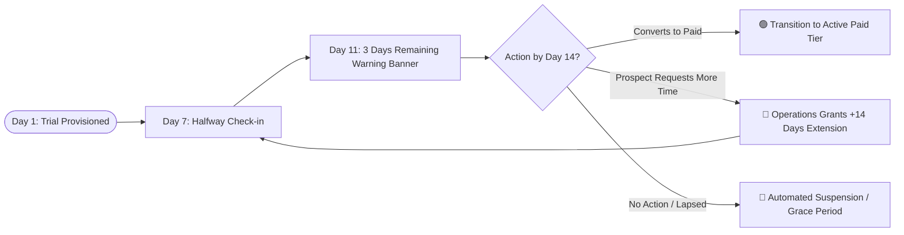
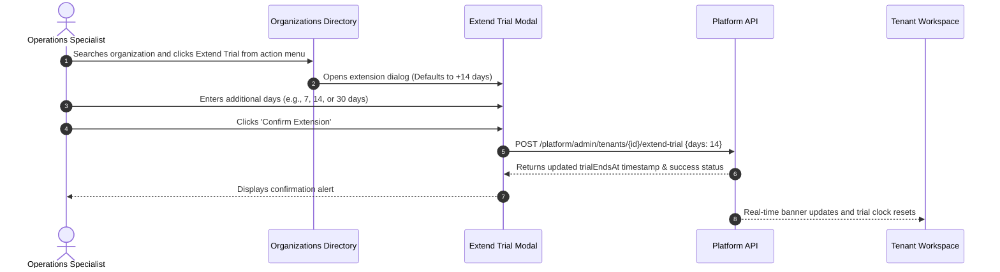
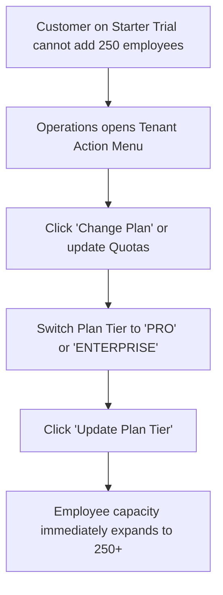

# Trial Management, Quotas & Employee Tier Allocations

Welcome to the **Trial Management, Quotas & Employee Tier Allocations Guide**. High-converting enterprise sales cycles depend upon frictionless evaluation trials. When prospective clients test HubNest, they evaluate everything from bulk employee payroll processing to real-time WebRTC video conferences.

As a Tenant Operations Specialist, you manage the evaluation lifecycle: extending trial windows for engaged accounts, adjusting employee seat limits during pilot deployments, and resolving quota ceilings before they disrupt customer testing.

---

## 1. The 14-Day Evaluation Trial Lifecycle

When an organization signs up through the marketing site or is provisioned by direct sales, it enters the **Trial** operational state:

### In-App Trial Indicators
- **In-App Header Countdown:** Users in trial organizations see a sleek, non-intrusive banner at the top of their screen indicating remaining days (e.g., *"11 days left in your enterprise evaluation trial — Upgrade Now"*).
- **Trial Expiration Timestamp (`trialEndsAt`):** Stored in the database as an explicit ISO-8601 UTC timestamp. When this timestamp lapses, the platform's automated cron service transitions the organization to `suspended` status unless extended or upgraded.

---

## 2. Step-by-Step: Extending an Evaluation Trial

When an enterprise customer requests an extension to complete board approvals or security audits:

### Procedure
1. Navigate to **Organizations** (`/tenants`).
2. Filter the table by **Status: Trial** or search for the specific organization.
3. Click the **Three-Dots (`...`)** menu on the right side of the tenant row.
4. Select **Extend Trial**.
5. In the **Extend Evaluation Window Modal**:
   - The default duration is pre-populated as **14 days**.
   - You can enter any custom day count (e.g., `7`, `14`, `21`, or `30` days) depending on sales guidance.
6. Click **Confirm Extension**.
7. The table and the customer's top banner immediately recalculate the remaining evaluation days.

---

## 3. Managing Operational Resource Quotas

Each subscription tier (`STARTER`, `PRO`, `ENTERPRISE`) defines maximum resource limits. During pilots, enterprise customers with 500+ employees frequently require temporary quota increases:

| Resource Quota Dimension | Unit of Measurement | Default Tier Limits | Enforcement Mechanism |
| :--- | :--- | :--- | :--- |
| **Employee Limit (`employeeLimit`)** | Maximum active employee profiles. | Starter: `25` Pro: `100` Enterprise: `Unlimited` | Gated by `TierGate.java` in HubHRMS. Adding employee #26 triggers an upgrade modal. |
| **HR Admin Limit (`hrAdminLimit`)** | Dedicated administrative seats. | Starter: `2` Pro: `5` Enterprise: `Unlimited` | Keycloak role assignment validation. |
| **Department Manager Limit (`managerLimit`)** | Supervisory team roster seats. | Starter: `5` Pro: `20` Enterprise: `Unlimited` | Role mapping bounds in HRMS. |
| **Concurrent Meetings Limit** | Simultaneous active video rooms. | Starter: `2` Pro: `10` Enterprise: `Unlimited` | LiveKit SFU room creation barrier. |
| **Cloud Storage Quota (`storageQuotaGb`)** | Gigabytes for document vault & recordings. | Starter: `5 GB` Pro: `50 GB` Enterprise: `1,000 GB+` | S3 document upload gateway rejection. |
| **AI Copilot Monthly Credits** | Document tokens & AI chat responses. | Starter: `10,000` Pro: `100,000` Enterprise: `1,000,000+` | Vector search & LLM token metering. |

---

## 4. Temporary Pilot Quota Adjustments

When an enterprise prospect with 250 employees wants to test HubHRMS on a trial account before purchasing an Enterprise contract:

1. Locate the organization row in **Organizations** (`/tenants`).
2. Click **Three-Dots (`...`)** > **Change Plan**.
3. Select **PRO** or **ENTERPRISE** from the tier selection dropdown.
4. Click **Update Plan Tier**.
5. The organization's employee limit expands instantly without requiring commercial checkout or payment gateway transaction completion.

---

## 5. Operations Best Practices for Quota Governance
- **Monitor the 48-Hour Expiration Radar:** Every morning, filter organizations by `Trial` status and sort by `trialEndsAt`. Reach out to accounts expiring in under 48 hours to prevent sudden service interruption.
- **Differentiate Active vs. Abandoned Trials:** Always check the **Users Count** and **Last Active** columns. If a tenant has 0 added employees and has not logged in for 10 days, allow the trial to expire naturally rather than extending it automatically.
- **Log Extension Reasons in Support Tickets:** Never grant extensions exceeding 30 days without approval from the Head of Sales or Operations.
